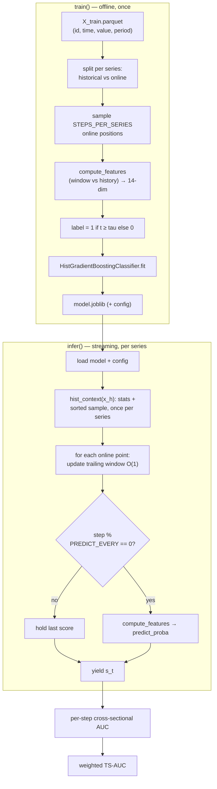
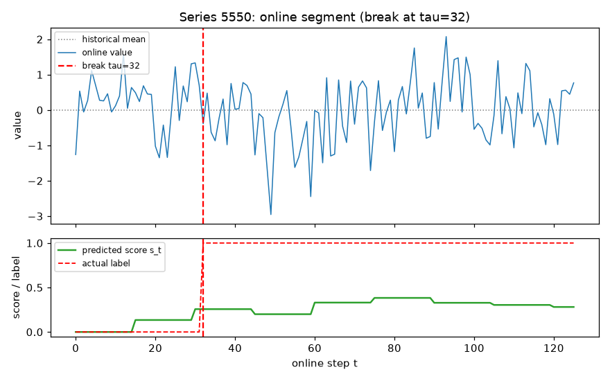
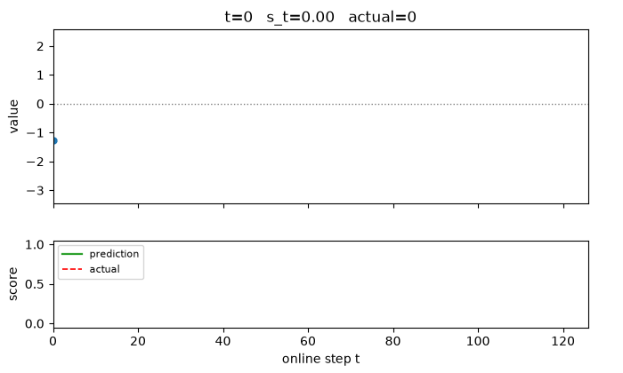
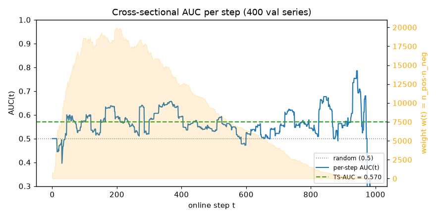

# Architecture

How the streaming structural-break detector turns raw time series into a per-step break
score, and how those scores are graded. For the experiment history and rationale, see
[README.md](README.md).

## 1. Data model

Each series has two parts, stored in one parquet with a `(id, time)` MultiIndex and a
`period` column:

| period | segment | size | given |
| --- | --- | --- | --- |
| 1 | `x_historical` — reference behaviour, **no break** | 1,000–5,000 | in full, up front |
| 2 | `x_online` — under scrutiny, break at unknown `tau` (or none) | 10–1,000 | one point at a time |

The task: at every online step `t`, emit `s_t ∈ [0,1]` = belief a break has already
occurred by `t`. The ideal is a step: `0` before `tau`, `1` after.

## 2. Pipeline overview



The same `hist_context` / `compute_features` code is shared by `train()` and `infer()`,
so training features and streaming features are computed identically.

## 3. The feature step: window vs history

Every prediction compares a **trailing online window** (last `WINDOW=75` points) against a
one-time summary of the historical segment. The 14 features each target a way a series can
break:

| aspect | features |
| --- | --- |
| level | `mean_z` |
| scale | `log_var_ratio`, `iqr_ratio`, `rng_ratio` |
| shape | `ks`, `skew_diff`, `kurt_diff`, `tail2`, `tail3` |
| dependence | `ac1_diff`, `ac2_diff`, `zero_cross` |
| trend / spectrum | `slope_norm`, `spec_centroid_diff` |

All are pure-numpy for speed (see [README.md](README.md) E4). The classifier maps this
vector to a break probability; the score is refreshed every `PREDICT_EVERY` steps and held
constant in between to stay within the time budget.

## 4. Prediction step: score vs actual

Below is a **real run** of the model on validation series `5550` (a variance break at
`tau=32`). Top: the online values. Bottom: the model's score `s_t` (green) against the
true label (red step). The score is near zero before the break and lifts once the window
starts diverging from history.



Animated, one online point at a time — this is exactly what `infer()` sees and yields:



> Note: this is a *variance* break — the mean barely moves, so the EWMA baseline (E0)
> would miss it, while the two-sample features pick up the scale change.

## 5. How the score is graded: TS-AUC, step by step

TS-AUC compares scores **across series at the same step**, not over time. At each step `t`:

1. Look at every series still alive at `t`.
2. Label each `1` if `t ≥ tau` (break already happened) else `0`.
3. Compute an ordinary AUC of scores vs labels at that step.
4. Weight it by `w(t) = n_pos(t) · n_neg(t)` (number of positive–negative pairs).
5. `TS-AUC = Σ w(t)·AUC(t) / Σ w(t)`.

### Worked example (real scores, step `t = 50`)

Take 4 alive series and their actual model scores at `t=50`:

| series | score `s_50` | label |
| --- | --- | --- |
| 359 | 0.29 | 1 (broken) |
| 3460 | 0.25 | 0 |
| 5550 | 0.20 | 1 (broken) |
| 2887 | 0.16 | 0 |

AUC at this step = fraction of positive–negative pairs the score ranks correctly.
There are `n_pos · n_neg = 2 · 2 = 4` pairs:

| positive | negative | ranked correctly? |
| --- | --- | --- |
| 359 (0.29) | 3460 (0.25) | ✅ |
| 359 (0.29) | 2887 (0.16) | ✅ |
| 5550 (0.20) | 3460 (0.25) | ❌ (0.20 < 0.25) |
| 5550 (0.20) | 2887 (0.16) | ✅ |

3 of 4 correct → **AUC(50) = 0.75** on this sample. Over *all* alive series at `t=50`
the real value is **AUC(50) = 0.594** with weight `w(50) = 12,145`. Each step contributes
its own AUC and weight; the weighted average is the leaderboard number.

### Per-step AUC across a full validation set

Running the model on 400 held-out series and computing AUC(t) at every step gives the
curve below. The orange envelope is the weight `w(t)` — largest early (many series alive,
balanced classes) and decaying as series end. The weighted average is **TS-AUC = 0.570**.



Because grading is cross-sectional, a score that merely grows with `t` contributes nothing
— only genuine per-step separation between broken and un-broken series moves TS-AUC.

## 6. Reproducing the figures

```bash
.venv/bin/python -u _make_figures.py   # writes docs/*.png and docs/prediction.gif
```

Trains on 5,000 series, predicts on 400, and regenerates all three assets plus the printed
worked-example numbers.
