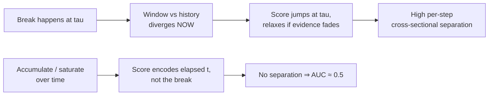
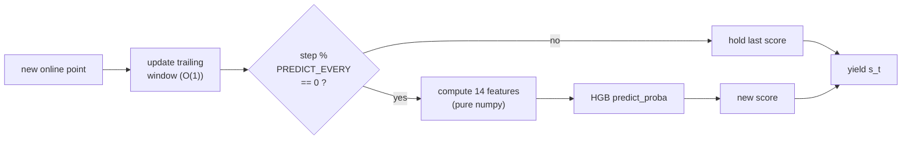

# Structural Break — Real-Time (CrunchDAO)

Streaming structural-break detection. For each series we get a full `x_historical`
segment (no break) and an `x_online` segment revealed one point at a time. At every
online step `t` we emit a score `s_t ∈ [0,1]` = belief a break has already occurred.

**Metric — TS-AUC (Time-Stratified AUC).** At each step, AUC is computed *across
series* (label 1 if `t ≥ tau`), weighted by `w(t) = n_pos(t)·n_neg(t)`. Random = 0.5.
Because it is cross-sectional per step, scores that merely grow with `t` gain nothing —
only genuine per-step separation helps.

## Files

| File | Purpose |
| --- | --- |
| `streaming_detector.ipynb` | The submission notebook (supervised model). |
| `_exp_fast.py` | Standalone train + streaming-validation harness (measures TS-AUC and infer speed). |
| `_val_harness.py` | **Robust multi-fold** validation harness: per-candidate mean±std across K disjoint folds + paired deltas vs base (the noise-aware decision tool, see below). |
| `baseline.ipynb` | Original EWMA baseline from the competition. |
| `data/` | Local train/test parquet files. |

## Model (current submission)

Per online step, a trailing window (`WINDOW=75`) is compared to the historical segment
via 14 two-sample features, and a `HistGradientBoostingClassifier` maps them to a break
probability. Features are recomputed every `PREDICT_EVERY` steps and held between.

Features: `mean_z, log_var_ratio, ks, skew_diff, kurt_diff, ac1_diff, ac2_diff,
iqr_ratio, tail2, tail3, zero_cross, slope_norm, spec_centroid_diff, rng_ratio`.

Key config: `WINDOW=75, MIN_N=15, HIST_CAP=200, PREDICT_EVERY=1, MAX_ITER=200,
STEPS_PER_SERIES=10, MAX_TRAIN_SERIES=10000, SEED=42`.

## Validation methodology

Feature decisions are made with `_val_harness.py`, **not** a single val split. It trains
one model per candidate feature set on a fixed training pool (disjoint from every fold),
evaluates each on `N_FOLDS=5` disjoint `FOLD_SIZE=400`-series folds, and reports:

* **per-fold TS-AUC + mean + std** — the std is the *noise floor*;
* **paired delta vs base** on the same folds, with `t = mean_delta / (std_delta/√K)`.

**Decision rule:** only port a change to the notebook when its paired mean gain clearly
exceeds the noise floor (target `|t| ≥ 2`, gain > fold std). This exists because E8's
+0.006 single-split "win" was ~4× smaller than the fold-to-fold noise and *reversed* on
the leaderboard. Streaming is parallelised across series (joblib, BLAS capped to 1).

*First run (5×400 folds, 6000-series pool):* base `mean 0.5511, std 0.0125` (same model
swings 0.5402→0.5708 across folds); the E8 split features scored `+0.0009 (t=0.31)` —
decisively **noise**. The harness would have rejected split *before* submitting it.

## Experiment log

| # | Approach | Result | Notes |
| --- | --- | --- | --- |
| E0 | EWMA z-score baseline (submitted) | **LB 50.65%** (rank 388) | Only reacts to mean shifts; blind to variance/shape/dependence. |
| E1 | Unsupervised (KS + variance + mean, noisy-OR) | ~0.518 local | Marginal-distribution stats miss autocorrelation/stationarity breaks. |
| E2 | Unsupervised CUSUM / monotone-accumulating variants | ~0.50 local | *Worse.* Saturating/accumulating scores destroy cross-sectional separation. |
| E3 | Supervised HGB, 14 two-sample features (scipy) | **TS-AUC 0.5701** (800 val series) | Best score, but too slow → submission timed out (exit 124). |
| E4 | E3 rewritten: pure-numpy features + single-thread + fewer trees | **TS-AUC 0.5636**, ~10× faster infer | Speed fix, negligible score change. |
| E5 | Cap threads at call time (`threadpool_limits`) + raise parallelism | **LB 55.30%** (rank 296/1144) | Fixed the 5 h+ cloud hang; ran fast, determinism check passed. |
| E6 | `PREDICT_EVERY` 15 → 1 (predict every step, no staleness) | **LB 55.48%** (rank 289) | Free win, +0.18 pt. 31 min on 16 vCPU. Local 0.5636 → 0.5663. |
| E7 | Train on all 10000 series (`MAX_TRAIN_SERIES` 6000 → 10000), keep 10 steps/series | **LB 55.94%** (rank 268) | +0.46 pt. Trained 9934 series/98.8k rows; parallelism 15; 42 min. |
| E8 | +3 recent-vs-older split features (window halves) | **LB 55.70%** (rank 269) — *reverted* | Local +0.006 but LB **−0.24 pt** vs E7. 400-series val was misleading; rolled back to 14 feats. |
| E9 | Robust/rank-based stats (median/MAD, Mann–Whitney, Brown–Forsythe) via 5×400-fold harness | **all within noise** (best t=+0.19) — *not shipped* | Redundant with existing KS/`mean_z`/`log_var_ratio`. No submission; harness caught it locally. |
| E10 | HGB hyperparameter grid (108 configs, GroupKFold row-level proxy) | best +0.0013 proxy AUC — *not shipped* | Model isn't the bottleneck; gain under proxy noise. |
| E11 | Window geometry: `WINDOW` 75 → 130 | **LB 56.63%** (rank 235) | +0.69 pt, +33 ranks — biggest single jump. Infer cost ~identical (free). 10-fold Δ +0.0110, t=+3.96. |
| E12 | Overnight 40-candidate feature battery (5×400 folds @ W75) | 3 ship-grade: `runs` t=2.48, `combo_volatility` t=2.40, `spec_entropy` t=2.39 | Winners cluster by family (run/level-crossing, complexity/spectral). Re-confirm at W130 before shipping. |
| E13 | Re-confirm E12 winners at WINDOW=130 (10 folds); ship `spec_entropy` (15th feat) | **LB 56.84%** (rank 229) | +0.21 pt, +6 ranks. `runs` (t=0.81) and `combo_volatility` (t=0.41) **collapsed at W130** — window-specific artifacts. Only `spec_entropy` held (t=+4.67). |
| E14 | Ship `perm_entropy` (order-3, 16th feat) on promising single-feature signal | *pending LB* | Standalone t=+1.93 vs base14 (below the |t|≥2 bar but best remaining single feature); let the LB adjudicate. Spectral/complexity sweep (13 singles) running in parallel. No stacking. |

**Takeaways:** instantaneous window-vs-history comparison beats any accumulating score
under TS-AUC; the local 100-series reduced set is noisy/optimistic (use ≥800 series to
judge); a supervised classifier over distribution-comparison features clearly beats
hand-tuned unsupervised rules. **On training data (E7):** breadth beats depth — training
on *more distinct series* helps, but taking *more sampled steps from the same series*
hurts (correlated, near-duplicate rows), and *oversampling steps near the break `τ`* hurts
(the most ambiguous, hardest-to-label points). **On inference (E6):** never let a score go
stale — TS-AUC ranks series against each other *at each step*, so predict every step.
**On validation (E8):** a single 400-series local split is too noisy to trust ~0.006
deltas — the split features looked like a win locally but *lost* on the full test; use a
larger/multi-fold val or treat the leaderboard as ground truth for small changes.
**On features (E9):** robust/rank-based restatements (median/MAD, Mann–Whitney,
Brown–Forsythe) add nothing over the existing KS + `mean_z` + `log_var_ratio` — they
measure the same location/scale/distribution shift, so they are redundant, not additive.

## Experiment details

### E0 — EWMA z-score baseline

The competition baseline. Summarize history by its mean `μ_H` and std `σ_H`, then track
an exponentially-weighted moving average of the online values and score by how far it has
drifted, in standard-deviation units:

$$z_t = \frac{\bar{x}_t - \mu_H}{\sigma_H / \sqrt{n_\text{eff}}}, \qquad s_t = \tanh(|z_t|)$$

Truly O(1) per step, so it never times out. But it **only measures the mean** — a break
that changes variance, distribution shape, or autocorrelation while keeping the mean
roughly constant is invisible to it. That is why it lands at essentially random
(**LB 50.65%**) and set the bar for everything below.

### E1 — Unsupervised two-sample (KS + variance + mean)

First improvement attempt: at each step compare a trailing online window against the
historical segment with several classical statistics — a Kolmogorov–Smirnov distance, a
variance ratio, and a mean shift — then combine them with a noisy-OR into one score.

This adds sensitivity to variance and distribution-shape changes the EWMA misses, so it
edges above random (**~0.518 local**). But it is still built on *marginal-distribution*
statistics: it cannot see breaks that live in the **temporal dependence** (e.g. a change
in autocorrelation with an unchanged histogram). Hand-tuning the OR weights gave only
marginal, noisy gains — the ceiling of rule-based combining was clearly low.

### E2 — CUSUM / monotone-accumulating variants

Intuition said "accumulate evidence over time" — CUSUM-style running sums and scores
forced to be monotonically non-decreasing. Under TS-AUC this **backfired** (**~0.50**).

The reason is the metric's cross-sectional nature: at each step AUC ranks series *against
each other*. A score that only grows with `t` orders series by how long they have been
running, not by whether they have actually broken — so it carries no discriminative
signal at any given step. This produced the single most important design rule:



**Instantaneous** window-vs-history comparison wins; accumulation loses.

### E3 — Supervised HGB with two-sample features (scipy)

Replace hand-tuned rules with a learned mapping. For each training series we take the
historical context once, sample online positions, build a 14-dim feature vector from the
trailing window, and label it `1` if the position is at/after the break `tau`. A
`HistGradientBoostingClassifier` learns the mapping; `lightgbm` was unavailable, and HGB
avoids a platform dependency.

The 14 features are all **window-vs-history contrasts** covering the failure modes of
E0/E1: level (`mean_z`), scale (`log_var_ratio`, `iqr_ratio`, `rng_ratio`), shape
(`ks`, `skew_diff`, `kurt_diff`, `tail2`, `tail3`), dependence (`ac1_diff`, `ac2_diff`,
`zero_cross`), and trend/spectrum (`slope_norm`, `spec_centroid_diff`).

This was the **best score (TS-AUC 0.5701** on 800 val series) — but the scipy-based
features cost ~7 ms each, and with millions of calls the cloud `infer()` **timed out
(exit code 124)**. Correct model, unshippable speed.

### E4 — Pure-numpy rewrite (current submission)

E4 keeps E3's model and features but makes them fast enough to ship. The inference loop:



**Diagnosis (measured, not guessed):**

- scipy `compute_features` (`ks_2samp`, `skew`, `kurtosis`, `polyfit`) cost **~7 ms/call**.
- Split timing inside infer showed **`predict_proba` dominated**, not feature compute.
- Single-row `predict_proba` benchmark:
  - default multi-thread: **1.56 ms/call**
  - `OMP_NUM_THREADS=1`: **0.29 ms/call** (random-data model, few trees)
  - real 200-tree model, single-thread: **~2.5 ms/call**
  - batched (not usable in a streaming generator): **0.6 µs/row**
- Cause: OpenMP thread-pool spin-up per tiny prediction, worsened by parallel infer
  processes oversubscribing cores.

**Fixes applied:**

- Pure-numpy features (manual skew/kurtosis moments, KS via pre-sorted sample +
  `searchsorted`, direct slope formula): **7 ms → 0.36 ms/call**.
- `OMP_NUM_THREADS=1` (+ OpenBLAS/MKL) set before numpy import.
- `MAX_ITER` 300 → 200 trees; `PREDICT_EVERY` 5 → 15; `HIST_CAP` 400 → 200;
  `MAX_TRAIN_SERIES=6000` cap.

**Validation (400 held-out train series, `_exp_fast.py`):**

- TS-AUC **0.5636** (vs 0.5635 pre-optimization — no loss).
- Infer **40 s / 400 series** → est. **~250 s at parallelism 4** for full test
  (was ~2400 s+; exit 124 before).
- Notebook re-verified: parses, `train()`+`infer()` run on synthetic data, exactly one
  score in `[0,1]` per online point.

### E5 — Cloud thread oversubscription (current submission)

After E4 passed locally, a cloud run **ran 5+ hours without finishing** (16 vCPU / 64 GB).

**Cause:** E4 capped threads with `os.environ["OMP_NUM_THREADS"]="1"`, which only takes
effect if set *before* numpy/OpenMP load. On the cloud the crunch runner imports
numpy/sklearn before the notebook cell runs, and each `infer()` worker is a separate
process — so the env var was ignored. With `INFER_PARALLELISM=4` workers each spawning
~16 OpenMP threads on 16 cores (~64 threads contending), every single-row `predict_proba`
became 10–50× slower.

**Fix:**

- Wrap the infer loop in `with threadpool_limits(limits=1):` (from `threadpoolctl`,
  ships with sklearn) — caps BLAS/OpenMP threads **at call time**, regardless of when
  libraries loaded or how workers are spawned.
- Raise `INFER_PARALLELISM` to `cpu_count()-1` now that each worker is single-threaded,
  to use the available vCPUs (auto-scales to whatever machine you pick).

**Where the parallelism happens:** across *series* (many single-threaded worker
processes, one series each), **not** inside a math op (BLAS/OpenMP threads capped to 1).
Parallelizing both layers on the same cores just oversubscribes them — hence 1 thread
per op × N worker processes = all cores busy, zero contention.

Model and features are unchanged from E4, so the score is unaffected; only wall-clock
changes. Re-verified on synthetic data (train + infer, scores in `[0,1]`).

**Result (2026-08-10):** cloud run finished quickly (parallelism 12, no hang), the
determinism re-check passed, and it scored **LB 55.30% — rank 296 / 1144** (up from
E0's rank 388). Confirms the hang was pure thread oversubscription, not the model.

### E6 — Predict every step (remove staleness)

With speed solved (E4/E5), `PREDICT_EVERY=15` was pure downside: TS-AUC ranks series
against each other **at each step**, so a score held 14 steps stale is compared against
freshly-updated peers. Swept `PREDICT_EVERY ∈ {15, 5, 1}` (train once, 400 val series):

| `PREDICT_EVERY` | TS-AUC | est. full test (12-core) |
| --- | --- | --- |
| 15 | 0.5636 | ~30 s |
| 5 | 0.5654 | ~87 s |
| **1** | **0.5663** | **~433 s (~7 min)** |

Set `PREDICT_EVERY=1`: best score, staleness eliminated, and ~7 min at 12 cores is well
within the inference budget (faster still on 16/32-core machines via adaptive parallelism).
Model and features unchanged. Sweep harness: `_sweep_pe.py`.

**Result (2026-08-10):** **LB 55.48% — rank 289** (up from 296), 31 min on 16 vCPU.
Confirms the staleness fix helps on the real leaderboard and stays within budget.

### E7 — Train on all series (more data)

Swept training-set size / density on a fixed disjoint 400-series val set (`PREDICT_EVERY=1`,
harness `_sweep_data.py`):

| n_series | steps/series | near-τ | rows | TS-AUC |
| --- | --- | --- | --- | --- |
| 5000 | 10 | — | 49k | 0.5457 |
| **9000** | **10** | **—** | 89k | **0.5648** |
| 9000 | 20 | — | 177k | 0.5582 |
| 9000 | 40 | — | 350k | 0.5585 |
| 9000 | 20 | 0.5 | 177k | 0.5486 |

(Absolute values differ from E6's table — different held-out val set; compare only within
this table.) **More *series* helps a lot** (+0.019); **more *steps per series* hurts**
(correlated, redundant samples skew the fit); **near-τ densification hurts** (ambiguous
boundary points confuse the classifier). Change: `MAX_TRAIN_SERIES` 6000 → 10000, keep
`STEPS_PER_SERIES=10`. Train-time only; infer cost unchanged.

**Result (2026-08-10):** **LB 55.94% — rank 268** (up from 289). Cloud trained on 9934
series / 98.8k rows; adaptive parallelism selected 15 workers on the 16-vCPU box;
determinism check passed; 42 min. Local +0.019 → LB +0.46 pt.

### E8 — Recent-vs-older split features

Every base feature contrasts the current window against the *full history*. That baseline
is sluggish and can't localize a break that happens **inside** the online stream. Added 3
features that split the current window into an older half and a recent half and contrast
them directly (standardized mean shift, log-variance ratio, KS) — **history-independent**,
firing exactly when the window straddles the break.

Feature A/B on a fixed disjoint 400-series val set (harness `_sweep_feats.py`, PE=5):

| feature set | n_feat | TS-AUC | Δ |
| --- | --- | --- | --- |
| base | 14 | 0.5370 | — |
| base+short (last-25 scale) | 17 | 0.5410 | +0.0040 |
| **base+split (recent-vs-older)** | 17 | **0.5430** | **+0.0060** |
| base+short+split | 20 | 0.5422 | +0.0052 |

Split is the biggest single win and short *doesn't stack* on top of it (overlapping
"recent change" signal), so we kept split only. Confirmed at the submission setting
(PE=1, `_confirm_split.py`): base 0.5380 → base+split **0.5441** (+0.0061), infer +22%
(551 s → 672 s on 400 val series, 1 core) — still within budget. Feature count 14 → 17.

**Result (2026-08-10) — REGRESSION, REVERTED:** on the leaderboard this scored **55.70%
(rank 269)**, *down* 0.24 pt from E7's 55.94%. The +0.006 gain on a single 400-series val
set did **not** generalize — it reversed sign on the full 10000-series test. Reverted to the
14-feature set. **Lesson:** a single 400-series local split is too noisy to trust a ~0.006
delta; only act on feature changes with a large margin or multi-fold / larger-val evidence,
and treat the leaderboard as the source of truth for small deltas.

### E9 — Robust / rank-based statistics

Step 4 of the roadmap: replace the moment-based contrasts with **outlier-resistant**
restatements, in case heavy tails were distorting `mean_z` / `log_var_ratio`. Four
candidates, each = base14 + the new feature(s), judged on the multi-fold harness
(`_val_harness.py`, 5×400 disjoint folds, 6000-series pool), paired against base on the
same folds:

| candidate | added feature(s) | mean Δ vs base | t | verdict |
| --- | --- | --- | --- | --- |
| `rob_loc` | median-z, log-MAD-ratio | +0.0002 | +0.19 | noise |
| `mwu` | Mann–Whitney rank-location z | −0.0004 | −0.47 | noise |
| `bf` | Brown–Forsythe robust scale | +0.0006 | +0.18 | noise |
| `rob_all` | all four combined | −0.0032 | −0.88 | regression |

Every delta sits inside the noise floor (base fold std **0.0125**); the best `t` is 0.19,
nowhere near the `|t| ≥ 2` bar. Conclusion: the existing KS + `mean_z` + `log_var_ratio`
already capture location/scale/distribution shift, and the robust versions are redundant
rather than additive. **Not shipped** — the harness rejected all four locally, at zero
leaderboard cost. Notebook stays at the E7 14-feature config.

```bash
# quick single-split validation harness (train + streaming TS-AUC + speed)
.venv/bin/python -u _exp_fast.py

# robust multi-fold harness: per-candidate mean+-std across 5 folds + paired t vs base
.venv/bin/python -u _val_harness.py
```

### E11 — Window geometry (`WINDOW` 75 → 130)

Step 5 of the roadmap: the trailing-window length is a near-free knob (the window is
maintained in O(1), so inference cost is unchanged). A proxy sweep (row-level GroupKFold
AUC) rose monotonically 0.544 (w40) → 0.568 (w75) → 0.594 (w130) → plateau ~160–250, but
the proxy overstates large-window benefit; streaming TS-AUC confirmation is the arbiter.

- **5-fold streaming:** WINDOW=130 mean 0.5563, Δ **+0.0051**, t=**1.73** (all 5 folds
  positive) — promising but borderline.
- **10-fold streaming** (overnight, higher power): WINDOW=130 vs 75, Δ **+0.0110**, t=**+3.96**.

Clears the `|t| ≥ 2` bar decisively. **Shipped** (`WINDOW = 130`): **LB 56.63%** (rank 235),
up from E7's 55.94% (rank 268) — **+0.69 pt, +33 ranks**, at ~identical infer cost. The
biggest single jump so far, and a clean confirmation that the 10-fold harness (local +0.011)
translates to real LB gains. (Note: the first WINDOW=130 attempt reverted to 75 before
submission and reproduced E7's 55.94% exactly — a useful reproducibility check.)

### E12 — Overnight feature battery (40 candidates)

Unattended run (`_overnight.py` + `_feat_lib.py`, ~3.4 h): base14 vs base14 + each of 34
feature groups + 6 combos, at WINDOW=75 on the same 5×400 folds as `_val_harness` (base14
reference reproduces 0.5511 exactly), paired t per candidate, crash-safe incremental TSV.

Ship-grade (`|t| ≥ 2`, Δ > 0):

| candidate | added feature(s) | Δ vs base | t |
| --- | --- | --- | --- |
| `runs` | # runs about the median (normalized) | +0.0028 | +2.48 |
| `combo_volatility` | abs-change, realized-vol ratio, curvature, down/up vol | +0.0050 | +2.40 |
| `spec_entropy` | spectral entropy of the window | +0.0054 | +2.39 |

Promising (1.5 ≤ t < 2): `perm_entropy` (1.85), `median_cross` (1.84), `longest_run`
(1.69), `rv_ratio` (1.62). Everything else (distance/robust/cusum/wasserstein/…) was noise
or negative — reinforcing E9 (distance/robust restatements are redundant with KS/`mean_z`/
`log_var_ratio`). Winners **cluster by family** (run/level-crossing; complexity/spectral),
which argues real signal over the ~2 false positives expected from 40 tests.

Not yet shipped: the battery ran at WINDOW=75, so the top features must be **re-confirmed at
WINDOW=130** (10 folds) before adding, since features can interact with window length.

### E13 — Feature re-confirmation at WINDOW=130

The E12 winners were ranked at WINDOW=75; since features can interact with window length,
each was re-tested at the shipped WINDOW=130 over 10 folds (`_confirm_feats130.py`,
base14@130 = 0.5670 reference, paired t):

| candidate | added feature(s) | Δ vs base | t | verdict |
| --- | --- | --- | --- | --- |
| `stack_runs_spec` | runs + spec_entropy | +0.0071 | +3.49 | SHIP |
| `spec_entropy` | spectral entropy of the window | +0.0050 | +4.67 | **SHIP** |
| `perm_entropy` | permutation entropy | +0.0022 | +1.93 | promising |
| `runs` | # runs about the median | +0.0011 | +0.81 | noise |
| `combo_volatility` | abs-change / rv-ratio / curvature / down-up vol | +0.0008 | +0.41 | noise |
| `rv_ratio` | realized-vol ratio | −0.0001 | −0.12 | noise |

**Two of the three W75 "winners" collapsed at W130** — `runs`-alone (t=2.48→0.81) and
`combo_volatility` (t=2.40→0.41) were window-specific artifacts, vindicating the
re-confirmation step. Only **`spec_entropy` survived and strengthened** (t=2.39→4.67).
`stack_runs_spec` has a higher mean, but its extra +0.0021 comes entirely from `runs`
(noise on its own), so shipping it risks an E8-style reversal. **Shipped `spec_entropy`
alone** as the 15th feature (`compute_features` 14→15): **LB 56.84%** (rank 229), up from
E11's 56.63% (rank 235) — **+0.21 pt, +6 ranks**. `+runs` on top queued as a follow-up test.

```bash
# quick single-split validation harness (train + streaming TS-AUC + speed)
.venv/bin/python -u _exp_fast.py

# robust multi-fold harness: per-candidate mean+-std across 5 folds + paired t vs base
.venv/bin/python -u _val_harness.py

# overnight feature/window battery: writes _overnight_results.tsv + _overnight_summary.txt
.venv/bin/python -u _overnight.py
```

In the notebook: run all model cells, then `crunch_tools.test()`, then the TS-AUC cell,
then `crunch_tools.submit()`.

## History / provenance

Records before this file existed were reconstructed from the assistant's conversation
summary and the local session store (`/chronicle`), which retains past VS Code Copilot
sessions for this workspace (setup + baseline submission on 2026-08-07, improvement work
following). There is no automatic persistent memory across chats — going forward, each
experiment will be appended to the table above.
