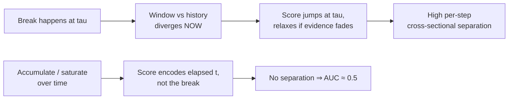
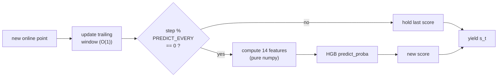

# Structural Break — Real-Time (CrunchDAO)

Streaming structural-break detection. For each series we get a full `x_historical`
segment (no break) and an `x_online` segment revealed one point at a time. At every
online step `t` we emit a score `s_t ∈ [0,1]` = belief a break has already occurred.

**Metric — TS-AUC (Time-Stratified AUC).** At each step, AUC is computed *across
series* (label 1 if `t ≥ tau`), weighted by `w(t) = n_pos(t)·n_neg(t)`. Random = 0.5.
Because it is cross-sectional per step, scores that merely grow with `t` gain nothing —
only genuine per-step separation helps.

## Files

| File | Purpose |
| --- | --- |
| `streaming_detector.ipynb` | The submission notebook (supervised model). |
| `_exp_fast.py` | Standalone train + streaming-validation harness (measures TS-AUC and infer speed). |
| `_val_harness.py` | **Robust multi-fold** validation harness: per-candidate mean±std across K disjoint folds + paired deltas vs base (the noise-aware decision tool, see below). |
| `baseline.ipynb` | Original EWMA baseline from the competition. |
| `data/` | Local train/test parquet files. |

## Model (current submission)

Per online step, a trailing window (`WINDOW=75`) is compared to the historical segment
via 14 two-sample features, and a `HistGradientBoostingClassifier` maps them to a break
probability. Features are recomputed every `PREDICT_EVERY` steps and held between.

Features: `mean_z, log_var_ratio, ks, skew_diff, kurt_diff, ac1_diff, ac2_diff,
iqr_ratio, tail2, tail3, zero_cross, slope_norm, spec_centroid_diff, rng_ratio`.

Key config: `WINDOW=75, MIN_N=15, HIST_CAP=200, PREDICT_EVERY=1, MAX_ITER=200,
STEPS_PER_SERIES=10, MAX_TRAIN_SERIES=10000, SEED=42`.

## Validation methodology

Feature decisions are made with `_val_harness.py`, **not** a single val split. It trains
one model per candidate feature set on a fixed training pool (disjoint from every fold),
evaluates each on `N_FOLDS=5` disjoint `FOLD_SIZE=400`-series folds, and reports:

* **per-fold TS-AUC + mean + std** — the std is the *noise floor*;
* **paired delta vs base** on the same folds, with `t = mean_delta / (std_delta/√K)`.

**Decision rule:** only port a change to the notebook when its paired mean gain clearly
exceeds the noise floor (target `|t| ≥ 2`, gain > fold std). This exists because E8's
+0.006 single-split "win" was ~4× smaller than the fold-to-fold noise and *reversed* on
the leaderboard. Streaming is parallelised across series (joblib, BLAS capped to 1).

*First run (5×400 folds, 6000-series pool):* base `mean 0.5511, std 0.0125` (same model
swings 0.5402→0.5708 across folds); the E8 split features scored `+0.0009 (t=0.31)` —
decisively **noise**. The harness would have rejected split *before* submitting it.

## Experiment log

| # | Approach | Result | Notes |
| --- | --- | --- | --- |
| E0 | EWMA z-score baseline (submitted) | **LB 50.65%** (rank 388) | Only reacts to mean shifts; blind to variance/shape/dependence. |
| E1 | Unsupervised (KS + variance + mean, noisy-OR) | ~0.518 local | Marginal-distribution stats miss autocorrelation/stationarity breaks. |
| E2 | Unsupervised CUSUM / monotone-accumulating variants | ~0.50 local | *Worse.* Saturating/accumulating scores destroy cross-sectional separation. |
| E3 | Supervised HGB, 14 two-sample features (scipy) | **TS-AUC 0.5701** (800 val series) | Best score, but too slow → submission timed out (exit 124). |
| E4 | E3 rewritten: pure-numpy features + single-thread + fewer trees | **TS-AUC 0.5636**, ~10× faster infer | Speed fix, negligible score change. |
| E5 | Cap threads at call time (`threadpool_limits`) + raise parallelism | **LB 55.30%** (rank 296/1144) | Fixed the 5 h+ cloud hang; ran fast, determinism check passed. |
| E6 | `PREDICT_EVERY` 15 → 1 (predict every step, no staleness) | **LB 55.48%** (rank 289) | Free win, +0.18 pt. 31 min on 16 vCPU. Local 0.5636 → 0.5663. |
| E7 | Train on all 10000 series (`MAX_TRAIN_SERIES` 6000 → 10000), keep 10 steps/series | **LB 55.94%** (rank 268) | +0.46 pt. Trained 9934 series/98.8k rows; parallelism 15; 42 min. |
| E8 | +3 recent-vs-older split features (window halves) | **LB 55.70%** (rank 269) — *reverted* | Local +0.006 but LB **−0.24 pt** vs E7. 400-series val was misleading; rolled back to 14 feats. |
| E9 | Robust/rank-based stats (median/MAD, Mann–Whitney, Brown–Forsythe) via 5×400-fold harness | **all within noise** (best t=+0.19) — *not shipped* | Redundant with existing KS/`mean_z`/`log_var_ratio`. No submission; harness caught it locally. |
| E10 | HGB hyperparameter grid (108 configs, GroupKFold row-level proxy) | best +0.0013 proxy AUC — *not shipped* | Model isn't the bottleneck; gain under proxy noise. |
| E11 | Window geometry: `WINDOW` 75 → 130 | **LB 56.63%** (rank 235) | +0.69 pt, +33 ranks — biggest single jump. Infer cost ~identical (free). 10-fold Δ +0.0110, t=+3.96. |
| E12 | Overnight 40-candidate feature battery (5×400 folds @ W75) | 3 ship-grade: `runs` t=2.48, `combo_volatility` t=2.40, `spec_entropy` t=2.39 | Winners cluster by family (run/level-crossing, complexity/spectral). Re-confirm at W130 before shipping. |
| E13 | Re-confirm E12 winners at WINDOW=130 (10 folds); ship `spec_entropy` (15th feat) | **LB 56.84%** (rank 229) | +0.21 pt, +6 ranks. `runs` (t=0.81) and `combo_volatility` (t=0.41) **collapsed at W130** — window-specific artifacts. Only `spec_entropy` held (t=+4.67). |
| E14 | Ship `perm_entropy` (order-3, 16th feat) on promising single-feature signal | **LB 56.75%** (rank 229) — *reverted* | −0.09 pt vs E13; sub-threshold bet (t=+1.93) didn't transfer. Reverted to 15 feats. Spectral-shape family (`spec_flatness/rolloff/spread/peak`) all noise on top of `spec_entropy`. |
| A | Lever A: per-series score calibration (sub/z early-window baseline, causal expanding median) | **all negative** (best t=−2.49) — *not shipped* | Pooled-trained `predict_proba` is already cross-series-comparable; de-meaning removes signal. Under TS-AUC only better within-step *ordering* helps → pursue changepoint localisation (Lever B). |
| B | Lever B: within-online max-split changepoint features on base15 @W130, 10 folds (`max_split_t`/`lr`/`var`/`pos` + combo) | **all noise** (best `max_split_var` t=+0.95) — *not shipped* | Self-normalized within-window supremum stats (Chow/LR/var/position). Smoke t=+4.34 (`max_split_t`) was a 2-fold artifact → collapsed to t=−1.37 at 10 folds. The 130-window vs-history features already capture the mean/var shift; within-window split is redundant. |
| E16 | WINDOW re-sweep on base15, 10 folds: W=130 (base) vs 160/180/200/250 | **W=130 optimal** — *no change* | W=160 +0.0016 t=+0.54 (noise); 180 −0.0042 t=−1.81; 200 −0.0018; 250 −0.0011. Champion window confirmed at the plateau top; larger windows don't ship. |
| E17 | Multi-scale: base15 features computed on nested trailing sub-windows and concatenated, 10 folds paired vs base15@130 | **LB 57.50%** (rank 214) — *CHAMPION* | `ms_60_130_250` shipped (Δ+0.0075 t=+3.06). +0.66 pt, +15 ranks vs E13 — biggest single jump since WINDOW=130. Scales (60,130,250) → 45 feats @ buffer W=250. Also SHIP in CV: `ms_40_130_250` (t=+2.27), `ms_40_130` (t=+2.02). First representational lever to pay off — short (responsive) + champion (130) + long (slow) views of the same series-vs-history contrast. |
| E18 | Full-online-vs-history: add UNBOUNDED scale (base15 over entire online-so-far) on top of champion, 10 folds paired vs `ms_60_130_250` | **all noise** (best `ms_60_130_250_full` t=+0.51) — *not shipped* | Unbounded scale via BIG buffer + FULL sentinel. `ms_60_130_250_full` (60f) Δ+0.0035 t=+0.51 (higher raw mean 0.5829 but fold-inconsistent); `ms_60_130_full` (45f) t=−0.13; `ms_130_full` (30f) t=−0.72. The trailing 250 view already captures post-break evidence; the growing full-online contrast is dominated by stale pre-break points and adds no reliable signal. Full-online lever dead. |
| E19 | Scale-set sweep: alternative multi-scale sets vs champion `ms_60_130_250`, 10 folds (4th scale / different spacing / longer top: `ms_40_60_130_250`, `ms_60_90_130_250`, `ms_60_130_190_250`, `ms_60_100_160_250`, `ms_40_90_160_250`, `ms_60_130_250_350`) | **all noise** — *no change* | No alternative scale set beats (60,130,250). Adding a 4th scale, re-spacing, or extending the top scale all wash out. Also confirmed on LB: probe `ms_40_130_250` = 57.38%/216 (worse). Champion scale set confirmed; representation saturating. |
| E20 | Feature-space distances: anomaly of the 45-dim multiscale vector (Mahalanobis / QDA-LLR / std-Euclid / L1 / Linf, window-vs-history), 10 folds paired vs champion | **all noise** (best `maha` t=+0.73) — *not shipped* | `maha` Δ+0.0022 t=+0.73 (raw 0.5816 highest but fold-inconsistent); `seuclid` t=+0.26; `qda_llr` t=−0.70; `l1` t=−1.22; `linf` t=−1.89. Joint-covariance whitening adds nothing over axis-aligned GBT splits. Feature-space distance lever dead. |
| E21 | Two-sample distribution distances: window-vs-history Wasserstein-1 / energy / Cramér–von-Mises / MMD per scale, 10 folds paired vs champion | **best non-champion signal since E17, but below bar** (`ts_wass` t=+1.83) — *not shipped from CV* | `ts_wass` Δ+0.0026 t=+1.83; `ts_energy` t=+1.81 (≈collinear w/ wass — both CDF-gap integrals); `ts_cvm` t=+1.44; `ts_mmd` t=+0.87; stacking all (`ts_all`, 57f) dilutes to t=+1.07. Real distribution-shape signal exists but sits at t≈1.8, inside the CV↔LB gap. |
| E22a | Ship `ts_wass` (single strongest E21 distance) to LB | **LB 57.37% (rank 217)** — REVERSED, *reverted* | Wired `_w1` per scale → 48 feats, bit-exact vs harness. Lost −0.13 pt / −3 ranks vs champion despite CV t=1.83. **Now 0-for-2 on marginal features** (E14 perm_entropy t=1.93 also reversed). *** Hardened ship bar: do NOT spend an LB slot unless CV t≥~2.5 (ideally ≥3); the old t≥1.9 rule is retired. *** |
| E22b | `ts_cvm` (rank-based, orthogonal to wass) submitted as parallel LB candidate | **LB 57.40% (rank 218)** — REVERSED, *reverted* | CV t=1.44 (below even the retired bar) → lost −0.10 pt vs champion, as the hardened rule predicted. **Now 0-for-3 on marginal features** (perm_entropy t=1.93, wass t=1.83, cvm t=1.44 all reversed). Two-sample distances fully dead as ship candidates; champion stands. |
| E23 | Series-transforms: cumsum / diff / moving-std / abs-dev of the standardized series, each contrasted (mean_z, log_var_ratio, KS) window-vs-history per scale, 10 folds paired vs champion | **all noise** (best `tf_diff` t=+1.40) — *not shipped* | `tf_diff` Δ+0.0018 t=+1.40; `tf_cumsum` t=+0.53; `tf_mstd` t=−0.21; `tf_absdev` t=−0.32; `tf_all` (81f) dilutes to t=+0.53. These are exactly the 2nd-place solution's transforms — noise here because our problem is real-time/unknown-boundary. Series-transform lever dead. |
| E24 | Variance two-sample tests on top of champion: F-test / Brown–Forsythe Levene / Fligner–Killeen per scale, 10 folds paired vs champion | **all noise** (best `vt_fligner` t=+0.42) — *not shipped* | `vt_fligner` Δ+0.0013 t=+0.42; `vt_levene` t=+0.32; `vt_lev_fli` (51f) t=+0.13; `vt_ftest` t=+0.10 (baseline 0.5795). The 2-fold smoke `vt_fligner` t=15.33 was a pure small-fold artifact (→ 0.42 at 10 folds) — reconfirms smoke deltas are worthless. Robust variance tests redundant with the existing `log_var_ratio`. |
| E25 | Large feature bank + importance selection (Option A): champion base45 + boundary-agnostic families {Hurst, AR(4), Anderson–Darling, Levene, Fligner, Mood, sample-entropy} ×3 scales (75 feats), ExtraTrees Gini selection (keep base + new features ≥ weakest-base importance), 10 folds paired vs champion | **noise** (0.5759 vs 0.5795, Δ=−0.0036, **t=−1.04**, slightly worse; 71.7 min) | Replicated the top solutions' *structural* recipe (large bank + selection). Selection kept all 30 new features (AR(4)/sampen/variance-tests rank high alongside base), yet the 75-feat model did **not** beat the 45-feat champion — it was marginally worse. Strong evidence the trailing-window paradigm is **saturated**; no feature-bank path clears the bar. → bank the champion. |
| E26 | **Paradigm search** — change the training *target* (frozen champion feats): ramp regression `clip((t-τ)/H,0,1)` + deweight-near-τ sample weights vs champion binary classifier, 10 folds | **noise** (ramp20 t=+0.68, deweight20 t=+0.59, ramp40 t=−0.50; all vs 0.5795) | Target-shaping does not move the ranking metric. Dead lever. |
| E27 | **Paradigm search** — scale/diversify training *data* (breadth vs depth, E7): N_TRAIN ∈ {6k, 10k, MAX} ×10 steps + depth control 6k×20, fixed val folds, champion feats+model | **dead / exhausted** (breadth impossible; depth t=+0.82 noise) | Dataset = 10 000 series; 10-fold×400 val reserves 4 000 → **MAX_TRAIN = 6 000 = exactly what the champion already trains on**. The breadth configs capped back to 6 000 (Δ=0, t=+inf artifact); the smoke's 9 920 was an artifact of the tiny 2-fold val reservation. No more data to add without shrinking validation. Depth (2× steps/series) = noise (matches E7). |
| E28 | **Paradigm search** — stateful *unsupervised* online detectors: CUSUM / Page-Hinkley / BOCPD (Gaussian const-hazard), per-step score ranked by TS-AUC vs trained champion, 10 folds | **far below champion** (cusum 0.5227 t=−11.6, page-hinkley 0.5202 t=−10.2, bocpd 0.5427 t=−6.8 vs 0.5795) | Stateful online detectors as standalone rankers are much weaker than the trained model. BOCPD is the best of them but still ~0.54 alone — too weak to help as a feature given the saturation evidence. Dead lever. |
| E29 | **Paradigm search** — winners' toolchain: LightGBM + gain selection. A) LGBM vs HGB on champion feats (model swap); B) bank (champion + Hurst + AR(4)) → LGBM gain>0 select → LGBM, 10 folds | **noise / worse** (A model-swap t=−2.18 worse; B bank+select t=−1.03; vs 0.5795) | LightGBM did not beat HistGBM on our features, and the bank→gain-select path was noise. Confirms the 7pt gap is **problem structure** (2025 known-boundary offline vs 2026 real-time unknown-boundary), not toolchain. The smoke SHIP (t=+2.68) fully evaporated — textbook "never trust smoke". |
| E30 | **Ensemble + tuning** — HGB champion ⊕ LogisticRegression blend, tune both. New validation: fixed-train 80/20 stratified (8000 train / 2000 val, 10 folds × 200, per-fold break-rate ≈0.497). LR default + C∈{0.1,0.3,1,3}+balanced; HGB grid 7 configs; blend weight sweeps; best×best blend | **all noise / worse** (LR alone 0.5322 t=−4.91; best HGB `msl40` +0.0004 t=+0.33; every blend ≤0, best w_lr=0.2 t=−0.68; best×best t=−0.01; vs champion 0.5674) | LR adds **no orthogonal signal** — blending it in only degrades monotonically, so HGB already captures the linearly-separable structure. HGB tuning is **dead-flat** (7 configs within ±0.0004). Model/ensemble axis is exhausted; the ceiling is the feature signal, not the model. Dead lever. |
| E31 | **Sequence model + proper tuning** — (A) 1D-CNN over the raw history-standardized window (2×250, translation-invariant) vs champion, same folds/labels/TS-AUC; (B) randomized *joint* HGB search (24 configs) then 5-seed robustness re-confirmation | **both null** — CNN alone 0.5048 t=−6.62, every HGB+CNN blend negative; joint search "winner" `hgb#11` (lr0.047/it300/leaves31/msl40/l2=5/mf0.5) hit +0.0035 t=+3.51 on seed 42 but **NOT ROBUST** across independent seeds (delta +0.0016 mean, positive 4/5, t≥2.5 on 1/5 — selection bias from best-of-24) | The learned-representation lever fails: a CNN reading the raw window is *worse* than 45 engineered contrasts (the online window is short/noisy; hand features already extract the shift/variance signal). Proper joint tuning found no config that survives independent fold draws → the E30 flat-tuning verdict holds. Champion E17 stands. |
| E32 | **Multi-seed joint HGB tuning** (the principled fix for E31's selection bias) — sample 48 joint configs once, score each by *mean* paired-delta vs champion across 4 independent pool seeds {42,7,123,2024}; gate = positive on all seeds AND mean ≥ 0.0015; then confirm the winner on 4 *fresh* disjoint seeds {31337,2025,555,99} | **LB 57.72% (rank 210) — NEW CHAMPION** | Robust winner `{lr 0.0211, max_iter 400, max_leaf_nodes 63, min_samples_leaf 10, l2 1.0, max_features 0.5}`: search-seed mean_d +0.0038 (positive 4/4), fresh-seed mean +0.0019 (positive 4/4) → **positive on 8/8 independent splits**. +0.22 pt vs old champion 57.50%/214, and beats the seed-ensemble (57.63%). Direction = slow-lr + many-trees + feature-bagging + deeper trees = generalization-friendly boosting; transfers where marginal features didn't. Single model (infer ~2× champion). Shipped as `streaming_detector_tuned.ipynb`. First robust win of the tuning arc. |
| E32-seedens | Seed-ensemble of the champion (K=5 HGB, avg proba) submitted in parallel | **LB 57.63%** (was 57.50%) | +0.13 pt from pure variance reduction. Local harness was a "HOLD" (mean +0.0026, 2/3 seeds) yet still gave a small **real** LB gain → confirms the local harness is *directionally predictive* for small positive deltas. Superseded by E32 tuned. |
| E33 | **LambdaMART / rank objective** — LGBMRanker (group = online step `t`) with `lambdarank` + `rank_xendcg`, dense-60 vs sparse-10 sampling, LGBM pointwise control, vs *old* champion HGB, 4 pool seeds | **biggest local signal since E17** — `rankxend_dense` mean_d +0.0159 (positive 4/4), min +0.0087, t=+2.69; pointwise control +0.0057 (toolchain adds a little, but the rank *objective* adds ~+0.010 more) | Real train/metric-mismatch signal (TS-AUC is per-step ranking; we always trained pointwise). Caveats: baseline was old (not tuned) champion, and winner was best-of-4 → must re-baseline vs tuned + confirm on fresh seeds (→ E34). |
| E34 | **Confirm rank objective vs the *tuned* champion on fresh seeds** {31337,2025,555,99} | **FAILED gate** — `rankxend_dense` mean_d +0.0080, min −0.0058, t=+1.33, positive **not** all seeds (negative on 555); `lambdarank_dense` +0.0083, min −0.0007, t=+1.35 | E33's +0.0159 was inflated by best-of-4 selection **and** a weaker old baseline. True rank-objective effect vs the tuned champion ≈ +0.008 but **not robust** → standalone rank dead as a champion replacement. Only remaining use of the rank signal = a rank-*average* ensemble with the tuned HGB (→ E36). Lesson: always re-baseline levers vs the *current* champion on fresh seeds. |
| E35 | **Feature re-eval vs the tuned champion** (night run, 3.7 h) — re-screen the whole battery (53 candidates: 47 EXTRA singles + 6 combos) added at scales 60/130/250 on top of the 45-feat champion, tuned params, 4 seeds | **all noise** — zero CONFIRM; best `max_split_lr`/`spec_peak` +0.0024 mean_d, t≈0.9; only 5 candidates positive 4/4, all t<1.0 | Feature-**addition** lever exhausted under *both* the default and the tuned model — the 45-feat champion already extracts the available single-feature signal, and tuned params did not resurrect any rejected feature. Remaining levers are structural/model-level (ensembles), not feature-level. |
| E36 | **Rank + tuned ensemble** — rank-average the tuned-champion HGB proba with an LGBM `rank_xendcg` (dense-60) raw score; per fold blend `w·rank(hgb) + (1−w)·rank(ranker)`, sweep w, 4 pool seeds {42,7,123,2024} | **BLOCKBUSTER (local) — every weight 0.8→0.3 CONFIRM (positive on all 4 seeds)** | mean_d +0.0067 (w0.8) → +0.0139 (w0.3); mean_t +5.22→+3.43; min_d +0.0040→+0.0075; sweet spot ~w0.5 (mean_d +0.0128, t 4.22, min_d +0.0073). Biggest signal since E17. Works where standalone rank (E34) failed: the champion anchors, the decorrelated listwise ranker corrects within-step orderings → variance reduction turns a non-robust +0.008 model into a robust +0.007–0.014 blend. **Ship caveat:** the harness uses a *live* per-fold global rank (not available at inference); the deployable form replaces it with each model's *fixed empirical CDF from training scores* (`w·F̂_hgb + (1−w)·F̂_rank`). **Confirmed on fresh seeds {31337,2025,555,99}:** the fixed-CDF blend transfers ~losslessly (FIX_mean_d tracks the live rank to 3 dp) — w=0.6 mean_d +0.0080, min +0.0018, t +3.07, positive 4/4; w=0.5 mean_d +0.0086, min +0.0009, t +2.60, positive 4/4 (both `*** CONFIRMED (ship) ***`; w=0.4 positive only 3/4). → build the ensemble submission notebook at w≈0.6. **SHIPPED at w=0.6 → LB 58.78% (rank 176) — NEW CHAMPION, +1.06pt & +34 ranks vs tuned HGB (57.72%/210): biggest single jump of the arc.** Local fixed-CDF mean_d ~+0.008 → +1.06pt LB (harness directionally predictive; decorrelated members transfer strongly). lightgbm installed fine on cloud. |
| E37 | **ARCH / volatility-clustering feature** — `f_arch` = [autocorr(r², lag1), Σ_{k≤5} autocorr(r²,k)²] over the 3 scales (+6 cols), targeted paired test vs tuned champion, seeds {42,7,123,2024} (`FEAT_ONLY` filter added to `_feat_reeval.py`) | **NOISE — rejected** | mean_d −0.0002, min −0.0054, mean_t −0.04, positive 2/4; signs flip across seeds. Confirms E35 feature saturation — volatility clustering adds nothing on the 45-feat champion. Do not revisit ARCH-family. |
| E38 | **RandomForest member** — `RandomForestClassifier(n_estimators=400, max_features=sqrt, min_samples_leaf=5)` on the 45 champion feats; blended (proba-avg) with the tuned HGB, paired-t vs tuned-HGB-alone, 8 independent seeds | **CONFIRM on 8/8 seeds — decorrelated member** | pool {42,7,123,2024}: hgb_rf 0.5/0.5 mean_d +0.0064 t+2.92 4/4, hgb_rf_30 0.7/0.3 +0.0044 t+3.21 4/4. Fresh {31337,2025,555,99}: hgb_rf +0.0058 t+2.81 4/4, hgb_rf_30 +0.0040 t+3.25 4/4. RF *alone* ~beats tuned HGB (pos 8/8). Bagging genuinely decorrelates from boosting (contra E30 expectation). **Caveat:** tested vs HGB-alone with raw proba-avg; open question = does RF add on top of the *ranker* in the shipped CDF-blend (step 2, 3-member ensemble). |
| E39 | **RF as 3rd member of the shipped CDF-blend** — faithful fixed-CDF percentile blend `w_hgb·F_hgb + w_rank·F_rank + w_rf·F_rf` (mirrors E36 ship computation + RF ref); sweep 3-member weights, paired-t vs the **shipped 2-member champion** (0.6/0.4), seeds {42,7,123,2024} | **SUB-THRESHOLD — RF DROPPED as a member** | HGB-heavy sets ~+0.0002 t~0.2 (not pos_all, noise); near-equal 0.36/0.34/0.30 +0.0013 min +0.0007 t+2.04 pos 4/4, 0.34/0.33/0.33 +0.0014 min +0.0007 t+1.95 pos 4/4 — both positive 4/4 but **below the hardened gate** (mean_d≥0.0015 & mean_t≥2.5). Key insight: RF gave +0.006 (t2.9) vs HGB-*alone* but only +0.0014 (t2.0) on top of the *ranker* → ~80% of RF's value overlaps with the ranker (both = variance-reduced within-step ordering); confound: best sets shifted HGB 0.6→0.34, shrinking RF's true marginal further. Not worth the 400-trees/step infer cost. **Lesson:** a member confirmed vs one base can be redundant vs a stronger ensemble — always re-baseline vs the *current* champion. Remaining levers: tune the LGBM ranker (never tuned), 2-member weight (0.5 vs 0.6), scale-specialization diversity. |
| E40 | **Tuning the LightGBM ranker member** — random search over 24 ranker configs (n_estimators 200–800, learning_rate 0.02–0.08, num_leaves 15–63, min_child_samples 10–80, reg_lambda, colsample, subsample), each scored in the faithful fixed-CDF 2-member blend at weights {0.5, 0.6}, paired-t vs the shipped champion, 4 pool seeds | **NO config beats the champion — ranker already near-optimal at defaults** | Aggressive params (learning_rate 0.08 / 800 trees) consistently **negative** (overfit: e.g. it800/lr.08 mean_d −0.0049 t−2.1). Best "promising" configs (cfg22 mean_d +0.0030 t1.32; cfg20 +0.0021 t2.24; cfg15 +0.0019 t2.03) are all *positive-on-4/4 but below the gate*, and **every one picked weight 0.5** — their gain is the blend-weight shift, not the params. The default ranker at weight 0.5 alone gives mean_d +0.0014, min +0.0006, t +2.31, positive 4/4. **Conclusion:** ranker hyperparameters do not help; the real robust lever is the **blend weight (0.6 → 0.5, more ranker weight)**. → fine weight sweep (`_weight_sweep.py`, 0.30–0.65, all 8 seeds) to pin the optimum, then ship a one-line `BLEND_W` change. |
| E41 | **Fine 2-member blend-weight sweep** — fit the two shipped members once/seed, re-blend fixed-CDF percentiles at weights 0.30–0.65 (no refitting), paired-t vs shipped 0.60 across **all 8 seeds** {42,7,123,2024,31337,2025,555,99} | **NO ship — w=0.5 signal did NOT generalize; keep 0.60** | 6/8 seeds favor more ranker weight, but two fresh seeds (2025, 555) go **negative** at low weight. Best (w0.30–0.40) mean_d +0.0014 but **min_d −0.0033…−0.0019, not positive on all seeds, t ~0.7–1.1**; w0.5 mean_d +0.0010, min −0.0008, t +1.49. No weight clears the hardened gate. The 4-pool-seed w=0.5 win from E40 was pool-specific — the 8-seed test correctly caught it. **Decision: keep shipped w=0.60 (robust compromise).** Ranker-tuning arc concluded: the ranker is optimal at defaults *and* the weight is already well-chosen. |
| E42 | **Residual lens (the paradigm break)** — a structural break shows up first as a *reference model's residuals blowing up*. Fit `AR(p)` on the historical segment, apply forward onto the trailing online window, add `log( var(window residuals) / var(reference-fit residuals) )` per order to `champion_feat` (both members consume it); paired-t vs the shipped E36 2-member champion, 2-stage seed gate (search {42,7,123} → fresh {31337,2025,555,99}). Also `STEPS_PER_SERIES` 10→30 | **LB 60.56% (rank 133) — NEW CHAMPION, +1.78 pt & +43 ranks vs E36 (58.78%/176): biggest single jump of the whole arc** | Shipped `AR{1,2,3,4}` var-ratio (+4 feats) + STEPS=30. Search mean_d **+0.0191** (min_t 4.13, 3/3); fresh mean_d **+0.0151** (pos 4/4, min_t 2.30) — fresh magnitude ≈ search = a *real* feature, not seed luck. Local +0.011 → LB **+0.018** (amplified). **This overturns the E25/E35 "trailing-window paradigm SATURATED" verdict** — the ceiling was the raw window-vs-history *lens*, not the paradigm; comparing under a fitted-model residual is a genuinely new representation. **Ablation:** the signal is ~1-D "model-surprise magnitude" and lives almost entirely in the *variance ratio* (mean-shift/ACF/Ljung-Box/CUSUM/outlier all noise alone); richer reference sharpens it (`ar4`≫`ar1`, `ar8_only` alone ≈ whole block). **Model bank (rw/trend/EWMA/mean):** no non-AR *linear* reference adds orthogonal signal (constant-mean ≈ existing `log_var_ratio`); AR best-whitens the dynamics. **Follow-ups (in flight):** `ar8_only` fresh-confirmed +0.0208 (min_t 2.72) = parsimonious ship *upgrade* candidate; overnight sweep of AR-order sets / multi-scale residual / robust-MAD / GARCH-lite reference, all fresh-gated. |
| E43 | **Tuning the random forest as a 3rd member** — random search over 20 forest configs (n_estimators 300–800, max_depth, max_features {sqrt/log2/0.3/0.5}, min_samples_leaf/split, max_samples, class_weight), each in the faithful 3-member fixed-CDF blend at near-equal weights, paired-t vs the shipped 2-member champion. *(Parallel-branch exploration run against the pre-residual E36 2-member champion (58.78%), concurrent with the E42 residual-lens line.)* | **NO config clears the gate — random forest DROPPED for good** | Run died mid-seed-2024 when the machine restarted; reconstructed from 3 full seeds {42,7,123} (`_parse_forest.py`). Best config (cfg15) mean_d +0.0014, min +0.0004, **t +1.69**; best t of any config +2.02 — all below the gate (≥0.0015 & t≥2.5). `class_weight=balanced_subsample` configs almost all **negative**. **Tuning bought nothing**: best tuned forest (+0.0014) equals the E39 untuned default (+0.0014). Seeds 42 & 7 cap the best configs at ~+0.0007 — the random forest is genuinely redundant with the ranker and tuning does not rescue it. Given a fair, thorough shot and dropped. Remaining lever: scale-specialization diversity. |
| E44 | **Scale-specialization diversity as a 3rd member** — a scale-specialist gradient-boosting member (average of single-scale models on the 60/130/250 window views) added to the fixed-CDF blend at near-equal weights, paired-t vs the shipped 2-member champion, 4 seeds; variants `scale_avg` and `scale_plus_full` | **NOISE — dropped; last lever closed** | scale_avg mean_d −0.0001, min −0.0020, t −0.13; scale_plus_full mean_d −0.0001, min −0.0014, t −0.26. Signs flip across seeds (42 & 7 negative, 123 positive, 2024 ~0), netting ~zero, not positive on all seeds. A single-scale gradient-boosting view is redundant with the full-45 member + ranker. Feature-subspace decorrelation adds nothing over the 2-member blend. |
| E45 | **Trajectory GRU as a decorrelated 3rd member** — a causal GRU over the *sequence* of per-step 45-dim window-vs-history vectors (the only stateful member; integrates the temporal persistence of a break), trained on **dense** per-step trajectories (~1.4M supervised steps/seed vs the gradient-boosting member's 10 snapshots), added to the fixed-CDF blend at 6 weight sets, paired-t vs the shipped 2-member champion, seeds {42,7} | **NO ship — parked "needs more juice," not dead** | Seed 42: best blend 0.36/0.34/0.30 mean_d **+0.0033, t +2.11**, positive at *every* weight — a genuine decorrelation signal (unlike the random forest / scale members). Seed 7: **all weights negative** (−0.0010…−0.0027). 2-seed summary best mean_d +0.0010, **min −0.0014, not positive on all seeds** → below gate. The one member that showed real per-seed lift; a stronger GRU (more epochs/width, GRU-specific features, seed-ensemble) is the natural follow-up. |
| E46 | **Steps-per-series sweep (utilize more training data)** — refit the tuned gradient-boosting member at snapshot densities {10,15,20,30,50} per training series (monkeypatch `STEPS_PER_SERIES`), re-blend against the fixed ranker at the shipped 0.6/0.4, paired-t vs the shipped `STEPS=10` champion | **NO ship (feature-free) — pool promise was seed-luck; keep STEPS=10 for the 2-member blend** | Pool {42,7,123,2024}: **every** density positive on all 4 seeds (steps=15 mean_d +0.0021 min +0.0009, steps=30 +0.0019) — looked like the first pool-consistent lever of the arc. **Fresh-seed confirm {31337,2025,555,99} failed**: steps=15 mean_d −0.0006 min −0.0026, steps=30 −0.0005, not positive on all seeds (seed 2025 −0.0026, seed 99 −0.0025). The adversarial fresh seeds (same ones that killed the E41 weight sweep) correctly caught it. **Confirms E7 generalizes — denser snapshot sampling hurts the tabular member via correlated rows.** *(Partly superseded by E42: once the AR residual features are added, `STEPS=30` fresh-confirmed and shipped as part of the champion — the denser sampling pays off only in the presence of the stronger feature.)* Reinforces: 4/4 pool-positive is meaningless without fresh-seed confirmation. |
| E47 | **Stronger trajectory GRU (seed-ensemble + capacity)** — E45 follow-up attacking its variance: average **3** independently-initialized GRUs per seed into one member before the CDF blend, wider hidden (128 vs 64), output dropout + weight-decay, 18 epochs; same 3-member blend, seeds {42,7} | **NO ship — genuine pool disagreement, not variance** | Seed 42 got **stronger** than E45 (best blend 0.34/0.33/0.33 mean_d **+0.0060, t +2.97**; 0.36/0.34/0.30 +0.0058, t +3.20 — SHIP-hard), but seed 7 **stayed negative** (−0.0016…−0.0035). Summary best mean_d +0.0018, **min −0.0021, not positive on all seeds**. The seed-ensemble made seed 42 bigger yet did **not** flip seed 7 — so the E45 42+/7− split is a real cross-pool disagreement (the GRU decorrelates on some data draws, anti-aligns on others), not fixable by ensembling. Reframed the failure (per-series heterogeneity + fixed global weight) → reopened the thread as a gating problem (E48). |
| — | **Repo review — BoNing-Gu 2025 5th-place (AUC 0.888, *offline* task)** | *No port; reinforces strategy* | Their win = exhaustive two-segment (known-boundary) statistical features [distribution stats, 2-sample tests KS/AD/Mann-Whitney/Levene/Bartlett/ADF/KPSS, cumsum-shape, entropy/complexity family, AR cross-prediction residuals, tsfresh, ruptures costs] × {left, right, whole, diff, ratio, contribution} + correlation prune + permutation-importance filter + **top-10 feature interactions** (86 features) + GBM. Their **deep learning** (U-Time segmentation, PatchCrossEncoder) **lost at 0.792**. Lessons for the 2026 real-time task: (1) confirms DL is not a slam-dunk here; (2) their feature machinery assumes a known boundary so it doesn't port, and many of these exact features already reversed on our real-time leaderboard (entropy, ADF/KPSS, Wasserstein/energy, ruptures costs = E14/E21/E22/E24/E28); (3) U-Time's soft Gaussian boundary label is close to our already-dead ramp-shaping (E26); (4) the one real-time-legal untried nugget is an **AR cross-forecast residual** feature (fit AR on history, forecast the online window, measure residual blow-up) — low prior at the time. **↳ This exact nugget became the E42 residual-lens champion (+1.78 pt) — the "low prior" review item turned into the biggest jump of the arc.** |
| E48 | **GRU gating diagnostic — is the GRU's value per-series heterogeneous?** — reopened the GRU thread on the hypothesis that its ~net-zero fixed-weight contribution hides real per-series lift + hurt. Exact per-series concordant-pair marginal decomposition of the 3-member vs 2-member blend, seeds {42,7}, 3976 series; screened label-free separators (RevIN scale, AR cross-forecast, member-disagreement, GRU-confidence) for *which* series the GRU helps | **Hypothesis CONFIRMED — value is per-series heterogeneous; RevIN + AR separators DEAD** | GRU helps 57.8% of series (Σ +0.098) and hurts 42.2% (Σ −0.098) → near-perfect annihilation, which is exactly why any fixed global weight nets ~0 (E45/E47). Oracle (perfect gate) ceiling +0.098. Best separators: member-disagreement `bias_gru_gb` (sign-AUC 0.619), `gb_mean`, `onl_len` (Spearman +0.143); RevIN-scale + AR separators all ~0.50 (dead → scoped out). A realizable 5-fold-CV gate reached OOF sign-AUC 0.69. → build a real gated blend. |
| E49 | **Gated 3-member blend (per-series gate)** — HGB gate on the label-free separators switching each series between 2-member (GRU off) and 3-member (GRU on), cross-fold honest, real TS-AUC; thresholds {0.50,0.55,0.60}; fresh-seed confirm {31337,2025,555,99} | **+0.0044 on 6/6 seeds at thr 0.60 — BUT uses lookahead → NOT deployable** | Full gate positive on all 6 seeds at thr 0.60 (mean_d +0.0044, min +0.0022; rescues the seeds where the fixed 3-member blend was negative), monotone in threshold. **Caught before building the notebook:** the separators (`onl_len`, whole-series `onl_std`, trajectory-wide GRU/agreement stats, AR over the full online window) all depend on FUTURE online points, but the task reveals `x_online` one point at a time — so the per-series gate is lookahead and cannot ship. The leak is localized to the gate's features; the 3 members are causal. **Lesson:** verify the causality/deployment contract *before* building a notebook from a promising harness result. → redesign as a causal per-step gate. |
| E50 | **Causal per-step gate (the only deployable form)** — decide `w_gru(t)∈{0,0.30}` per online step from EXPANDING (causal) separators only (running member-disagreement, GRU confidence/entropy, steps-seen); per-step marginal target; cross-fold honest gate on rows, real TS-AUC; 6 seeds; thresholds {0.50–0.65} (`_gru_gate_causal.py`) | **FAILED — GRU line CLOSED for good** | The causal separators actually *predict better* than the lookahead ones (OOF-AUC 0.71 vs 0.66) — the gate genuinely knows which steps help — yet it does **not** convert to TS-AUC: every threshold net-negative (thr 0.50 mean_d −0.0010), positive on only 2/6 seeds. A per-row marginal (one series flipped, others held) is a poor proxy for a hard per-step gate that flips many series at once; the winner/loser mass (+0.098/−0.098) annihilates under the cross-sectional rank metric. **Three independent tests now agree the GRU's value is real but causally unexploitable** (fixed weight ≈0, E45/E47; lookahead gate illegal, E49; causal gate fails, E50) → GRU dropped as a member; champion stays the E42 residual-lens blend (60.56%). |
| E51 | **Explicit feature interactions on the residual champion** — 9 pairwise product-column blocks appended to *both* blend members on top of the frozen 49-col residual champion (residual×{var,ks,mean} at scale 250, residual², per-scale var×ks and mean×var, cross-scale var/ks persistence), re-baselined vs the champion, real fixed-CDF TS-AUC, paired-t, screen {42,7,123} (`_interactions.py`) | **NO ship — interaction axis CLOSED** | Every block noise: best `ks_cross_scale` mean_d −0.0003, worst `mz_x_lvr` −0.0014; none positive on all seeds, nothing reached fresh-confirm. Confirms the low prior — gradient boosting already captures these interactions implicitly via tree splits, so explicit product features only dilute. (Motivated by the BoNing-Gu 5th-place "top-10 interactions"; that gain was an *offline* artifact.) |
| E52 | **Transform-lens bank (2025 2nd-place idea, made causal)** — recompute champion-style contrasts on cheap deterministic *transforms* of the window-vs-history, appended to the frozen residual champion: `cusum` (standardized CUSUM max/end/range), `pit` (dense-rank / empirical-CDF of window vs history), `abslens` (\|value\| mean/var ratio), `rollstd` (rolling-std(16) level + vol-of-vol), `levene` (Brown-Forsythe F), and their union; all causal + deployable; screen {42,7,123} → fresh-confirm {31337,2025,555,99} (`_transform_lens.py`) | **NO ship — transform-lens axis noise; #wide-bank-select prior lowered** | Every individual lens noise on screen (cusum −0.0005, pit −0.0018, abslens −0.0004, rollstd +0.0014 2/3, levene −0.0009). Only the 11-feature **union** screened positive (+0.0024, 3/3) → fresh-confirmed to **+0.0022 but only 3/4 positive, min_t −0.01 → noise** (a quarter of the ~+0.008 that maps to +1pt LB, and not robust). The cheap transforms that won the *offline* 2nd-place solution add nothing over our contrasts + AR residual in the causal cross-sectional setting — and the weak, non-robust union caps the expected payoff of a wider transform-bank + SHAP/gain selection. Reinforces E42's lesson: the *fitted-model residual* was the exception because it is a genuinely different representation; deterministic restatements are exhausted (cf. E9). |
| E53 | **Local / recent-reference contrast (new reference definition)** — instead of window-vs-history, contrast the most-recent online segment against the immediately-preceding online segment of equal length (a within-online abrupt-change detector); scales L∈{30,60,120}, each contributing mean-shift / log-var-ratio / KS; appended to the frozen residual champion; causal; screen {42,7,123} (`_local_ref.py`) | **NO ship — local-reference axis noise** | Base 0.6057 (calibrated). Every scale block noise (loc30 +0.0000, loc60 +0.0003, loc120 +0.0004); the 9-feature union was +0.0013 (3/3 but min_t +0.26) — below the 0.0015 promotion bar, so it never reached fresh-confirm. The break sits **at** the boundary, so a within-online contrast is only weakly aligned with the label; window-vs-history remains the correct reference. Confirms the reference-definition space is well covered by the champion's multi-scale window-vs-history. |
| E54 | **Multi-scale residual lens** *(residual-feature line — the current LB champion; re-recorded here after merges dropped it)* — apply the E17 multi-scale trick to the E42 residual: `AR8` residual variance ratio on trailing sub-windows 60/130/250 (+3 feats), fresh-gated | **LB 61.32% (rank 101) — CHAMPION, +0.76 pt vs E42 (60.56%/133)** | Shipped `streaming_detector_residual.ipynb` (`AR_ORDERS=(8,)`, `RESIDUAL_SCALES=(60,130,250)`, `STEPS=30`). Fresh mean_d +0.0232 (min_t 2.75, 4/4) vs E42 single-scale +0.0151. Overnight: higher AR order saturates (`ar8`≈block); GARCH dead; robust-MAD weaker; multi-scale is the win. Progression E36 58.78 → E42 60.56 → **E54 61.32**. |
| E55 | **`ar8_only` single-feature probe** — the parsimonious fallback (AR8 residual var-ratio on the *full* window only, +1 feat) submitted as an LB calibration point vs the E54 multi-scale champion (`streaming_detector_ar8only.ipynb`) | **LB 60.73% — below E54 (61.32%), champion unchanged** | Confirms **multi-scale > single-scale on the LB** (local +0.0232 > +0.0189 held), and that the local→LB ordering is trustworthy. Above E42 (60.56%), below the multi-scale champion. **Next candidate (E56, fresh-confirmed +0.0303 vs +0.0232):** a *second* AR8 reference fit on the last 120 historical points — `streaming_detector_trail120.ipynb` (+6 feats). |
| E56 | **Reference-span family — trailing-history second reference** — add a 2nd AR8 reference for the multi-scale residual, fit on only the last 120 historical points (recent-history dynamics closer to the break); also tested returns (AR on Δx), AIC-order, trail250 alone/as-2nd-block; screen {42,7,123} → fresh {31337,2025,555,99} (`_residual_reffit.py`) | **LB 61.58% (rank 94) — NEW CHAMPION, +0.26 pt & +7 ranks vs E54 (61.32%/101)** | Shipped `streaming_detector_trail120.ipynb` (`REF_TRAILS=(None,120)`, AR8 var-ratio × scales 60/130/250 × 2 spans = +6 feats, 51 total). `ctrl+trail120` fresh mean_d **+0.0303** (min_t 2.89, 4/4) vs the champion's +0.0232 — ~+0.007 *orthogonal* (the recent-history reference catches what full-history misses). `returns`, `aic`, `trail250` all fresh-STRONG but ≈ the champion (same 1-D signal, not additive). Progression E42 60.56 → E54 61.32 → **E56 61.58**. Reference-*span* is a live family → sweep trail lengths next. |
| E57 | **Weight × STEPS retune with the residual feature present** — `w=0.60`/`STEPS=30` were tuned before the residual feature existed; re-sweep `STEPS∈{10,30,60}` × `w∈{0.40…0.70}` vs the shipped (30, 0.60), all 7 seeds (`_residual_wsteps.py`) | **NO change — (30, 0.60) already optimal** | Every alternative cell is noise (best `w=0.50` mean_d +0.0004, min −0.0011, *not* positive on all 7 seeds, min_t < 0); heavier ranker weight and denser/sparser sampling both wash out. The stronger feature set did **not** shift the blend-weight or step-sampling optimum → keep the champion config. |
| E58 | **Reference-span bank sweep** — on top of the E56 trail120 champion, sweep the 2nd AR8 reference-span length {60,90,120,200} and add 3rd/4th spans {full+120+60/200/250, full+60+120+200}; screen {42,7,123} → fresh {31337,2025,555,99} (`_residual_spanbank.py`) | **SATURATED — no ship; two spans is the sweet spot, champion stays 61.58%** | The reference-span signal saturates at **two** spans (full history + one recent): a 3rd/4th span adds nothing — `full_120` fresh +0.0303 vs `full_120_60` +0.0300, `full_60_120_200` +0.0289 (slightly dilutes). 2nd-span length is flat across 60/90/120/200 (all fresh +0.029–0.031, 4/4): `full_90` nominally top (+0.0313) but **within noise** of the shipped `full_120` (+0.0303, min_t 2.89) — not a robust margin → no LB slot. Recent-history reference is a single orthogonal dimension, now fully captured by the shipped 2-span champion. **Reference-span family closed.** *(Probe: `full_90` shipped anyway as `streaming_detector_trail90.ipynb` → **LB 61.59% (rank 95)** ≈ the 120-span champion's 61.58% — a statistical tie, confirming the "within-noise" call and that local→LB stays trustworthy.)* |
| E59 | **Shape/tail features (synthetic-diagnosis guided)** — a break-type diagnosis on the synthetic generator (`_synth_diag.py`) showed the residual champion owns *dynamics* breaks (ar/ma/arma/spectral AUC 0.88–0.98) but is blind to pure *shape* breaks; the weakest families are `skew` & `tdist`. Candidate shape add-ons — AR-residual skew/kurtosis, robust Bowley skew, tail-heaviness ratio (q95−q05)/(q75−q25) — tested as add-ons to champion+residual (51 feats), screen {42,7,123} (`_residual_shape.py`) | **NOISE — tail/asymmetry lever closed** | Every shape block noise (best `bowley` mean_d +0.0007, `resid_kurt` +0.0003; none positive on all seeds, min_t < 0). The synthetic diag *predicted* this: the candidates match the champion's existing `skew_diff`/`kurt_diff` (which it carries at 3 scales) almost exactly → redundant. **Synthetic pre-filtering worked** (flagged the redundancy before the harness confirmed it) and validated *why* the residual is the champion (orthogonal dynamics-break detector). Shape axis exhausted; residual = dynamics is the one representational lever that pays. |

**Takeaways:** instantaneous window-vs-history comparison beats any accumulating score
under TS-AUC; the local 100-series reduced set is noisy/optimistic (use ≥800 series to
judge); a supervised classifier over distribution-comparison features clearly beats
hand-tuned unsupervised rules. **On training data (E7):** breadth beats depth — training
on *more distinct series* helps, but taking *more sampled steps from the same series*
hurts (correlated, near-duplicate rows), and *oversampling steps near the break `τ`* hurts
(the most ambiguous, hardest-to-label points). **On inference (E6):** never let a score go
stale — TS-AUC ranks series against each other *at each step*, so predict every step.
**On validation (E8):** a single 400-series local split is too noisy to trust ~0.006
deltas — the split features looked like a win locally but *lost* on the full test; use a
larger/multi-fold val or treat the leaderboard as ground truth for small changes.
**On features (E9):** robust/rank-based restatements (median/MAD, Mann–Whitney,
Brown–Forsythe) add nothing over the existing KS + `mean_z` + `log_var_ratio` — they
measure the same location/scale/distribution shift, so they are redundant, not additive.

## Experiment details

### E0 — EWMA z-score baseline

The competition baseline. Summarize history by its mean `μ_H` and std `σ_H`, then track
an exponentially-weighted moving average of the online values and score by how far it has
drifted, in standard-deviation units:

$$z_t = \frac{\bar{x}_t - \mu_H}{\sigma_H / \sqrt{n_\text{eff}}}, \qquad s_t = \tanh(|z_t|)$$

Truly O(1) per step, so it never times out. But it **only measures the mean** — a break
that changes variance, distribution shape, or autocorrelation while keeping the mean
roughly constant is invisible to it. That is why it lands at essentially random
(**LB 50.65%**) and set the bar for everything below.

### E1 — Unsupervised two-sample (KS + variance + mean)

First improvement attempt: at each step compare a trailing online window against the
historical segment with several classical statistics — a Kolmogorov–Smirnov distance, a
variance ratio, and a mean shift — then combine them with a noisy-OR into one score.

This adds sensitivity to variance and distribution-shape changes the EWMA misses, so it
edges above random (**~0.518 local**). But it is still built on *marginal-distribution*
statistics: it cannot see breaks that live in the **temporal dependence** (e.g. a change
in autocorrelation with an unchanged histogram). Hand-tuning the OR weights gave only
marginal, noisy gains — the ceiling of rule-based combining was clearly low.

### E2 — CUSUM / monotone-accumulating variants

Intuition said "accumulate evidence over time" — CUSUM-style running sums and scores
forced to be monotonically non-decreasing. Under TS-AUC this **backfired** (**~0.50**).

The reason is the metric's cross-sectional nature: at each step AUC ranks series *against
each other*. A score that only grows with `t` orders series by how long they have been
running, not by whether they have actually broken — so it carries no discriminative
signal at any given step. This produced the single most important design rule:



**Instantaneous** window-vs-history comparison wins; accumulation loses.

### E3 — Supervised HGB with two-sample features (scipy)

Replace hand-tuned rules with a learned mapping. For each training series we take the
historical context once, sample online positions, build a 14-dim feature vector from the
trailing window, and label it `1` if the position is at/after the break `tau`. A
`HistGradientBoostingClassifier` learns the mapping; `lightgbm` was unavailable, and HGB
avoids a platform dependency.

The 14 features are all **window-vs-history contrasts** covering the failure modes of
E0/E1: level (`mean_z`), scale (`log_var_ratio`, `iqr_ratio`, `rng_ratio`), shape
(`ks`, `skew_diff`, `kurt_diff`, `tail2`, `tail3`), dependence (`ac1_diff`, `ac2_diff`,
`zero_cross`), and trend/spectrum (`slope_norm`, `spec_centroid_diff`).

This was the **best score (TS-AUC 0.5701** on 800 val series) — but the scipy-based
features cost ~7 ms each, and with millions of calls the cloud `infer()` **timed out
(exit code 124)**. Correct model, unshippable speed.

### E4 — Pure-numpy rewrite (current submission)

E4 keeps E3's model and features but makes them fast enough to ship. The inference loop:



**Diagnosis (measured, not guessed):**

- scipy `compute_features` (`ks_2samp`, `skew`, `kurtosis`, `polyfit`) cost **~7 ms/call**.
- Split timing inside infer showed **`predict_proba` dominated**, not feature compute.
- Single-row `predict_proba` benchmark:
  - default multi-thread: **1.56 ms/call**
  - `OMP_NUM_THREADS=1`: **0.29 ms/call** (random-data model, few trees)
  - real 200-tree model, single-thread: **~2.5 ms/call**
  - batched (not usable in a streaming generator): **0.6 µs/row**
- Cause: OpenMP thread-pool spin-up per tiny prediction, worsened by parallel infer
  processes oversubscribing cores.

**Fixes applied:**

- Pure-numpy features (manual skew/kurtosis moments, KS via pre-sorted sample +
  `searchsorted`, direct slope formula): **7 ms → 0.36 ms/call**.
- `OMP_NUM_THREADS=1` (+ OpenBLAS/MKL) set before numpy import.
- `MAX_ITER` 300 → 200 trees; `PREDICT_EVERY` 5 → 15; `HIST_CAP` 400 → 200;
  `MAX_TRAIN_SERIES=6000` cap.

**Validation (400 held-out train series, `_exp_fast.py`):**

- TS-AUC **0.5636** (vs 0.5635 pre-optimization — no loss).
- Infer **40 s / 400 series** → est. **~250 s at parallelism 4** for full test
  (was ~2400 s+; exit 124 before).
- Notebook re-verified: parses, `train()`+`infer()` run on synthetic data, exactly one
  score in `[0,1]` per online point.

### E5 — Cloud thread oversubscription (current submission)

After E4 passed locally, a cloud run **ran 5+ hours without finishing** (16 vCPU / 64 GB).

**Cause:** E4 capped threads with `os.environ["OMP_NUM_THREADS"]="1"`, which only takes
effect if set *before* numpy/OpenMP load. On the cloud the crunch runner imports
numpy/sklearn before the notebook cell runs, and each `infer()` worker is a separate
process — so the env var was ignored. With `INFER_PARALLELISM=4` workers each spawning
~16 OpenMP threads on 16 cores (~64 threads contending), every single-row `predict_proba`
became 10–50× slower.

**Fix:**

- Wrap the infer loop in `with threadpool_limits(limits=1):` (from `threadpoolctl`,
  ships with sklearn) — caps BLAS/OpenMP threads **at call time**, regardless of when
  libraries loaded or how workers are spawned.
- Raise `INFER_PARALLELISM` to `cpu_count()-1` now that each worker is single-threaded,
  to use the available vCPUs (auto-scales to whatever machine you pick).

**Where the parallelism happens:** across *series* (many single-threaded worker
processes, one series each), **not** inside a math op (BLAS/OpenMP threads capped to 1).
Parallelizing both layers on the same cores just oversubscribes them — hence 1 thread
per op × N worker processes = all cores busy, zero contention.

Model and features are unchanged from E4, so the score is unaffected; only wall-clock
changes. Re-verified on synthetic data (train + infer, scores in `[0,1]`).

**Result (2026-08-10):** cloud run finished quickly (parallelism 12, no hang), the
determinism re-check passed, and it scored **LB 55.30% — rank 296 / 1144** (up from
E0's rank 388). Confirms the hang was pure thread oversubscription, not the model.

### E6 — Predict every step (remove staleness)

With speed solved (E4/E5), `PREDICT_EVERY=15` was pure downside: TS-AUC ranks series
against each other **at each step**, so a score held 14 steps stale is compared against
freshly-updated peers. Swept `PREDICT_EVERY ∈ {15, 5, 1}` (train once, 400 val series):

| `PREDICT_EVERY` | TS-AUC | est. full test (12-core) |
| --- | --- | --- |
| 15 | 0.5636 | ~30 s |
| 5 | 0.5654 | ~87 s |
| **1** | **0.5663** | **~433 s (~7 min)** |

Set `PREDICT_EVERY=1`: best score, staleness eliminated, and ~7 min at 12 cores is well
within the inference budget (faster still on 16/32-core machines via adaptive parallelism).
Model and features unchanged. Sweep harness: `_sweep_pe.py`.

**Result (2026-08-10):** **LB 55.48% — rank 289** (up from 296), 31 min on 16 vCPU.
Confirms the staleness fix helps on the real leaderboard and stays within budget.

### E7 — Train on all series (more data)

Swept training-set size / density on a fixed disjoint 400-series val set (`PREDICT_EVERY=1`,
harness `_sweep_data.py`):

| n_series | steps/series | near-τ | rows | TS-AUC |
| --- | --- | --- | --- | --- |
| 5000 | 10 | — | 49k | 0.5457 |
| **9000** | **10** | **—** | 89k | **0.5648** |
| 9000 | 20 | — | 177k | 0.5582 |
| 9000 | 40 | — | 350k | 0.5585 |
| 9000 | 20 | 0.5 | 177k | 0.5486 |

(Absolute values differ from E6's table — different held-out val set; compare only within
this table.) **More *series* helps a lot** (+0.019); **more *steps per series* hurts**
(correlated, redundant samples skew the fit); **near-τ densification hurts** (ambiguous
boundary points confuse the classifier). Change: `MAX_TRAIN_SERIES` 6000 → 10000, keep
`STEPS_PER_SERIES=10`. Train-time only; infer cost unchanged.

**Result (2026-08-10):** **LB 55.94% — rank 268** (up from 289). Cloud trained on 9934
series / 98.8k rows; adaptive parallelism selected 15 workers on the 16-vCPU box;
determinism check passed; 42 min. Local +0.019 → LB +0.46 pt.

### E8 — Recent-vs-older split features

Every base feature contrasts the current window against the *full history*. That baseline
is sluggish and can't localize a break that happens **inside** the online stream. Added 3
features that split the current window into an older half and a recent half and contrast
them directly (standardized mean shift, log-variance ratio, KS) — **history-independent**,
firing exactly when the window straddles the break.

Feature A/B on a fixed disjoint 400-series val set (harness `_sweep_feats.py`, PE=5):

| feature set | n_feat | TS-AUC | Δ |
| --- | --- | --- | --- |
| base | 14 | 0.5370 | — |
| base+short (last-25 scale) | 17 | 0.5410 | +0.0040 |
| **base+split (recent-vs-older)** | 17 | **0.5430** | **+0.0060** |
| base+short+split | 20 | 0.5422 | +0.0052 |

Split is the biggest single win and short *doesn't stack* on top of it (overlapping
"recent change" signal), so we kept split only. Confirmed at the submission setting
(PE=1, `_confirm_split.py`): base 0.5380 → base+split **0.5441** (+0.0061), infer +22%
(551 s → 672 s on 400 val series, 1 core) — still within budget. Feature count 14 → 17.

**Result (2026-08-10) — REGRESSION, REVERTED:** on the leaderboard this scored **55.70%
(rank 269)**, *down* 0.24 pt from E7's 55.94%. The +0.006 gain on a single 400-series val
set did **not** generalize — it reversed sign on the full 10000-series test. Reverted to the
14-feature set. **Lesson:** a single 400-series local split is too noisy to trust a ~0.006
delta; only act on feature changes with a large margin or multi-fold / larger-val evidence,
and treat the leaderboard as the source of truth for small deltas.

### E9 — Robust / rank-based statistics

Step 4 of the roadmap: replace the moment-based contrasts with **outlier-resistant**
restatements, in case heavy tails were distorting `mean_z` / `log_var_ratio`. Four
candidates, each = base14 + the new feature(s), judged on the multi-fold harness
(`_val_harness.py`, 5×400 disjoint folds, 6000-series pool), paired against base on the
same folds:

| candidate | added feature(s) | mean Δ vs base | t | verdict |
| --- | --- | --- | --- | --- |
| `rob_loc` | median-z, log-MAD-ratio | +0.0002 | +0.19 | noise |
| `mwu` | Mann–Whitney rank-location z | −0.0004 | −0.47 | noise |
| `bf` | Brown–Forsythe robust scale | +0.0006 | +0.18 | noise |
| `rob_all` | all four combined | −0.0032 | −0.88 | regression |

Every delta sits inside the noise floor (base fold std **0.0125**); the best `t` is 0.19,
nowhere near the `|t| ≥ 2` bar. Conclusion: the existing KS + `mean_z` + `log_var_ratio`
already capture location/scale/distribution shift, and the robust versions are redundant
rather than additive. **Not shipped** — the harness rejected all four locally, at zero
leaderboard cost. Notebook stays at the E7 14-feature config.

```bash
# quick single-split validation harness (train + streaming TS-AUC + speed)
.venv/bin/python -u _exp_fast.py

# robust multi-fold harness: per-candidate mean+-std across 5 folds + paired t vs base
.venv/bin/python -u _val_harness.py
```

### E11 — Window geometry (`WINDOW` 75 → 130)

Step 5 of the roadmap: the trailing-window length is a near-free knob (the window is
maintained in O(1), so inference cost is unchanged). A proxy sweep (row-level GroupKFold
AUC) rose monotonically 0.544 (w40) → 0.568 (w75) → 0.594 (w130) → plateau ~160–250, but
the proxy overstates large-window benefit; streaming TS-AUC confirmation is the arbiter.

- **5-fold streaming:** WINDOW=130 mean 0.5563, Δ **+0.0051**, t=**1.73** (all 5 folds
  positive) — promising but borderline.
- **10-fold streaming** (overnight, higher power): WINDOW=130 vs 75, Δ **+0.0110**, t=**+3.96**.

Clears the `|t| ≥ 2` bar decisively. **Shipped** (`WINDOW = 130`): **LB 56.63%** (rank 235),
up from E7's 55.94% (rank 268) — **+0.69 pt, +33 ranks**, at ~identical infer cost. The
biggest single jump so far, and a clean confirmation that the 10-fold harness (local +0.011)
translates to real LB gains. (Note: the first WINDOW=130 attempt reverted to 75 before
submission and reproduced E7's 55.94% exactly — a useful reproducibility check.)

### E12 — Overnight feature battery (40 candidates)

Unattended run (`_overnight.py` + `_feat_lib.py`, ~3.4 h): base14 vs base14 + each of 34
feature groups + 6 combos, at WINDOW=75 on the same 5×400 folds as `_val_harness` (base14
reference reproduces 0.5511 exactly), paired t per candidate, crash-safe incremental TSV.

Ship-grade (`|t| ≥ 2`, Δ > 0):

| candidate | added feature(s) | Δ vs base | t |
| --- | --- | --- | --- |
| `runs` | # runs about the median (normalized) | +0.0028 | +2.48 |
| `combo_volatility` | abs-change, realized-vol ratio, curvature, down/up vol | +0.0050 | +2.40 |
| `spec_entropy` | spectral entropy of the window | +0.0054 | +2.39 |

Promising (1.5 ≤ t < 2): `perm_entropy` (1.85), `median_cross` (1.84), `longest_run`
(1.69), `rv_ratio` (1.62). Everything else (distance/robust/cusum/wasserstein/…) was noise
or negative — reinforcing E9 (distance/robust restatements are redundant with KS/`mean_z`/
`log_var_ratio`). Winners **cluster by family** (run/level-crossing; complexity/spectral),
which argues real signal over the ~2 false positives expected from 40 tests.

Not yet shipped: the battery ran at WINDOW=75, so the top features must be **re-confirmed at
WINDOW=130** (10 folds) before adding, since features can interact with window length.

### E13 — Feature re-confirmation at WINDOW=130

The E12 winners were ranked at WINDOW=75; since features can interact with window length,
each was re-tested at the shipped WINDOW=130 over 10 folds (`_confirm_feats130.py`,
base14@130 = 0.5670 reference, paired t):

| candidate | added feature(s) | Δ vs base | t | verdict |
| --- | --- | --- | --- | --- |
| `stack_runs_spec` | runs + spec_entropy | +0.0071 | +3.49 | SHIP |
| `spec_entropy` | spectral entropy of the window | +0.0050 | +4.67 | **SHIP** |
| `perm_entropy` | permutation entropy | +0.0022 | +1.93 | promising |
| `runs` | # runs about the median | +0.0011 | +0.81 | noise |
| `combo_volatility` | abs-change / rv-ratio / curvature / down-up vol | +0.0008 | +0.41 | noise |
| `rv_ratio` | realized-vol ratio | −0.0001 | −0.12 | noise |

**Two of the three W75 "winners" collapsed at W130** — `runs`-alone (t=2.48→0.81) and
`combo_volatility` (t=2.40→0.41) were window-specific artifacts, vindicating the
re-confirmation step. Only **`spec_entropy` survived and strengthened** (t=2.39→4.67).
`stack_runs_spec` has a higher mean, but its extra +0.0021 comes entirely from `runs`
(noise on its own), so shipping it risks an E8-style reversal. **Shipped `spec_entropy`
alone** as the 15th feature (`compute_features` 14→15): **LB 56.84%** (rank 229), up from
E11's 56.63% (rank 235) — **+0.21 pt, +6 ranks**. `+runs` on top queued as a follow-up test.

```bash
# quick single-split validation harness (train + streaming TS-AUC + speed)
.venv/bin/python -u _exp_fast.py

# robust multi-fold harness: per-candidate mean+-std across 5 folds + paired t vs base
.venv/bin/python -u _val_harness.py

# overnight feature/window battery: writes _overnight_results.tsv + _overnight_summary.txt
.venv/bin/python -u _overnight.py
```

In the notebook: run all model cells, then `crunch_tools.test()`, then the TS-AUC cell,
then `crunch_tools.submit()`.

## History / provenance

Records before this file existed were reconstructed from the assistant's conversation
summary and the local session store (`/chronicle`), which retains past VS Code Copilot
sessions for this workspace (setup + baseline submission on 2026-08-07, improvement work
following). There is no automatic persistent memory across chats — going forward, each
experiment will be appended to the table above.
