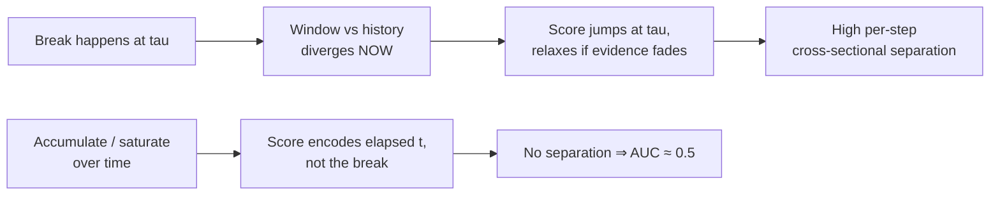
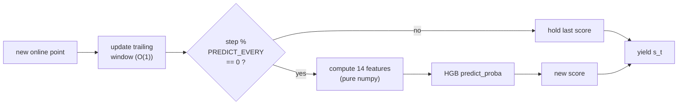

# Structural Break — Real-Time (CrunchDAO)

Streaming structural-break detection. For each series we get a full `x_historical`
segment (no break) and an `x_online` segment revealed one point at a time. At every
online step `t` we emit a score `s_t ∈ [0,1]` = belief a break has already occurred.

**Metric — TS-AUC (Time-Stratified AUC).** At each step, AUC is computed *across
series* (label 1 if `t ≥ tau`), weighted by `w(t) = n_pos(t)·n_neg(t)`. Random = 0.5.
Because it is cross-sectional per step, scores that merely grow with `t` gain nothing —
only genuine per-step separation helps.

## Files

| File | Purpose |
| --- | --- |
| `streaming_detector.ipynb` | The submission notebook (supervised model). |
| `_exp_fast.py` | Standalone train + streaming-validation harness (measures TS-AUC and infer speed). |
| `_val_harness.py` | **Robust multi-fold** validation harness: per-candidate mean±std across K disjoint folds + paired deltas vs base (the noise-aware decision tool, see below). |
| `baseline.ipynb` | Original EWMA baseline from the competition. |
| `data/` | Local train/test parquet files. |

## Model (current submission)

Per online step, a trailing window (`WINDOW=75`) is compared to the historical segment
via 14 two-sample features, and a `HistGradientBoostingClassifier` maps them to a break
probability. Features are recomputed every `PREDICT_EVERY` steps and held between.

Features: `mean_z, log_var_ratio, ks, skew_diff, kurt_diff, ac1_diff, ac2_diff,
iqr_ratio, tail2, tail3, zero_cross, slope_norm, spec_centroid_diff, rng_ratio`.

Key config: `WINDOW=75, MIN_N=15, HIST_CAP=200, PREDICT_EVERY=1, MAX_ITER=200,
STEPS_PER_SERIES=10, MAX_TRAIN_SERIES=10000, SEED=42`.

## Validation methodology

Feature decisions are made with `_val_harness.py`, **not** a single val split. It trains
one model per candidate feature set on a fixed training pool (disjoint from every fold),
evaluates each on `N_FOLDS=5` disjoint `FOLD_SIZE=400`-series folds, and reports:

* **per-fold TS-AUC + mean + std** — the std is the *noise floor*;
* **paired delta vs base** on the same folds, with `t = mean_delta / (std_delta/√K)`.

**Decision rule:** only port a change to the notebook when its paired mean gain clearly
exceeds the noise floor (target `|t| ≥ 2`, gain > fold std). This exists because E8's
+0.006 single-split "win" was ~4× smaller than the fold-to-fold noise and *reversed* on
the leaderboard. Streaming is parallelised across series (joblib, BLAS capped to 1).

*First run (5×400 folds, 6000-series pool):* base `mean 0.5511, std 0.0125` (same model
swings 0.5402→0.5708 across folds); the E8 split features scored `+0.0009 (t=0.31)` —
decisively **noise**. The harness would have rejected split *before* submitting it.

## Experiment log

| # | Approach | Result | Notes |
| --- | --- | --- | --- |
| E0 | EWMA z-score baseline (submitted) | **LB 50.65%** (rank 388) | Only reacts to mean shifts; blind to variance/shape/dependence. |
| E1 | Unsupervised (KS + variance + mean, noisy-OR) | ~0.518 local | Marginal-distribution stats miss autocorrelation/stationarity breaks. |
| E2 | Unsupervised CUSUM / monotone-accumulating variants | ~0.50 local | *Worse.* Saturating/accumulating scores destroy cross-sectional separation. |
| E3 | Supervised HGB, 14 two-sample features (scipy) | **TS-AUC 0.5701** (800 val series) | Best score, but too slow → submission timed out (exit 124). |
| E4 | E3 rewritten: pure-numpy features + single-thread + fewer trees | **TS-AUC 0.5636**, ~10× faster infer | Speed fix, negligible score change. |
| E5 | Cap threads at call time (`threadpool_limits`) + raise parallelism | **LB 55.30%** (rank 296/1144) | Fixed the 5 h+ cloud hang; ran fast, determinism check passed. |
| E6 | `PREDICT_EVERY` 15 → 1 (predict every step, no staleness) | **LB 55.48%** (rank 289) | Free win, +0.18 pt. 31 min on 16 vCPU. Local 0.5636 → 0.5663. |
| E7 | Train on all 10000 series (`MAX_TRAIN_SERIES` 6000 → 10000), keep 10 steps/series | **LB 55.94%** (rank 268) | +0.46 pt. Trained 9934 series/98.8k rows; parallelism 15; 42 min. |
| E8 | +3 recent-vs-older split features (window halves) | **LB 55.70%** (rank 269) — *reverted* | Local +0.006 but LB **−0.24 pt** vs E7. 400-series val was misleading; rolled back to 14 feats. |
| E9 | Robust/rank-based stats (median/MAD, Mann–Whitney, Brown–Forsythe) via 5×400-fold harness | **all within noise** (best t=+0.19) — *not shipped* | Redundant with existing KS/`mean_z`/`log_var_ratio`. No submission; harness caught it locally. |
| E10 | HGB hyperparameter grid (108 configs, GroupKFold row-level proxy) | best +0.0013 proxy AUC — *not shipped* | Model isn't the bottleneck; gain under proxy noise. |
| E11 | Window geometry: `WINDOW` 75 → 130 | **LB 56.63%** (rank 235) | +0.69 pt, +33 ranks — biggest single jump. Infer cost ~identical (free). 10-fold Δ +0.0110, t=+3.96. |
| E12 | Overnight 40-candidate feature battery (5×400 folds @ W75) | 3 ship-grade: `runs` t=2.48, `combo_volatility` t=2.40, `spec_entropy` t=2.39 | Winners cluster by family (run/level-crossing, complexity/spectral). Re-confirm at W130 before shipping. |
| E13 | Re-confirm E12 winners at WINDOW=130 (10 folds); ship `spec_entropy` (15th feat) | **LB 56.84%** (rank 229) | +0.21 pt, +6 ranks. `runs` (t=0.81) and `combo_volatility` (t=0.41) **collapsed at W130** — window-specific artifacts. Only `spec_entropy` held (t=+4.67). |
| E14 | Ship `perm_entropy` (order-3, 16th feat) on promising single-feature signal | **LB 56.75%** (rank 229) — *reverted* | −0.09 pt vs E13; sub-threshold bet (t=+1.93) didn't transfer. Reverted to 15 feats. Spectral-shape family (`spec_flatness/rolloff/spread/peak`) all noise on top of `spec_entropy`. |
| A | Lever A: per-series score calibration (sub/z early-window baseline, causal expanding median) | **all negative** (best t=−2.49) — *not shipped* | Pooled-trained `predict_proba` is already cross-series-comparable; de-meaning removes signal. Under TS-AUC only better within-step *ordering* helps → pursue changepoint localisation (Lever B). |
| B | Lever B: within-online max-split changepoint features on base15 @W130, 10 folds (`max_split_t`/`lr`/`var`/`pos` + combo) | **all noise** (best `max_split_var` t=+0.95) — *not shipped* | Self-normalized within-window supremum stats (Chow/LR/var/position). Smoke t=+4.34 (`max_split_t`) was a 2-fold artifact → collapsed to t=−1.37 at 10 folds. The 130-window vs-history features already capture the mean/var shift; within-window split is redundant. |
| E16 | WINDOW re-sweep on base15, 10 folds: W=130 (base) vs 160/180/200/250 | **W=130 optimal** — *no change* | W=160 +0.0016 t=+0.54 (noise); 180 −0.0042 t=−1.81; 200 −0.0018; 250 −0.0011. Champion window confirmed at the plateau top; larger windows don't ship. |
| E17 | Multi-scale: base15 features computed on nested trailing sub-windows and concatenated, 10 folds paired vs base15@130 | **LB 57.50%** (rank 214) — *CHAMPION* | `ms_60_130_250` shipped (Δ+0.0075 t=+3.06). +0.66 pt, +15 ranks vs E13 — biggest single jump since WINDOW=130. Scales (60,130,250) → 45 feats @ buffer W=250. Also SHIP in CV: `ms_40_130_250` (t=+2.27), `ms_40_130` (t=+2.02). First representational lever to pay off — short (responsive) + champion (130) + long (slow) views of the same series-vs-history contrast. |
| E18 | Full-online-vs-history: add UNBOUNDED scale (base15 over entire online-so-far) on top of champion, 10 folds paired vs `ms_60_130_250` | **all noise** (best `ms_60_130_250_full` t=+0.51) — *not shipped* | Unbounded scale via BIG buffer + FULL sentinel. `ms_60_130_250_full` (60f) Δ+0.0035 t=+0.51 (higher raw mean 0.5829 but fold-inconsistent); `ms_60_130_full` (45f) t=−0.13; `ms_130_full` (30f) t=−0.72. The trailing 250 view already captures post-break evidence; the growing full-online contrast is dominated by stale pre-break points and adds no reliable signal. Full-online lever dead. |
| E19 | Scale-set sweep: alternative multi-scale sets vs champion `ms_60_130_250`, 10 folds (4th scale / different spacing / longer top: `ms_40_60_130_250`, `ms_60_90_130_250`, `ms_60_130_190_250`, `ms_60_100_160_250`, `ms_40_90_160_250`, `ms_60_130_250_350`) | **all noise** — *no change* | No alternative scale set beats (60,130,250). Adding a 4th scale, re-spacing, or extending the top scale all wash out. Also confirmed on LB: probe `ms_40_130_250` = 57.38%/216 (worse). Champion scale set confirmed; representation saturating. |
| E20 | Feature-space distances: anomaly of the 45-dim multiscale vector (Mahalanobis / QDA-LLR / std-Euclid / L1 / Linf, window-vs-history), 10 folds paired vs champion | **all noise** (best `maha` t=+0.73) — *not shipped* | `maha` Δ+0.0022 t=+0.73 (raw 0.5816 highest but fold-inconsistent); `seuclid` t=+0.26; `qda_llr` t=−0.70; `l1` t=−1.22; `linf` t=−1.89. Joint-covariance whitening adds nothing over axis-aligned GBT splits. Feature-space distance lever dead. |
| E21 | Two-sample distribution distances: window-vs-history Wasserstein-1 / energy / Cramér–von-Mises / MMD per scale, 10 folds paired vs champion | **best non-champion signal since E17, but below bar** (`ts_wass` t=+1.83) — *not shipped from CV* | `ts_wass` Δ+0.0026 t=+1.83; `ts_energy` t=+1.81 (≈collinear w/ wass — both CDF-gap integrals); `ts_cvm` t=+1.44; `ts_mmd` t=+0.87; stacking all (`ts_all`, 57f) dilutes to t=+1.07. Real distribution-shape signal exists but sits at t≈1.8, inside the CV↔LB gap. |
| E22a | Ship `ts_wass` (single strongest E21 distance) to LB | **LB 57.37% (rank 217)** — REVERSED, *reverted* | Wired `_w1` per scale → 48 feats, bit-exact vs harness. Lost −0.13 pt / −3 ranks vs champion despite CV t=1.83. **Now 0-for-2 on marginal features** (E14 perm_entropy t=1.93 also reversed). *** Hardened ship bar: do NOT spend an LB slot unless CV t≥~2.5 (ideally ≥3); the old t≥1.9 rule is retired. *** |
| E22b | `ts_cvm` (rank-based, orthogonal to wass) submitted as parallel LB candidate | **LB 57.40% (rank 218)** — REVERSED, *reverted* | CV t=1.44 (below even the retired bar) → lost −0.10 pt vs champion, as the hardened rule predicted. **Now 0-for-3 on marginal features** (perm_entropy t=1.93, wass t=1.83, cvm t=1.44 all reversed). Two-sample distances fully dead as ship candidates; champion stands. |
| E23 | Series-transforms: cumsum / diff / moving-std / abs-dev of the standardized series, each contrasted (mean_z, log_var_ratio, KS) window-vs-history per scale, 10 folds paired vs champion | **all noise** (best `tf_diff` t=+1.40) — *not shipped* | `tf_diff` Δ+0.0018 t=+1.40; `tf_cumsum` t=+0.53; `tf_mstd` t=−0.21; `tf_absdev` t=−0.32; `tf_all` (81f) dilutes to t=+0.53. These are exactly the 2nd-place solution's transforms — noise here because our problem is real-time/unknown-boundary. Series-transform lever dead. |
| E24 | Variance two-sample tests on top of champion: F-test / Brown–Forsythe Levene / Fligner–Killeen per scale, 10 folds paired vs champion | **all noise** (best `vt_fligner` t=+0.42) — *not shipped* | `vt_fligner` Δ+0.0013 t=+0.42; `vt_levene` t=+0.32; `vt_lev_fli` (51f) t=+0.13; `vt_ftest` t=+0.10 (baseline 0.5795). The 2-fold smoke `vt_fligner` t=15.33 was a pure small-fold artifact (→ 0.42 at 10 folds) — reconfirms smoke deltas are worthless. Robust variance tests redundant with the existing `log_var_ratio`. |
| E25 | Large feature bank + importance selection (Option A): champion base45 + boundary-agnostic families {Hurst, AR(4), Anderson–Darling, Levene, Fligner, Mood, sample-entropy} ×3 scales (75 feats), ExtraTrees Gini selection (keep base + new features ≥ weakest-base importance), 10 folds paired vs champion | **noise** (0.5759 vs 0.5795, Δ=−0.0036, **t=−1.04**, slightly worse; 71.7 min) | Replicated the top solutions' *structural* recipe (large bank + selection). Selection kept all 30 new features (AR(4)/sampen/variance-tests rank high alongside base), yet the 75-feat model did **not** beat the 45-feat champion — it was marginally worse. Strong evidence the trailing-window paradigm is **saturated**; no feature-bank path clears the bar. → bank the champion. |
| E26 | **Paradigm search** — change the training *target* (frozen champion feats): ramp regression `clip((t-τ)/H,0,1)` + deweight-near-τ sample weights vs champion binary classifier, 10 folds | **noise** (ramp20 t=+0.68, deweight20 t=+0.59, ramp40 t=−0.50; all vs 0.5795) | Target-shaping does not move the ranking metric. Dead lever. |
| E27 | **Paradigm search** — scale/diversify training *data* (breadth vs depth, E7): N_TRAIN ∈ {6k, 10k, MAX} ×10 steps + depth control 6k×20, fixed val folds, champion feats+model | **dead / exhausted** (breadth impossible; depth t=+0.82 noise) | Dataset = 10 000 series; 10-fold×400 val reserves 4 000 → **MAX_TRAIN = 6 000 = exactly what the champion already trains on**. The breadth configs capped back to 6 000 (Δ=0, t=+inf artifact); the smoke's 9 920 was an artifact of the tiny 2-fold val reservation. No more data to add without shrinking validation. Depth (2× steps/series) = noise (matches E7). |
| E28 | **Paradigm search** — stateful *unsupervised* online detectors: CUSUM / Page-Hinkley / BOCPD (Gaussian const-hazard), per-step score ranked by TS-AUC vs trained champion, 10 folds | **far below champion** (cusum 0.5227 t=−11.6, page-hinkley 0.5202 t=−10.2, bocpd 0.5427 t=−6.8 vs 0.5795) | Stateful online detectors as standalone rankers are much weaker than the trained model. BOCPD is the best of them but still ~0.54 alone — too weak to help as a feature given the saturation evidence. Dead lever. |
| E29 | **Paradigm search** — winners' toolchain: LightGBM + gain selection. A) LGBM vs HGB on champion feats (model swap); B) bank (champion + Hurst + AR(4)) → LGBM gain>0 select → LGBM, 10 folds | **noise / worse** (A model-swap t=−2.18 worse; B bank+select t=−1.03; vs 0.5795) | LightGBM did not beat HistGBM on our features, and the bank→gain-select path was noise. Confirms the 7pt gap is **problem structure** (2025 known-boundary offline vs 2026 real-time unknown-boundary), not toolchain. The smoke SHIP (t=+2.68) fully evaporated — textbook "never trust smoke". |
| E30 | **Ensemble + tuning** — HGB champion ⊕ LogisticRegression blend, tune both. New validation: fixed-train 80/20 stratified (8000 train / 2000 val, 10 folds × 200, per-fold break-rate ≈0.497). LR default + C∈{0.1,0.3,1,3}+balanced; HGB grid 7 configs; blend weight sweeps; best×best blend | **all noise / worse** (LR alone 0.5322 t=−4.91; best HGB `msl40` +0.0004 t=+0.33; every blend ≤0, best w_lr=0.2 t=−0.68; best×best t=−0.01; vs champion 0.5674) | LR adds **no orthogonal signal** — blending it in only degrades monotonically, so HGB already captures the linearly-separable structure. HGB tuning is **dead-flat** (7 configs within ±0.0004). Model/ensemble axis is exhausted; the ceiling is the feature signal, not the model. Dead lever. |
| E31 | **Sequence model + proper tuning** — (A) 1D-CNN over the raw history-standardized window (2×250, translation-invariant) vs champion, same folds/labels/TS-AUC; (B) randomized *joint* HGB search (24 configs) then 5-seed robustness re-confirmation | **both null** — CNN alone 0.5048 t=−6.62, every HGB+CNN blend negative; joint search "winner" `hgb#11` (lr0.047/it300/leaves31/msl40/l2=5/mf0.5) hit +0.0035 t=+3.51 on seed 42 but **NOT ROBUST** across independent seeds (delta +0.0016 mean, positive 4/5, t≥2.5 on 1/5 — selection bias from best-of-24) | The learned-representation lever fails: a CNN reading the raw window is *worse* than 45 engineered contrasts (the online window is short/noisy; hand features already extract the shift/variance signal). Proper joint tuning found no config that survives independent fold draws → the E30 flat-tuning verdict holds. Champion E17 stands. |
| E32 | **Multi-seed joint HGB tuning** (the principled fix for E31's selection bias) — sample 48 joint configs once, score each by *mean* paired-delta vs champion across 4 independent pool seeds {42,7,123,2024}; gate = positive on all seeds AND mean ≥ 0.0015; then confirm the winner on 4 *fresh* disjoint seeds {31337,2025,555,99} | **LB 57.72% (rank 210) — NEW CHAMPION** | Robust winner `{lr 0.0211, max_iter 400, max_leaf_nodes 63, min_samples_leaf 10, l2 1.0, max_features 0.5}`: search-seed mean_d +0.0038 (positive 4/4), fresh-seed mean +0.0019 (positive 4/4) → **positive on 8/8 independent splits**. +0.22 pt vs old champion 57.50%/214, and beats the seed-ensemble (57.63%). Direction = slow-lr + many-trees + feature-bagging + deeper trees = generalization-friendly boosting; transfers where marginal features didn't. Single model (infer ~2× champion). Shipped as `streaming_detector_tuned.ipynb`. First robust win of the tuning arc. |
| E32-seedens | Seed-ensemble of the champion (K=5 HGB, avg proba) submitted in parallel | **LB 57.63%** (was 57.50%) | +0.13 pt from pure variance reduction. Local harness was a "HOLD" (mean +0.0026, 2/3 seeds) yet still gave a small **real** LB gain → confirms the local harness is *directionally predictive* for small positive deltas. Superseded by E32 tuned. |
| E33 | **LambdaMART / rank objective** — LGBMRanker (group = online step `t`) with `lambdarank` + `rank_xendcg`, dense-60 vs sparse-10 sampling, LGBM pointwise control, vs *old* champion HGB, 4 pool seeds | **biggest local signal since E17** — `rankxend_dense` mean_d +0.0159 (positive 4/4), min +0.0087, t=+2.69; pointwise control +0.0057 (toolchain adds a little, but the rank *objective* adds ~+0.010 more) | Real train/metric-mismatch signal (TS-AUC is per-step ranking; we always trained pointwise). Caveats: baseline was old (not tuned) champion, and winner was best-of-4 → must re-baseline vs tuned + confirm on fresh seeds (→ E34). |
| E34 | **Confirm rank objective vs the *tuned* champion on fresh seeds** {31337,2025,555,99} | **FAILED gate** — `rankxend_dense` mean_d +0.0080, min −0.0058, t=+1.33, positive **not** all seeds (negative on 555); `lambdarank_dense` +0.0083, min −0.0007, t=+1.35 | E33's +0.0159 was inflated by best-of-4 selection **and** a weaker old baseline. True rank-objective effect vs the tuned champion ≈ +0.008 but **not robust** → standalone rank dead as a champion replacement. Only remaining use of the rank signal = a rank-*average* ensemble with the tuned HGB (→ E36). Lesson: always re-baseline levers vs the *current* champion on fresh seeds. |
| E35 | **Feature re-eval vs the tuned champion** (night run, 3.7 h) — re-screen the whole battery (53 candidates: 47 EXTRA singles + 6 combos) added at scales 60/130/250 on top of the 45-feat champion, tuned params, 4 seeds | **all noise** — zero CONFIRM; best `max_split_lr`/`spec_peak` +0.0024 mean_d, t≈0.9; only 5 candidates positive 4/4, all t<1.0 | Feature-**addition** lever exhausted under *both* the default and the tuned model — the 45-feat champion already extracts the available single-feature signal, and tuned params did not resurrect any rejected feature. Remaining levers are structural/model-level (ensembles), not feature-level. |
| E36 | **Rank + tuned ensemble** — rank-average the tuned-champion HGB proba with an LGBM `rank_xendcg` (dense-60) raw score; per fold blend `w·rank(hgb) + (1−w)·rank(ranker)`, sweep w, 4 pool seeds {42,7,123,2024} | **BLOCKBUSTER (local) — every weight 0.8→0.3 CONFIRM (positive on all 4 seeds)** | mean_d +0.0067 (w0.8) → +0.0139 (w0.3); mean_t +5.22→+3.43; min_d +0.0040→+0.0075; sweet spot ~w0.5 (mean_d +0.0128, t 4.22, min_d +0.0073). Biggest signal since E17. Works where standalone rank (E34) failed: the champion anchors, the decorrelated listwise ranker corrects within-step orderings → variance reduction turns a non-robust +0.008 model into a robust +0.007–0.014 blend. **Ship caveat:** the harness uses a *live* per-fold global rank (not available at inference); the deployable form replaces it with each model's *fixed empirical CDF from training scores* (`w·F̂_hgb + (1−w)·F̂_rank`). **Confirmed on fresh seeds {31337,2025,555,99}:** the fixed-CDF blend transfers ~losslessly (FIX_mean_d tracks the live rank to 3 dp) — w=0.6 mean_d +0.0080, min +0.0018, t +3.07, positive 4/4; w=0.5 mean_d +0.0086, min +0.0009, t +2.60, positive 4/4 (both `*** CONFIRMED (ship) ***`; w=0.4 positive only 3/4). → build the ensemble submission notebook at w≈0.6. **SHIPPED at w=0.6 → LB 58.78% (rank 176) — NEW CHAMPION, +1.06pt & +34 ranks vs tuned HGB (57.72%/210): biggest single jump of the arc.** Local fixed-CDF mean_d ~+0.008 → +1.06pt LB (harness directionally predictive; decorrelated members transfer strongly). lightgbm installed fine on cloud. |
| E37 | **ARCH / volatility-clustering feature** — `f_arch` = [autocorr(r², lag1), Σ_{k≤5} autocorr(r²,k)²] over the 3 scales (+6 cols), targeted paired test vs tuned champion, seeds {42,7,123,2024} (`FEAT_ONLY` filter added to `_feat_reeval.py`) | **NOISE — rejected** | mean_d −0.0002, min −0.0054, mean_t −0.04, positive 2/4; signs flip across seeds. Confirms E35 feature saturation — volatility clustering adds nothing on the 45-feat champion. Do not revisit ARCH-family. |
| E38 | **RandomForest member** — `RandomForestClassifier(n_estimators=400, max_features=sqrt, min_samples_leaf=5)` on the 45 champion feats; blended (proba-avg) with the tuned HGB, paired-t vs tuned-HGB-alone, 8 independent seeds | **CONFIRM on 8/8 seeds — decorrelated member** | pool {42,7,123,2024}: hgb_rf 0.5/0.5 mean_d +0.0064 t+2.92 4/4, hgb_rf_30 0.7/0.3 +0.0044 t+3.21 4/4. Fresh {31337,2025,555,99}: hgb_rf +0.0058 t+2.81 4/4, hgb_rf_30 +0.0040 t+3.25 4/4. RF *alone* ~beats tuned HGB (pos 8/8). Bagging genuinely decorrelates from boosting (contra E30 expectation). **Caveat:** tested vs HGB-alone with raw proba-avg; open question = does RF add on top of the *ranker* in the shipped CDF-blend (step 2, 3-member ensemble). |
| E39 | **RF as 3rd member of the shipped CDF-blend** — faithful fixed-CDF percentile blend `w_hgb·F_hgb + w_rank·F_rank + w_rf·F_rf` (mirrors E36 ship computation + RF ref); sweep 3-member weights, paired-t vs the **shipped 2-member champion** (0.6/0.4), seeds {42,7,123,2024} | **SUB-THRESHOLD — RF DROPPED as a member** | HGB-heavy sets ~+0.0002 t~0.2 (not pos_all, noise); near-equal 0.36/0.34/0.30 +0.0013 min +0.0007 t+2.04 pos 4/4, 0.34/0.33/0.33 +0.0014 min +0.0007 t+1.95 pos 4/4 — both positive 4/4 but **below the hardened gate** (mean_d≥0.0015 & mean_t≥2.5). Key insight: RF gave +0.006 (t2.9) vs HGB-*alone* but only +0.0014 (t2.0) on top of the *ranker* → ~80% of RF's value overlaps with the ranker (both = variance-reduced within-step ordering); confound: best sets shifted HGB 0.6→0.34, shrinking RF's true marginal further. Not worth the 400-trees/step infer cost. **Lesson:** a member confirmed vs one base can be redundant vs a stronger ensemble — always re-baseline vs the *current* champion. Remaining levers: tune the LGBM ranker (never tuned), 2-member weight (0.5 vs 0.6), scale-specialization diversity. |
| E40 | **Tuning the LightGBM ranker member** — random search over 24 ranker configs (n_estimators 200–800, learning_rate 0.02–0.08, num_leaves 15–63, min_child_samples 10–80, reg_lambda, colsample, subsample), each scored in the faithful fixed-CDF 2-member blend at weights {0.5, 0.6}, paired-t vs the shipped champion, 4 pool seeds | **NO config beats the champion — ranker already near-optimal at defaults** | Aggressive params (learning_rate 0.08 / 800 trees) consistently **negative** (overfit: e.g. it800/lr.08 mean_d −0.0049 t−2.1). Best "promising" configs (cfg22 mean_d +0.0030 t1.32; cfg20 +0.0021 t2.24; cfg15 +0.0019 t2.03) are all *positive-on-4/4 but below the gate*, and **every one picked weight 0.5** — their gain is the blend-weight shift, not the params. The default ranker at weight 0.5 alone gives mean_d +0.0014, min +0.0006, t +2.31, positive 4/4. **Conclusion:** ranker hyperparameters do not help; the real robust lever is the **blend weight (0.6 → 0.5, more ranker weight)**. → fine weight sweep (`_weight_sweep.py`, 0.30–0.65, all 8 seeds) to pin the optimum, then ship a one-line `BLEND_W` change. |
| E41 | **Fine 2-member blend-weight sweep** — fit the two shipped members once/seed, re-blend fixed-CDF percentiles at weights 0.30–0.65 (no refitting), paired-t vs shipped 0.60 across **all 8 seeds** {42,7,123,2024,31337,2025,555,99} | **NO ship — w=0.5 signal did NOT generalize; keep 0.60** | 6/8 seeds favor more ranker weight, but two fresh seeds (2025, 555) go **negative** at low weight. Best (w0.30–0.40) mean_d +0.0014 but **min_d −0.0033…−0.0019, not positive on all seeds, t ~0.7–1.1**; w0.5 mean_d +0.0010, min −0.0008, t +1.49. No weight clears the hardened gate. The 4-pool-seed w=0.5 win from E40 was pool-specific — the 8-seed test correctly caught it. **Decision: keep shipped w=0.60 (robust compromise).** Ranker-tuning arc concluded: the ranker is optimal at defaults *and* the weight is already well-chosen. |
| E42 | **Residual lens (the paradigm break)** — a structural break shows up first as a *reference model's residuals blowing up*. Fit `AR(p)` on the historical segment, apply forward onto the trailing online window, add `log( var(window residuals) / var(reference-fit residuals) )` per order to `champion_feat` (both members consume it); paired-t vs the shipped E36 2-member champion, 2-stage seed gate (search {42,7,123} → fresh {31337,2025,555,99}). Also `STEPS_PER_SERIES` 10→30 | **LB 60.56% (rank 133) — NEW CHAMPION, +1.78 pt & +43 ranks vs E36 (58.78%/176): biggest single jump of the whole arc** | Shipped `AR{1,2,3,4}` var-ratio (+4 feats) + STEPS=30. Search mean_d **+0.0191** (min_t 4.13, 3/3); fresh mean_d **+0.0151** (pos 4/4, min_t 2.30) — fresh magnitude ≈ search = a *real* feature, not seed luck. Local +0.011 → LB **+0.018** (amplified). **This overturns the E25/E35 "trailing-window paradigm SATURATED" verdict** — the ceiling was the raw window-vs-history *lens*, not the paradigm; comparing under a fitted-model residual is a genuinely new representation. **Ablation:** the signal is ~1-D "model-surprise magnitude" and lives almost entirely in the *variance ratio* (mean-shift/ACF/Ljung-Box/CUSUM/outlier all noise alone); richer reference sharpens it (`ar4`≫`ar1`, `ar8_only` alone ≈ whole block). **Model bank (rw/trend/EWMA/mean):** no non-AR *linear* reference adds orthogonal signal (constant-mean ≈ existing `log_var_ratio`); AR best-whitens the dynamics. **Follow-ups (in flight):** `ar8_only` fresh-confirmed +0.0208 (min_t 2.72) = parsimonious ship *upgrade* candidate; overnight sweep of AR-order sets / multi-scale residual / robust-MAD / GARCH-lite reference, all fresh-gated. |
| E43 | **Tuning the random forest as a 3rd member** — random search over 20 forest configs (n_estimators 300–800, max_depth, max_features {sqrt/log2/0.3/0.5}, min_samples_leaf/split, max_samples, class_weight), each in the faithful 3-member fixed-CDF blend at near-equal weights, paired-t vs the shipped 2-member champion. *(Parallel-branch exploration run against the pre-residual E36 2-member champion (58.78%), concurrent with the E42 residual-lens line.)* | **NO config clears the gate — random forest DROPPED for good** | Run died mid-seed-2024 when the machine restarted; reconstructed from 3 full seeds {42,7,123} (`_parse_forest.py`). Best config (cfg15) mean_d +0.0014, min +0.0004, **t +1.69**; best t of any config +2.02 — all below the gate (≥0.0015 & t≥2.5). `class_weight=balanced_subsample` configs almost all **negative**. **Tuning bought nothing**: best tuned forest (+0.0014) equals the E39 untuned default (+0.0014). Seeds 42 & 7 cap the best configs at ~+0.0007 — the random forest is genuinely redundant with the ranker and tuning does not rescue it. Given a fair, thorough shot and dropped. Remaining lever: scale-specialization diversity. |
| E44 | **Scale-specialization diversity as a 3rd member** — a scale-specialist gradient-boosting member (average of single-scale models on the 60/130/250 window views) added to the fixed-CDF blend at near-equal weights, paired-t vs the shipped 2-member champion, 4 seeds; variants `scale_avg` and `scale_plus_full` | **NOISE — dropped; last lever closed** | scale_avg mean_d −0.0001, min −0.0020, t −0.13; scale_plus_full mean_d −0.0001, min −0.0014, t −0.26. Signs flip across seeds (42 & 7 negative, 123 positive, 2024 ~0), netting ~zero, not positive on all seeds. A single-scale gradient-boosting view is redundant with the full-45 member + ranker. Feature-subspace decorrelation adds nothing over the 2-member blend. |
| E45 | **Trajectory GRU as a decorrelated 3rd member** — a causal GRU over the *sequence* of per-step 45-dim window-vs-history vectors (the only stateful member; integrates the temporal persistence of a break), trained on **dense** per-step trajectories (~1.4M supervised steps/seed vs the gradient-boosting member's 10 snapshots), added to the fixed-CDF blend at 6 weight sets, paired-t vs the shipped 2-member champion, seeds {42,7} | **NO ship — parked "needs more juice," not dead** | Seed 42: best blend 0.36/0.34/0.30 mean_d **+0.0033, t +2.11**, positive at *every* weight — a genuine decorrelation signal (unlike the random forest / scale members). Seed 7: **all weights negative** (−0.0010…−0.0027). 2-seed summary best mean_d +0.0010, **min −0.0014, not positive on all seeds** → below gate. The one member that showed real per-seed lift; a stronger GRU (more epochs/width, GRU-specific features, seed-ensemble) is the natural follow-up. |
| E46 | **Steps-per-series sweep (utilize more training data)** — refit the tuned gradient-boosting member at snapshot densities {10,15,20,30,50} per training series (monkeypatch `STEPS_PER_SERIES`), re-blend against the fixed ranker at the shipped 0.6/0.4, paired-t vs the shipped `STEPS=10` champion | **NO ship (feature-free) — pool promise was seed-luck; keep STEPS=10 for the 2-member blend** | Pool {42,7,123,2024}: **every** density positive on all 4 seeds (steps=15 mean_d +0.0021 min +0.0009, steps=30 +0.0019) — looked like the first pool-consistent lever of the arc. **Fresh-seed confirm {31337,2025,555,99} failed**: steps=15 mean_d −0.0006 min −0.0026, steps=30 −0.0005, not positive on all seeds (seed 2025 −0.0026, seed 99 −0.0025). The adversarial fresh seeds (same ones that killed the E41 weight sweep) correctly caught it. **Confirms E7 generalizes — denser snapshot sampling hurts the tabular member via correlated rows.** *(Partly superseded by E42: once the AR residual features are added, `STEPS=30` fresh-confirmed and shipped as part of the champion — the denser sampling pays off only in the presence of the stronger feature.)* Reinforces: 4/4 pool-positive is meaningless without fresh-seed confirmation. |
| E47 | **Stronger trajectory GRU (seed-ensemble + capacity)** — E45 follow-up attacking its variance: average **3** independently-initialized GRUs per seed into one member before the CDF blend, wider hidden (128 vs 64), output dropout + weight-decay, 18 epochs; same 3-member blend, seeds {42,7} | **NO ship — genuine pool disagreement, not variance** | Seed 42 got **stronger** than E45 (best blend 0.34/0.33/0.33 mean_d **+0.0060, t +2.97**; 0.36/0.34/0.30 +0.0058, t +3.20 — SHIP-hard), but seed 7 **stayed negative** (−0.0016…−0.0035). Summary best mean_d +0.0018, **min −0.0021, not positive on all seeds**. The seed-ensemble made seed 42 bigger yet did **not** flip seed 7 — so the E45 42+/7− split is a real cross-pool disagreement (the GRU decorrelates on some data draws, anti-aligns on others), not fixable by ensembling. Reframed the failure (per-series heterogeneity + fixed global weight) → reopened the thread as a gating problem (E48). |
| — | **Repo review — BoNing-Gu 2025 5th-place (AUC 0.888, *offline* task)** | *No port; reinforces strategy* | Their win = exhaustive two-segment (known-boundary) statistical features [distribution stats, 2-sample tests KS/AD/Mann-Whitney/Levene/Bartlett/ADF/KPSS, cumsum-shape, entropy/complexity family, AR cross-prediction residuals, tsfresh, ruptures costs] × {left, right, whole, diff, ratio, contribution} + correlation prune + permutation-importance filter + **top-10 feature interactions** (86 features) + GBM. Their **deep learning** (U-Time segmentation, PatchCrossEncoder) **lost at 0.792**. Lessons for the 2026 real-time task: (1) confirms DL is not a slam-dunk here; (2) their feature machinery assumes a known boundary so it doesn't port, and many of these exact features already reversed on our real-time leaderboard (entropy, ADF/KPSS, Wasserstein/energy, ruptures costs = E14/E21/E22/E24/E28); (3) U-Time's soft Gaussian boundary label is close to our already-dead ramp-shaping (E26); (4) the one real-time-legal untried nugget is an **AR cross-forecast residual** feature (fit AR on history, forecast the online window, measure residual blow-up) — low prior at the time. **↳ This exact nugget became the E42 residual-lens champion (+1.78 pt) — the "low prior" review item turned into the biggest jump of the arc.** |
| E48 | **GRU gating diagnostic — is the GRU's value per-series heterogeneous?** — reopened the GRU thread on the hypothesis that its ~net-zero fixed-weight contribution hides real per-series lift + hurt. Exact per-series concordant-pair marginal decomposition of the 3-member vs 2-member blend, seeds {42,7}, 3976 series; screened label-free separators (RevIN scale, AR cross-forecast, member-disagreement, GRU-confidence) for *which* series the GRU helps | **Hypothesis CONFIRMED — value is per-series heterogeneous; RevIN + AR separators DEAD** | GRU helps 57.8% of series (Σ +0.098) and hurts 42.2% (Σ −0.098) → near-perfect annihilation, which is exactly why any fixed global weight nets ~0 (E45/E47). Oracle (perfect gate) ceiling +0.098. Best separators: member-disagreement `bias_gru_gb` (sign-AUC 0.619), `gb_mean`, `onl_len` (Spearman +0.143); RevIN-scale + AR separators all ~0.50 (dead → scoped out). A realizable 5-fold-CV gate reached OOF sign-AUC 0.69. → build a real gated blend. |
| E49 | **Gated 3-member blend (per-series gate)** — HGB gate on the label-free separators switching each series between 2-member (GRU off) and 3-member (GRU on), cross-fold honest, real TS-AUC; thresholds {0.50,0.55,0.60}; fresh-seed confirm {31337,2025,555,99} | **+0.0044 on 6/6 seeds at thr 0.60 — BUT uses lookahead → NOT deployable** | Full gate positive on all 6 seeds at thr 0.60 (mean_d +0.0044, min +0.0022; rescues the seeds where the fixed 3-member blend was negative), monotone in threshold. **Caught before building the notebook:** the separators (`onl_len`, whole-series `onl_std`, trajectory-wide GRU/agreement stats, AR over the full online window) all depend on FUTURE online points, but the task reveals `x_online` one point at a time — so the per-series gate is lookahead and cannot ship. The leak is localized to the gate's features; the 3 members are causal. **Lesson:** verify the causality/deployment contract *before* building a notebook from a promising harness result. → redesign as a causal per-step gate. |
| E50 | **Causal per-step gate (the only deployable form)** — decide `w_gru(t)∈{0,0.30}` per online step from EXPANDING (causal) separators only (running member-disagreement, GRU confidence/entropy, steps-seen); per-step marginal target; cross-fold honest gate on rows, real TS-AUC; 6 seeds; thresholds {0.50–0.65} (`_gru_gate_causal.py`) | **FAILED — GRU line CLOSED for good** | The causal separators actually *predict better* than the lookahead ones (OOF-AUC 0.71 vs 0.66) — the gate genuinely knows which steps help — yet it does **not** convert to TS-AUC: every threshold net-negative (thr 0.50 mean_d −0.0010), positive on only 2/6 seeds. A per-row marginal (one series flipped, others held) is a poor proxy for a hard per-step gate that flips many series at once; the winner/loser mass (+0.098/−0.098) annihilates under the cross-sectional rank metric. **Three independent tests now agree the GRU's value is real but causally unexploitable** (fixed weight ≈0, E45/E47; lookahead gate illegal, E49; causal gate fails, E50) → GRU dropped as a member; champion stays the E42 residual-lens blend (60.56%). |
| E51 | **Explicit feature interactions on the residual champion** — 9 pairwise product-column blocks appended to *both* blend members on top of the frozen 49-col residual champion (residual×{var,ks,mean} at scale 250, residual², per-scale var×ks and mean×var, cross-scale var/ks persistence), re-baselined vs the champion, real fixed-CDF TS-AUC, paired-t, screen {42,7,123} (`_interactions.py`) | **NO ship — interaction axis CLOSED** | Every block noise: best `ks_cross_scale` mean_d −0.0003, worst `mz_x_lvr` −0.0014; none positive on all seeds, nothing reached fresh-confirm. Confirms the low prior — gradient boosting already captures these interactions implicitly via tree splits, so explicit product features only dilute. (Motivated by the BoNing-Gu 5th-place "top-10 interactions"; that gain was an *offline* artifact.) |
| E52 | **Transform-lens bank (2025 2nd-place idea, made causal)** — recompute champion-style contrasts on cheap deterministic *transforms* of the window-vs-history, appended to the frozen residual champion: `cusum` (standardized CUSUM max/end/range), `pit` (dense-rank / empirical-CDF of window vs history), `abslens` (\|value\| mean/var ratio), `rollstd` (rolling-std(16) level + vol-of-vol), `levene` (Brown-Forsythe F), and their union; all causal + deployable; screen {42,7,123} → fresh-confirm {31337,2025,555,99} (`_transform_lens.py`) | **NO ship — transform-lens axis noise; #wide-bank-select prior lowered** | Every individual lens noise on screen (cusum −0.0005, pit −0.0018, abslens −0.0004, rollstd +0.0014 2/3, levene −0.0009). Only the 11-feature **union** screened positive (+0.0024, 3/3) → fresh-confirmed to **+0.0022 but only 3/4 positive, min_t −0.01 → noise** (a quarter of the ~+0.008 that maps to +1pt LB, and not robust). The cheap transforms that won the *offline* 2nd-place solution add nothing over our contrasts + AR residual in the causal cross-sectional setting — and the weak, non-robust union caps the expected payoff of a wider transform-bank + SHAP/gain selection. Reinforces E42's lesson: the *fitted-model residual* was the exception because it is a genuinely different representation; deterministic restatements are exhausted (cf. E9). |
| E53 | **Local / recent-reference contrast (new reference definition)** — instead of window-vs-history, contrast the most-recent online segment against the immediately-preceding online segment of equal length (a within-online abrupt-change detector); scales L∈{30,60,120}, each contributing mean-shift / log-var-ratio / KS; appended to the frozen residual champion; causal; screen {42,7,123} (`_local_ref.py`) | **NO ship — local-reference axis noise** | Base 0.6057 (calibrated). Every scale block noise (loc30 +0.0000, loc60 +0.0003, loc120 +0.0004); the 9-feature union was +0.0013 (3/3 but min_t +0.26) — below the 0.0015 promotion bar, so it never reached fresh-confirm. The break sits **at** the boundary, so a within-online contrast is only weakly aligned with the label; window-vs-history remains the correct reference. Confirms the reference-definition space is well covered by the champion's multi-scale window-vs-history. |
| E54 | **Multi-scale residual lens** *(residual-feature line — a prior LB champion, superseded by E56; re-recorded here after merges dropped it)* — apply the E17 multi-scale trick to the E42 residual: `AR8` residual variance ratio on trailing sub-windows 60/130/250 (+3 feats), fresh-gated | **LB 61.32% (rank 101) — was CHAMPION, +0.76 pt vs E42 (60.56%/133)** | Shipped `streaming_detector_residual.ipynb` (`AR_ORDERS=(8,)`, `RESIDUAL_SCALES=(60,130,250)`, `STEPS=30`). Fresh mean_d +0.0232 (min_t 2.75, 4/4) vs E42 single-scale +0.0151. Overnight: higher AR order saturates (`ar8`≈block); GARCH dead; robust-MAD weaker; multi-scale is the win. Progression E36 58.78 → E42 60.56 → **E54 61.32**. |
| E55 | **`ar8_only` single-feature probe** — the parsimonious fallback (AR8 residual var-ratio on the *full* window only, +1 feat) submitted as an LB calibration point vs the E54 multi-scale champion (`streaming_detector_ar8only.ipynb`) | **LB 60.73% — below E54 (61.32%), champion unchanged** | Confirms **multi-scale > single-scale on the LB** (local +0.0232 > +0.0189 held), and that the local→LB ordering is trustworthy. Above E42 (60.56%), below the multi-scale champion. **Next candidate (E56, fresh-confirmed +0.0303 vs +0.0232):** a *second* AR8 reference fit on the last 120 historical points — `streaming_detector_trail120.ipynb` (+6 feats). |
| E56 | **Reference-span family — trailing-history second reference** — add a 2nd AR8 reference for the multi-scale residual, fit on only the last 120 historical points (recent-history dynamics closer to the break); also tested returns (AR on Δx), AIC-order, trail250 alone/as-2nd-block; screen {42,7,123} → fresh {31337,2025,555,99} (`_residual_reffit.py`) | **LB 61.58% (rank 94) — NEW CHAMPION, +0.26 pt & +7 ranks vs E54 (61.32%/101)** | Shipped `streaming_detector_trail120.ipynb` (`REF_TRAILS=(None,120)`, AR8 var-ratio × scales 60/130/250 × 2 spans = +6 feats, 51 total). `ctrl+trail120` fresh mean_d **+0.0303** (min_t 2.89, 4/4) vs the champion's +0.0232 — ~+0.007 *orthogonal* (the recent-history reference catches what full-history misses). `returns`, `aic`, `trail250` all fresh-STRONG but ≈ the champion (same 1-D signal, not additive). Progression E42 60.56 → E54 61.32 → **E56 61.58**. Reference-*span* is a live family → sweep trail lengths next. |
| E57 | **Weight × STEPS retune with the residual feature present** — `w=0.60`/`STEPS=30` were tuned before the residual feature existed; re-sweep `STEPS∈{10,30,60}` × `w∈{0.40…0.70}` vs the shipped (30, 0.60), all 7 seeds (`_residual_wsteps.py`) | **NO change — (30, 0.60) already optimal** | Every alternative cell is noise (best `w=0.50` mean_d +0.0004, min −0.0011, *not* positive on all 7 seeds, min_t < 0); heavier ranker weight and denser/sparser sampling both wash out. The stronger feature set did **not** shift the blend-weight or step-sampling optimum → keep the champion config. |
| E58 | **Reference-span bank sweep** — on top of the E56 trail120 champion, sweep the 2nd AR8 reference-span length {60,90,120,200} and add 3rd/4th spans {full+120+60/200/250, full+60+120+200}; screen {42,7,123} → fresh {31337,2025,555,99} (`_residual_spanbank.py`) | **SATURATED — no ship; two spans is the sweet spot, champion stays 61.58%** | The reference-span signal saturates at **two** spans (full history + one recent): a 3rd/4th span adds nothing — `full_120` fresh +0.0303 vs `full_120_60` +0.0300, `full_60_120_200` +0.0289 (slightly dilutes). 2nd-span length is flat across 60/90/120/200 (all fresh +0.029–0.031, 4/4): `full_90` nominally top (+0.0313) but **within noise** of the shipped `full_120` (+0.0303, min_t 2.89) — not a robust margin → no LB slot. Recent-history reference is a single orthogonal dimension, now fully captured by the shipped 2-span champion. **Reference-span family closed.** *(Probe: `full_90` shipped anyway as `streaming_detector_trail90.ipynb` → **LB 61.59% (rank 95)** ≈ the 120-span champion's 61.58% — a statistical tie, confirming the "within-noise" call and that local→LB stays trustworthy.)* |
| E59 | **Shape/tail features (synthetic-diagnosis guided)** — a break-type diagnosis on the synthetic generator (`_synth_diag.py`) showed the residual champion owns *dynamics* breaks (ar/ma/arma/spectral AUC 0.88–0.98) but is blind to pure *shape* breaks; the weakest families are `skew` & `tdist`. Candidate shape add-ons — AR-residual skew/kurtosis, robust Bowley skew, tail-heaviness ratio (q95−q05)/(q75−q25) — tested as add-ons to champion+residual (51 feats), screen {42,7,123} (`_residual_shape.py`) | **NOISE — tail/asymmetry lever closed** | Every shape block noise (best `bowley` mean_d +0.0007, `resid_kurt` +0.0003; none positive on all seeds, min_t < 0). The synthetic diag *predicted* this: the candidates match the champion's existing `skew_diff`/`kurt_diff` (which it carries at 3 scales) almost exactly → redundant. **Synthetic pre-filtering worked** (flagged the redundancy before the harness confirmed it) and validated *why* the residual is the champion (orthogonal dynamics-break detector). Shape axis exhausted; residual = dynamics is the one representational lever that pays. |
| E60 | **Wide feature-bank + SHAP/gain selection, re-baselined on the multi-scale AR8 champion** *(laptop orthogonal lane; renumbered to E60 after the GPU claimed E58/E59)* — 20-feature extra bank (11 transform-lens [E52] + 9 local-reference [E53]) appended to the frozen 48-col multi-scale AR8 residual champion (E54); 9 selection configs (`all68`; LightGBM-gain / native-SHAP top-40 & top-55; `union_40`; `champ_ex{4,8,15}` = champion + top-{4,8,15} extras by gain); real fixed-CDF TS-AUC, paired-t, screen {42,7,123} → fresh-confirm {31337,2025,555,99}; reports per-config aggregate-t + per-seed-t, per-seed top-4/top-8 selected extras, and feature-representation counts (`_wide_select.py`) | **NO ship — wide-bank + selection axis CLOSED (noise on the stronger base)** | SCREEN: all 9 configs positive 3/3 (best `all68` mean_d +0.0047 t_agg +3.36) but every min_t < 1.1 → all promoted. FRESH {31337,2025,555,99}: **seed 2025 flips every config negative**, so nothing is robust. Only `champ_ex15` (full 68-col union) is 4/4-positive at mean_d **+0.0019, min_t +0.05, t_agg +1.13** — a quarter of the ~+0.008 that maps to +1 pt LB and t nowhere near the 2.0 bar; `champ_ex4` +0.0025 but 3/4 (fails 2025); `champ_ex8` (the old arc's strongest, +0.0038 on the stale AR{1,2,3,4} base) collapses to +0.0017, 2/4. **Selection consistently ranks the LOCAL-reference features top by gain** — fresh top-4 identical across all 4 seeds = {`loc120_ks`, `loc120_lvr`, `loc60_ks`, `rollstd_cv`} (each 4/4 in gain-top-4; `loc120_mz` 4/4 in gain-top-8) — yet even the gain-selected subset adds nothing robust. The multi-scale AR8 residual champion already absorbs what the transform-lens + local-reference banks offer; a wider bank + SHAP/gain selection does not rescue them. Reinforces E42/E52/E53. |
| E61 | **Two new residual lenses: spectral-residual saliency + quantile/distribution-residual** *(laptop orthogonal lane)* — the two untried lens axes, appended to the frozen 48-col multi-scale AR8 residual champion (E54). **spectral** [Spectral Residual saliency, Hou–Zhang 2007]: FFT log-amplitude minus its smoothed version, inverted to a time-domain saliency map → max / endpoint / spikiness / burst-density / endpoint-rank (5 feats). **quantile**: window vs history Q05/25/50/75/95 shift profile standardized by history IQR (median/lower/upper/tail-asymmetry/spread) + a Cramér-von-Mises PIT residual (6 feats). Each block and their union; all causal + deployable; screen {42,7,123} → fresh {31337,2025,555,99} (`_resid_lens2.py`) | **NO ship — both new lens axes noise** | Base 0.6083/0.6068/0.6194 (calibrated). Every block noise on screen: `spectral` mean_d −0.0001 (2/3, min_t −1.66), `quantile` −0.0004 (2/3, min_t −1.84), `all` −0.0003 (2/3, min_t −1.38); **seed 123 flips all three negative**, none positive on all seeds → nothing reached fresh-confirm. Frequency-domain saliency and quantile-profile/distribution residuals add no orthogonal signal over the multi-scale AR8 residual + champion contrasts in the causal cross-sectional setting. Closes the last two untried lens axes; consistent with E42's lesson that the *fitted-model residual* was the one genuinely-new representation. |
| E62 | **Dependence / early-onset lens (EDA levers 1+2)** *(laptop lane; overnight big-run, `_night_b.py` + `_night_banks.py`)* — the EDA flagged two orthogonal, untested axes: **latency** on pure dependence-structure breaks (`ma`/`ar_coef`, detected ~120–190 pts late) and a **specificity leak** (strong-AR quiet series false-positive). Added a 14-feature causal dependence bank on top of the 51-col trail120 champion: **studentized** AR residual (logVR z-scored vs the series' own sliding-window historical null — the AR-normalization fix), **early-onset residual CUSUM** (max/end/pos/drift — accumulate residual-surprise from the first post-break point), **ACF-lag contrasts** (Δacf 1/2/5/10), **arch contrast**, **sup-F/Chow scan** (supf_t/var/pos). Screen {42,7,123} → fresh-confirm {31337,2025,555,99} via the shipped 0.6/0.4 blend (`_eval`) on sub-blocks. | **PROMISING → SHIPPED — NEW CHAMPION, LB 62.48% (rank 61), +0.90 pt & +33 ranks vs trail120 (61.58%/94)** | SCREEN all-positive 3/3 except `accf`(noise)/`supf`(2/3). FRESH {31337,2025,555,99}: **`b_no_accf`** (champ + studentized + CUSUM + arch + supF, ACF-lag block dropped) mean_d **+0.0066, 4/4 pos, min_t +0.97** (per-seed t +0.97/+1.64/+2.59/+3.17); `b_all` (full 14) +0.0060 4/4; `b_student_supf` +0.0048 4/4; `b_student_cusum` +0.0042 4/4; `b_student` alone +0.0036 **3/4** (fails 31337); `b_cusum` alone +0.0002 1/4 → noise. So the studentized-residual + early-onset-CUSUM combination is the real orthogonal signal (~0.8 pt directional), the **ACF-lag block is pure noise** (drop it), and no single sub-feature carries it alone. Below the STRONG `min_t≥2.0` bar (dragged by seed 31337) but 4/4-positive at magnitude → **ship `b_no_accf` as an LB probe.** Validates the EDA's lever-1/lever-2 prediction. **Deployable notebook `streaming_detector_depearly.ipynb` built** (`_build_depearly_nb.py`: inserts a 10-feat dependence block after the residual block, inlined byte-faithfully from `_night_banks.dep_feats`, `_DEP_KEEP=[0,1,2,3,4,5,10,11,12,13]`, wired via the same `hist_context`/`compute_features_ms` late-binding the residual block uses → `train()`/`infer()` unchanged). Validated: **feature parity exact** (`_parity_depearly.py`, max\|diff\|=0.0 across shift-injected series, 61-col output) and **end-to-end smoke clean** (`_smoke_depearly.py`, HGB `(2998,61)` + ranker `(5898,61)`, 50 983 predictions streamed, no errors). **SHIPPED `streaming_detector_depearly.ipynb` → LB 62.48% (rank 61), the +0.90 pt landing matches the +0.0066 fresh mean_d ≈ +0.8 pt directional estimate almost exactly — new champion, dependence/early-onset lens confirmed on the LB.** Progression E54 61.32 → E56 61.58 → **E62 62.48**. |
| E63 | **Model-diversity stacking upgrade (2025 1st-place recipe, part 1)** *(laptop lane; overnight big-run, `_night_a.py` + `_night_stack.py`)* — the shipped detector blends only 2 fixed models (HGB + rank_xendcg, 0.6/0.4). The 2025 winner ran 8 diverse first-level models + a meta-learner. Kept the **same 51-col champion features**, replaced the fixed blend with a **leak-free series-level OOF stack**: members {HGB TUNED, LGBM-binary, ExtraTrees, rank_xendcg ranker, lambdarank ranker} → series-CV OOF → fixed-CDF calibration → meta-learner {logit, mean, gbm}; 5 configs vs the champion blend. | **NO ship — model-diversity over the same features HURTS** | SCREEN {42,7,123}: **every config negative** — `a_stack5_mean` −0.0003 (2/3), `a_stack5_logit` −0.0059 (0/3), `a_stack3_logit` −0.0060 (0/3), `a_clf3_logit` −0.0074 (0/3), `a_stack5_gbm` −0.0148 (0/3, min_t −4.44). None reached fresh-confirm. The shipped 0.6/0.4 HGB+ranker blend is already near-optimal for these features; adding member diversity + a meta-learner only adds variance. Confirms **the features are the bottleneck, not the model** — model-side complexity does not buy score in this causal cross-sectional setting. |
| E64 | **Alphabot replication: 1102-feature wide bank + 8 models + meta stack (2025 1st-place recipe, part 2)** *(laptop lane; overnight big-run, `_night_c.py` + `_night_banks.py`)* — a faithful port of the winning solution's architecture, made causal: **1102 features** across independent banks (51 champion + 14 dependence + 137 Alphabot primitives [Mario descriptors + financial ratios + Humberto two-sample tests + Rafael distances] + 900 deterministic random-search composites) → **8 diverse first-level models** across banks/objectives (HGB, LGBM×3 on all/alpha/composite banks, ExtraTrees×2, rank_xendcg, lambdarank) → series-level OOF → meta-learner. Reduced 2 search + 2 fresh seeds + wall-clock budget guard. | **NO ship — the big-bank stack does not survive fresh seeds (offline→causal gap)** | SCREEN {42,7}: `c_stack8_logit` +0.0052 (2/2), `c_stack8_mean` +0.0027 (2/2) looked promising. FRESH {123,31337}: **both flip** — `c_stack8_logit` −0.0006 (1/2, seed 123 −0.0028), `c_stack8_mean` −0.0057 (0/2). The winner's edge was an **offline pre/post batch** artifact; under our causal streaming metric the residual lens already captures the signal and 1000s of extra features add noise, not orthogonal lift. Total run 3h (build ~615s/seed for the 1102-col wide matrix). Closes the "throw 1000s of features + a big stack at it" axis — consistent with E60 (wide-bank + selection) and E63 (model diversity). |
| E65 | **Dependence-STRUCTURE v2 lens, re-baselined on the shipped E62 champion** *(laptop lane, `_night_bv2.py` + `_night_banks.py` dep2 bank)* — the shipped `b_no_accf` owns residual-*variance* change + accumulation + a mean/var split scan, but not a change in the dependence STRUCTURE itself (the AR/MA coefficient signature) when residual variance is ~fixed — the ma/ar_coef axis. Added a 14-feature dep2 bank on top of the **now-shipped 61-col champion** (not the old 51-col base → no double-counting): **ARCOEF** (window-vs-history AR(8) coefficient-vector L2/max-shift/cosine distance, via Levinson–Durbin), **PACF** (partial-autocorr direct-lag Δ 1/2/3), **LJUNG** (Ljung-Box Q₅/Q₁₀ + resid-ACF-absum of the historical-AR residual over the window), **VR** (Lo–MacKinlay multi-horizon variance ratio q=2/4/8 z-scored vs sliding-window null + slope), **HURST** (DFA long-memory exponent shift). 8 configs (each block + `all` + arcoef×vr/ljung), screen {42,7,123} → fresh {31337,2025,555,99}, shipped 0.6/0.4 blend (`_eval`). | **NO ship — explicit dependence-structure features add nothing on top of the residual+CUSUM champion** | Base champion(61) 10-fold 0.6216/0.6211/0.6307. SCREEN: nothing meaningful — best `v2_all` mean_d **+0.0015 3/3 but min_t only +0.13** (a fifth of the ~+0.008/1pt bar), `v2_arcoef_ljung`/`v2_arcoef_vr` +0.0013/+0.0010 3/3 min_t +0.25/+0.33, `v2_arcoef` +0.0014 **2/3**; every single block alone is noise or worse — `v2_ljung` −0.0004 1/3, `v2_vr` −0.0007 1/3, `v2_hurst` +0.0002 1/3, and **`v2_pacf` actively HURTS** (−0.0010, min_t −4.05 on seed 42). None cleared the promote gate → no fresh-confirm run. **PACF hurting mirrors E62's ACF-lag block being pure noise**: explicit autocorrelation-structure contrasts (ACF *or* PACF), AR-coefficient distance, portmanteau whiteness, variance-ratio profile, and long-memory all add no robust orthogonal signal — the studentized-residual + early-onset-CUSUM lens (`b_no_accf`) already absorbs the dependence structure. Closes the "explicit dependence-structure feature" sub-axis; the residual/CUSUM formulation, not raw coefficient/ACF descriptors, is the productive way to read dependence breaks. |
| E66 | **sup-F / Chow-scan refinement, re-baselined on the shipped E62 champion** *(laptop lane, `_night_supf2.py` + `_night_banks.py` supf2 bank)* — the one *structure* feature that PAID (the coarse sup-F/Chow scan rode into shipped `b_no_accf`) uses only a ~40-point grid on the RAW window. Sharpened it three ways on top of the 61-col champion (8-feat supf2 bank): **RAW** (fine full-grid mean-contrast sup-t + the variance-split position the coarse one omits + var-ratio), **RESID** (the same Chow scan run on the AR(8) *residual* — resid sup-t / var / split-pos, the productive residual formulation), **AGG** (Andrews–Ploberger `ave-F`/`exp-F`, stronger vs diffuse/gradual breaks than the `sup`/max). 6 configs (`s2_raw`/`resid`/`agg`/`resid_raw`/`resid_agg`/`all`), screen {42,7,123} → fresh {31337,2025,555,99}, shipped 0.6/0.4 blend (`_eval`). | **NO ship — sup-F is saturated at the coarse form; refinement adds nothing** | Base champion(61) 10-fold 0.6216/0.6211/0.6307. SCREEN: every variant noise — best `s2_all` mean_d **+0.0004 2/3 min_t −0.01**, `s2_raw` +0.0003 **1/3** (its one flicker was seed-123-only: +0.0024 t+2.57, but −0.0012/−0.0004 on 42/7), `s2_resid_raw` −0.0001 1/3, `s2_resid` −0.0002 1/3, `s2_resid_agg` −0.0003 0/3, `s2_agg` −0.0007 0/3. None cleared the promote gate → no fresh-confirm run. The fine full-grid scan, the residual-level Chow scan, and the Andrews–Ploberger aggregates all add no robust signal over the *coarse* sup-F already in the champion — the max-contrast split point is a low-information scalar and sharpening the grid/aggregation doesn't change it. **sup-F structure lever exhausted.** Consistent with E62 (only studentized-resid + early-onset-CUSUM carried the dependence bank; supF alone was 2/3) and E65 (explicit structure descriptors are noise). |
| E67 | **Causal sequential change-point detector bank — attack the early-detection cliff** *(laptop lane, `_night_e.py` + `_night_banks.py` seq bank; motivated by the 2026-08-18 EDA below)* — the extended EDA showed the champion detects *clean* windows at ~0.97 AUC but collapses to ~0.71 at 10 post-break points, and the per-time-online metric averages over those low-post steps → the head-room is the **boundary/early-detection regime**, not new clean-window statistics. Added an 11-feature bank of online change-point statistics on the **studentized AR8 residual**, read out with recency/endpoint emphasis so they fire on FEW post-break points, on top of the shipped 61-col champion: **BB** (Brownian-bridge CUSUM of the residual mean-shift — max/min/argmax-recency), **PH** (Page-Hinkley on the variance surprise `rs²−1` — max/endpoint), **EWMA** (fast/slow-decay EWMA of the variance surprise — endpoint is recent-weighted so it fires on few points + running max), **RECENT** (recency short-window residual z on the last 30/60 pts + recent mean-z). 7 configs (each block + `ph_recent`/`ewma_recent`/`all`), screen {42,7,123} → fresh {31337,2025,555,99}, shipped 0.6/0.4 blend (`_eval`). All detectors are vectorised (no reset loop) and reuse the dep bank's AR8 coef/refvar (no new per-series fit). | **NO ship — the feature-side of early-detection is also saturated** | Base champion(61) 0.6216/0.6211/0.6307. SCREEN: nothing cleared the promote bar — best `e_recent` +0.0009 (3/3, min_t +0.43), `e_ph_recent` +0.0005 (3/3, min_t +0.11); `e_ewma`/`e_ph`/`e_all` sign-flip (2/3), and **`e_bb` actively hurts** (−0.0014, 0/3). None reached fresh-confirm. The recency block is the only consistently-positive-sign one but at a third of the ~0.0015 bar. **Lesson:** the early-detection cliff is real, but it is *not* closable by adding more sequential-detector **features** to the same per-step classifier — the champion's studentized-resid + early-onset CUSUM already absorbs what CUSUM/PH/EWMA/recency-z provide, and at 10–40 post-break points the limiting factor is **information, not representation**. The boundary regime now points to the **target / weighting / calibration** side (levers #2–#3), not more features. |
| E68 | **Cross-sectional calibration bank (lever #2) — studentize / rank every champion feature against the series' own null** *(laptop lane, `_night_calib.py` + `_night_banks.py` calib bank; the checkpoint below's lever #2)* — the TS-AUC metric ranks series **against each other** at every online step, so a raw champion feature only helps in so far as a fixed value means the same thing across series; a noisy series has a wider null band of `mean_z`/`log_var_ratio` than a clean one, so a fixed GBT threshold is not comparable. Generalizes the E62 studentized AR8-residual win (+0.90 LB — one instance of exactly this idea) to the **full 51-col champion base row**: for each series build a null band of each feature from 20 sliding **pre-break** windows (same `champ_base_row`, window-vs-full-history, as online), then emit two calibrated readouts of the online row — a studentized **z** `(val−null_μ)/null_σ` ("k-σ above THIS series' own null") and an empirical **null-CDF rank** in [0,1] (rank-normalized, null-shape robust). 7 configs on top of the shipped 61-col champion: `z_scaleshift`(6)/`z_core`(15)/`z_resid`(6)/`z_all`(51), `rank_core`(15), `zr_core`(30), `all`(102). Screen {42,7,123} → fresh {31337,2025,555,99}, shipped 0.6/0.4 blend (`_eval`). No new per-step compute — calib readouts re-use the already-computed base row. | **NO ship — directionally positive but sub-threshold (first all-7-seed-positive since E62)** | `g_z_all` (all 51 **studentized** features) is positive on **7/7 seeds** (SCREEN +0.0037 3/3 min_t +1.15; FRESH +0.0019 4/4 min_t +0.03) — the first lever since E62 to hold sign on every seed, so per-series z-calibration has *real* merit. But magnitude is nibble-scale (~+0.0028 avg → ~+0.3 pt) with min_t ≈ 0, **far below the hardened t≥2.5 ship bar** (marginal features are 0-for-3 on LB reversals: perm_entropy/wass/cvm). Two clean sub-findings: (1) the **rank** readout *hurts* — adding it drops `g_all` to 3/4 noise and every rank/`zr` config is noise; the studentized **z** carries all the signal. (2) The **whole beats the parts** — `z_all`(51) > every curated subset (`z_core`/`z_scaleshift`/`z_resid` all noise on fresh), so the calibration helps broadly-but-weakly per feature, not as a concentrated new statistic. Calib bank + `champ_calib` mode retained in `_night_banks.py`/`_night_stack.py` for the refinement pass. || E69 | **Robust z-only calibration refinement (lever #2, E68 follow-up)** *(laptop lane, `_night_calibz.py` + `_night_banks.py` calibz bank)* — E68's studentized-z was positive 7/7 but sub-threshold; two refinements aimed to lift `t` over the bar by cutting per-seed noise (not adding features): (1) **z-only** (drop the null-CDF rank readout, E68-confirmed harmful); (2) a **better null estimate** — 32 sliding pre-break windows (up from 20) and a **robust** center/scale (median / 1.4826·MAD instead of mean/sd) that the heavy-tailed champion features don't drag. The bank emits both readouts (`z_meansd` and `z_robust`) so one run isolates the estimator. 5 configs on the 61-col champion: `zms_all`(51 mean/sd z @32w), `zr_all`(51 robust z), `zr_core`(15)/`zr_scaleshift`(6), `zms_zr`(102). Screen {42,7,123} → fresh {31337,2025,555,99}, shipped 0.6/0.4 blend. | **NO ship — both refinements failed; calibration confirmed at the noise floor** | SCREEN: only `g_zms_all` (mean/sd z @32w) passed (+0.0018 3/3, min_t +0.01); **every robust `g_zr_*` config is noise** (2/3) — median/MAD is *worse*, not better. FRESH: `g_zms_all` +0.0011 **3/4** (flips −0.0014 on seed 555), min_t −0.32 → noise — *worse* than E68's 20-window z (which held 4/4 fresh +0.0019), so more windows did not stabilize it. **Conclusion:** the per-series calibration signal is genuinely at the noise floor and cannot be lifted over the t-bar by estimator tweaks (robustness, more windows). Calibration (lever #2) is real-but-unshippable; axis closed for shipping. |
| E70 | **Hyperparameter + blend-weight search on the champion** *(laptop lane, `_night_hp.py`)* — the shipped HGB params (`TUNED`) were fixed at E32 on the *old* 45-col feature set, and `w=0.6` predates the residual + dependence features; re-open both on the current 61-col set. Search a 9-config HGB grid (one-knob perturbations of lr / iter / leaves / min-leaf / l2 / max-features) × blend weight `w∈{0.50…0.70}` on two column sets — `base61` (pure re-tune) and `aug` (base61 + the `z_meansd` calib block) — ranker fit once per set, each HGB fit once, w-sweep free over cached fixed-CDF percentiles; every cell paired vs the shipped champion. Screen {42,7,123} → fresh {31337,2025,555,99}. | **NO ship — champion HGB + blend weight already near-optimal** | (1) **Pure HGB re-tune is dead** — not a single `base61` cell made the screen top-20; the E32 `TUNED` params are still best on the 61-col set. (2) **Blend weight**: `w=0.50–0.55` edged 0.60 on screen but fresh survivors span 0.55/0.60 within noise → keep `w=0.6`. (3) The only 4/4-fresh cells are all `aug` (base61 + calib): `l2_3\|w0.55` +0.0020, `leaf31\|w0.50` +0.0019, `l2_3\|w0.60` +0.0019 — all **min_t ≈ 0.01–0.07**, the same sub-threshold calib nibble as E68 (+0.0019 4/4), reproduced independently 2×. ~+0.2 pt directional at t≈0, far below the t≥2.5 bar. Re-tune axis closed. |
| E71 | **Architecture exploration — calib-specialist member, model diversity, meta-learners** *(laptop lane, `_night_arch.py`, `eval_stack` leak-free series-CV OOF)* — open-ended search for an architecture that beats the shipped 2-member fixed-CDF blend, using the E69/E70 `z_meansd` calib block. 5 stacks vs the shipped champion: `A` {hgb, rank, hgb-on-calib} + mean (calib **specialist** member), `B` same + logit (meta-learner), `C` {hgb, rank}@aug + mean (feature-fusion), `D` {hgb, rank} + logit (learn the blend weight), `E` {hgb, rank, extratrees@aug} + logit (model diversity + meta). Screen {42,7,123} → fresh. | **NO ship — all architectures underperform the fixed blend (clean negative)** | Every stack failed screen, none promising → no fresh run. `C_fuse_aug_mean` +0.0003 2/3 (best, = the known calib nibble); `A_calib_spec_mean` −0.0025 0/3 (calib specialist **hurts**); `E_diverse_logit` −0.0039 0/3; `B_calib_spec_logit` −0.0053 0/3; **`D_blend_logit` −0.0055 0/3, min_t −4.11** — the strongest signal in the run: replacing the fixed 0.6/0.4 blend with a *learned* logit meta is decisively worse. Reconfirms **meta-learners hurt vs the fixed-CDF blend** (also E63/E64) and that the 2-member blend is near-optimal. Architecture / stacking / meta axis closed. |
| E72 | **Target / aggregation head (lever #3) — reshape the learning target around the break onset** *(laptop lane, `_night_head.py`; the checkpoint's last open lever)* — every prior experiment reshaped **features**; this one leaves the shipped 61-col champion features UNCHANGED and reshapes the **training target / sample-weighting** so the per-step classifier concentrates decision capacity on the early post-break offsets where the metric is still movable. 7 heads vs the shipped unit-weight classifier (`ctrl`): **sample-weight early-emphasis** `we_a{2,4,1}s{20,12,40}` (positives weighted `1+A·exp(−o/S)`, `o=t−τ`), **boundary-emphasis** `wb_a2s15` (`1+A·exp(−|o|/S)`), **soft hazard target** `haz_s20` (HGB-regressor on `1−exp(−max(o,0)/20)`), **linear ramp** `ramp_h40` (regressor on `clip(o/40,0,1)`, E26 re-baseline). No-break series get a `−1e9` offset sentinel (excluded from early up-weight). Screen {42,7,123}, shipped 0.6/0.4 blend. Companion EDA `eda_score_improvement.ipynb §6c` swept the detectability curve at **every** post-break offset 1–50 (pooled champion 5-fold OOF AUC) to locate the elbow the head should center on. | **NO ship — the target-head axis is saturated; last lever closed, champion stays 62.48%** | On full data **no head clears the promote gate** (≥0.0015 & all-pos): best `haz_s20` mean_d **+0.0007, 3/3 pos but min_t +0.04** (basically zero); `ramp_h40` +0.0003 2/3; every sample-weight early-emphasis head is **negative** (`we_a2s20` −0.0016 0/3, `we_a4s12` −0.0023 0/3 — up-weighting just-after-τ rows *hurts*, echoing E26). (SMOKE's +0.008 deltas were reduced-100-series artifacts — meaningless.) **Independent convergence:** the §6c elbow EDA (K_PER=80, smoothed) puts the detectability elbow at **~21 post-break points** (AUC ~0.55→0.80 by ~20, plateau ~0.89 by ~38) — and `haz_s20` (hazard scale S=20, sitting exactly on that elbow) was the *only* head positive on all 3 seeds. So the geometry analysis and the harness agree on *where* the information is, but there is **no exploitable head-room there**: the fixed-CDF blend on the shipped features already extracts what the early offsets afford. Lever #3 (target/aggregation head) **CLOSED** — all three checkpoint levers now exhausted; champion `b_no_accf` remains at LB **62.48%** (rank 61). *(Probe, user override of the gate: `haz_s20` shipped into `streaming_detector_depearly.ipynb` — HGB member swapped classifier→**regressor on the soft hazard target `1−exp(−max(t−τ,0)/20)`**, ranker/blend/features unchanged; harness says ~parity (base 0.6216 → 0.6217/0.6216/0.6321). Awaiting LB read; revert = classifier on binary label if it regresses.)* |

| E73 | **Stack consolidation to ranker+rf, then relaxed-gate feature re-screen on that base** *(laptop lane, `_rankerrf_vs_champ.py` + `_night_rankerrf.py` + new families `_screen_feats.py`)* — post-mortem of the 4-member stack4 (sub 75175, **LB 62.59% ~73rd**, only +0.11 pt over depearly 62.48%): on cached 7-seed OOF the **2-member ranker+rf (0.45/0.55) = 0.6251, +0.0016 vs champ, 7/7 seeds — equals the full 4-member stack**; hgb weight→0, xgb/catboost add nothing, **rf carries the whole gain** (broad plateau ranker .30–.55 / rf .70–.45). So drop hgb/xgb/catboost. Then re-screen the **entire `_feat_lib` battery + new families on the ranker+rf blend** (a different base than the HGB every feature was rejected on), RELAXED gate (rank by mean_d, flag any mean_d>0, no t>2), reduced recipe (rf 500, dense_k 40), seeds {42,7,123}, winners to re-confirm at full recipe on fresh seeds. New families (`_screen_feats.py`, real-time-legal `(w,ctx)->list`, multiscale): `cov` (std/mean), **`magic` = std²/mean** (the ADIA25 Hong&Gu "magic feature" `mul_cv_whole_std_whole`, LB 88.62% offline — a `mul` interaction GBDTs can't synthesize from axis splits), `lz` (LZ76 vs history), `mosum` (moving-variance burst), `ssa` (top singular-mode share). | **NO ship — relaxed-gate re-screen is a WASH; the ranker+rf *consolidation* (drop hgb/xgb/catboost) is the only keeper** — first run crashed on a `combo_spectral`→`spec_entropy` KeyError (base-resident key had no slice); fixed `cand_cols` to skip base keys + added the `std²/mean` `magic` family (the earlier `cov`=std/mean was the *wrong* form). **3-seed aggregate (final, seeds {42,7,123}):** the whole battery is saturated on ranker+rf just like on HGB — only **`perm_entropy4` (+0.00055, 3/3)** and **`max_split_lr` (+0.00014, 3/3)** are positive on all seeds, both far below the ~`+0.008→+1 pt` ship bar and inside our 0-for-3 marginal-feature LB-reversal record → not shippable. `mosum` collapsed to +0.00107 (2/3; the seed-42 +0.0034 was an outlier). **The `magic` std²/mean feature is NOISE here (−0.00032, 1/3, signs flip ±0.004)** — an offline known-boundary interaction that does not transfer to the real-time unknown-boundary task; `cov` (−0.0034), `ssa` (−0.0027), `lz` (−0.0009), `new_all` (−0.0017) all negative. **Keeper = the 2-member ranker+rf blend (== full stack, +0.0016 7/7); next step is rf→ONNX + ship the 2-member notebook, no new features.** |

| E74 | **Ship the 2-member ranker+rf with the joint-confirmed `perm_entropy4`+`max_split_lr`+`mosum` block** *(laptop lane, `_rankerrf_ship.py` joint-confirm + isolation, `_build_rankerrf_nb.py` → `streaming_detector_rankerrf.ipynb`)* — E73 judged the re-screen a wash on **individual** deltas, but features are **not additive**: a joint confirm on the ranker+rf blend (0.45/0.55, full recipe, seeds {42,7,123}) shows the three weak/inconsistent singles combine into the strongest, most consistent gain found. 3-seed isolation vs base=0.62503: `+perm4` +0.00055 (t=4.39, 3/3); `+mosum` +0.00107 (t=0.92, **2/3** — the seed-42 +0.0034 spike drives it, negative on seed 123, so unreliable alone); `+perm4+mosum` +0.00139 (t=1.67, 3/3); **`+perm4+maxlr+mosum` = 0.62725, +0.00222 (t=5.88, 3/3)** — highest score/mean/t, all seeds positive. `maxlr` (weak +0.00014 alone, and it *dilutes* perm4 when mosum is absent) becomes the piece that lights up seeds 7 & 123 once mosum is present. Built the ship notebook as a TRIM of stack4 (drop hgb/xgb/catboost, keep the ONNX-rf plumbing) + the +12-col ship block (3 families × 3 MS scales), blend ranker .45 / rf .55. | **SHIP candidate (not yet submitted) — `streaming_detector_rankerrf.ipynb`, expected ~+0.25 pt over the 62.503 ranker+rf base** — smoke (`_smoke_rankerrf.py`): feature dim **73** (61 champ + 12 ship), 2 members (ranker + rf→ONNX 14.7 MB), infer valid (0 NaN), **deterministic** (max\|Δ\| pass1-pass2 = 0), **2.22 ms/point**. Lesson: confirm feature sets **jointly**, never by summing individual deltas — mosum (untrustworthy solo) is essential in-combo, and the "top" single-feature winners (perm4/maxlr) are weaker than the trio. Awaiting manual submit for LB confirmation of the +0.0022 offline gain. **[2026-08-25 UPDATE — first cloud submit FAILED with an OOM during `infer` (worker exit 1).** Root cause (`_measure_rf_mem.py`, full-data 73-feat 800-tree RF): each ONNX-RF worker transiently spikes to **~11–12.5 GB PEAK RSS while onnxruntime builds the TreeEnsemble session** (settling to ~3 GB steady). crunch spawns all workers at once so their build peaks coincide; the inherited `_PER_WORKER_GB=3.7` (a *steady-state* figure) over-provisioned 15 workers → 15×~12 GB → OOM-kill. Peak is ~11 GB regardless of tree count (500 vs 800), so shrinking the forest doesn't help the peak. **Fix:** size `INFER_PARALLELISM` to the build PEAK — `_PER_WORKER_GB=12.5` → **4 workers on 64 GB** (was 15). Rebuilt + re-verified (train/infer intact, INFER_PARALLELISM=2 on the 30.5 GB laptop / 4 on 64 GB). Re-submit pending.]** |

| E75 | **Reference-span mining on the ranker+rf 73-col ship base → ship `trail60`+`trail200`** *(laptop lane, `_refspan_rankerrf.py`; parallel nulls `_scalesweep_rankerrf.py`, `_asym_rankerrf.py`)* — the residual lens fits AR8 on a history slice and reports `log(var(window_resid)/refvar)` per MS scale; the **span** = which slice the reference is fit on. Ship base already carried 2 spans (full history + `trail120`, E54). E58 swept span length on the OLD HGB base and found saturation — re-opened on the ranker+rf base (different RF split geometry). Each span adds +3 cols (one per scale 60/130/250). RELAXED gate, seeds {42,7,123}, rf500/dense40. **Results:** `trail60+trail200` **+0.00282 mean_d, 3/3** (min +0.00136) `<== WIN`; `gap120+trail60` +0.00236 3/3; `trail300` +0.00228 3/3; single spans weak/negative (`trail160` −0.00283 0/3 worst) — the gain comes from **pairing a short + long recency reference**, not any single length. Parity arms `ar6/ar10/ar12` (odd/even AR-order Q) came out **flat** (ar6 +0.0004 2/3, ar10 −0.0009 0/3, ar12 +0.0005 2/3) → no odd/even wiggle, that intuition is dead. Companion `_scalesweep_rankerrf.py` (add a 4th MS scale {40,90,160,190}) = **NULL**, every arm negative (best add40_ship −0.00026 1/3) → the (60,130,250) grid is saturated. | **SHIP (not yet submitted) — `REF_TRAILS = (None,120) → (None,120,60,200)` in the residual block, base 73 → 79 (+6 cols).** Byte-exact reuse: the probe's `_span_feats`/`_fit_span` are identical to the notebook's `_resid_stats` (min mode) / `_fit_ar_ref`, so the winning arm ships as a one-line config change (no new code path). First real additive gain found post-saturation. **CONFIRMED ON LB (2026-08-27): S-AUC 62.61%, +0.11 pt over the 62.50% pre-E75 ranker+rf base** — local isolation predicted ~+0.002 (ship features + trails), LB realized ~+0.0011; positive and directionally consistent. Biggest LB step since the ranker+rf consolidation. |
| E76 | **Port the base79 discovery (ship block + E75 trails) onto the 4-member stack** *(`streaming_detector_stack4.ipynb`: ranker .45 / rf .40 / xgb .10 / cat .05)* — the ship-feature block (`perm_entropy4`+`max_split_lr`+`mosum`, +12) and the E75 residual trails (`REF_TRAILS = (None,120,60,200)`, +6) had only ever been LB-scored on the 2-member ranker+rf (62.61%). Re-added the exact same 79-col contract to the 4-member ensemble (xgb/cat see the new cols for the first time) to get a clean 4-member LB read. Feature blocks byte-identical to the rankerrf notebook (late-binding `compute_features_ms` chain); only `INFER_PARALLELISM` pinned to 5 (4 models/step OOM'd at higher counts). | **SHIPPED — LB 62.70% (sub #40, run:109248, 3h37m on 16 vCPU/64 GB) — NEW CHAMPION.** +0.09 pt over rankerrf base79 (62.61%) and +0.11 pt over the old 61-col stack4 (62.59%). The ensemble both **transfers** the base79 gain and **adds** on top of the 2-member blend → the xgb/cat/hgb members contribute again once they're fed the ship+E75 columns. First clean 4-member LB read on the new features; best score to date. |
| E77 | **Spearman rank-autocorrelation contrast** *(`_spearac_rankerrf.py`, base79)* — 3rd survivor of a 2-agent ideation (leverage/time-irrev were the E-asym null); a *robust* (rank-based) autocorrelation `sac_k(window) − sac_k(history)` for lags k∈{1,2,3} × 3 scales, isolated on base79. Rationale: every base AR/residual feature is Pearson (variance-driven, outlier-sensitive under fat tails); rank-AC is the heavy-tail-robust complement. Affine-invariant *exactly* (rank-based, affine-check 0.00e+00). RELAXED gate, seeds {42,7,123}, rf500/dense40. | **NULL — no arm 3/3.** `sac1` +0.00050 mean but **2/3** and entirely seed-42-driven (+0.0027 s42, **−0.0153 s7**); `sac2` −0.00006 2/3; `sac_all` −0.00029 2/3; `sac3` −0.00109 **0/3** (dead). Rank-dependence adds nothing vs the metric's real negatives — consistent with the dependence axis being capped ~0.57 at late offset. **Closes the rank-dependence axis; also stands down the gated `_predgain` probe (A4, same conditional-mean dependence axis).** |
| E78 | **Window-scale switch (40,100,250)** *(`streaming_detector_stack4.ipynb`; probe `_winsearch`)* — the overnight winsearch window-length sweep found the shipped grid (60,130,250) saturated; only `t_50_120_250` was 3/3-positive, while the *highest-mean* arm `t_40_100_250` was +0.00076 but **2/3** (positive s42/s7, negative s123). Took the higher-mean gamble: set `MS_SCALES` **and** `RESIDUAL_SCALES` = (40,100,250) on the 62.70% stack4 champion (a pure config change, no new columns). | **SHIPPED — LB 62.76% (sub #41, run:109551, 5h01m on 16 vCPU/64 GB) — NEW CHAMPION.** +0.06 pt over the 62.70% base79 stack4. The 2/3-seed marginal arm *reversed the campaign's 0-for-N marginal-feature LB history* and held on the LB — the shorter scales sharpen the transition-onset detectors. Best score to date. |
| E79 | **Prewhitened residual shape/tail** *(`_rshape_rankerrf.py`, base79; from 2-agent ideation #2, critic KEEP #1)* — audit found every base residual column is a log-variance-ratio; the AR(8) residual's *shape* (skew/kurt/tail) is never read (base skew/kurt/tail are on the dependence-contaminated raw window = dead E59). Prewhiten by the history AR8, then contrast the window residual's shape vs history: `rkurt`@{130,250}, robust quantile-kurtosis `rqkurt`@{60,130,250}, Hill tail-index `rhill`@{250}. Targets tdist/garch/skew; persistent (doesn't decay). Affine-invariant (affine-check 2.5e-14). | **NULL — no arm 3/3, robust arms flat.** `rqkurt` +0.00017 **2/3** (≈zero); `rhill` −0.00032 1/3; `rshape_all` −0.00115 1/3; `rkurt` −0.00118 **0/3** (dead, exactly the predicted outlier-driven transition artifact). Believe-rule (robust arm must move) fails → residual shape/tail axis **closed**. Companion `_predgain` probe (A4) stood down after E77. Both 2-agent-ideation-#2 survivors null → the round's only gain was the E78 window switch, not a new feature. |
| E80 | **Metric-weighted loss** *(`_wloss_rankerrf.py`, base79 byte-identical, NCOL=79 — no new features; from 2-agent ideation #3, critic KEEP #1, target-side lever)* — the TS-AUC weight is dominated by LATE offsets, but training weights every row equally. Re-weight each training row by its *actual metric pairing count* at its absolute online step `t` (positive row → `n_neg(t)`, negative → `n_pos(t)`), raised to `gamma`, mean-normalized (so `gamma=0` == the champion). The empirical `w(t)` is **humped** (peaks then falls as `n_neg→0` at large offset), not the monotone-increasing profile the proposer assumed — the theoretically-correct AUC surrogate weight. Applied to *both* members: RF `sample_weight` + LGBMRanker rank_xendcg within-group weights (via `fit_ranker_w`/`sort_into_groups_w`). Arms `gamma∈{0.5,1.0,1.5}`, screen {42,7,123}. | **NULL — monotone DAMAGE, no arm positive.** `gamma=0.5` mean_d **−0.00169** (1/3); `1.0` −0.00650 (0/3); `1.5` −0.01695 (0/3, min −0.0289) — the more the loss is tilted toward the metric weight, the *worse* the cross-sectional AUC. Weighting toward high-pairing (late) steps starves the early-offset rows that carry the separable signal (per-offset AUC peaks 0.755@5-10, decays to 0.644@200), so the ranker/RF fit the near-ceiling late regime at the expense of the discriminable early one. Believe-rule fails outright → **metric-weighted-loss (target-side) lever closed.** |
| E81 | **Two-head early/late specialist** *(`_twohead_rankerrf.py`, base79, shared `_struct79_cache`; from 2-agent ideation #3, critic KEEP #2, model-side lever)* — offset is unknown at inference, so fit two full ranker+rf blends on offset-split positives (early head = neg + pos(off<K); late head = neg + pos(off≥K)), each with its own train-CDF refs, and blend `lam*early+(1-lam)*late` (both score every step). Arms `(K,lam)` K∈{40,60}×lam∈{0.4,0.6}; degenerate-head guard skips single-class heads. Screen {42,7,123}. | **NULL — all 4 arms negative, tight across seeds (robust null).** Best `K60_l0.4` mean_d **−0.00611** (0/3, min −0.0064 max −0.0059); `K40_l0.4` −0.00689; `K60_l0.6` −0.01555; `K40_l0.6` −0.01848 — heavier early-head weight monotonically worse. Splitting the positives halves each head's training signal and neither specialist beats the generalist that sees all offsets; the seed-tight negatives confirm it's structural, not noise. Mirrors E63 (model-diversity over the same features hurts). Both ideation-#3 survivors NULL → target-side and model-side re-weighting of the SAME features didn't move it; the untested axis is a learned REPRESENTATION (matched-filter / density-ratio). |
| E82 | **Learned residual-shape member (AR-MDN density-ratio), built + reviewed by agents** *(`_armdn_rankerrf.py` + `_armdn_diag.py`, own `_armdn_cache`)* — the smallest honest test of the learned-representation fork: a 3rd ensemble member = sklearn MLP(64,32) on a **32-quantile embedding** of the history-standardized AR(8) window residuals (an affine-invariant summary of residual *shape* the base79 variance-ratio columns never read), blended `W_RANK*(1-w)*pct(rk)+W_RF*(1-w)*pct(rf)+w*pct(mlp)`, arms `w∈{0.1,0.2,0.3}`. Build/review 2-agent loop: review verdict GO after a full empirical audit (proved `w=0` reproduces the TRUE champion — the RF no-`sample_weight` path; incidentally showed `_wloss` gamma=0 passes all-ones weights → a *different* sklearn RF path, 0.5431 vs the champion's 0.5384, so E80's baseline was itself slightly off but its deltas stay internally valid). Affine-check 3.89e-13. | **NULL, and the diagnostic says WHY (report absolute TS-AUC).** Screen {42,7,123} base2 TS-AUC 0.6323/0.6247/0.6389; adding the member: `w=0.10` → 0.6306/0.6238/0.6380 (mean_d −0.0012, 0/3), monotone worse to `w=0.30` (−0.0112). Decorrelation diagnostic `_armdn_diag.py` (all 3 seeds identical story): MLP **standalone TS-AUC ~0.54** (weak but >random), Spearman(mlp,blend) ~0.31 / OLS R²~0.18 (looks decorrelated), **but the ORTHOGONAL residual TS-AUC = 0.504/0.511/0.511 ≈ 0.50** — after projecting out ranker+rf, what's left is **noise**; blending the orthogonalized part helps at no weight. Verdict **REDUNDANT ON THIS EMBEDDING**: the ~0.54 of standalone signal is almost entirely the ~18% shared with RF; the residual-*shape* quantile vector carries no break-discriminative info beyond variance. Note quantiles are **sort-order-invariant** → they discard the residual's temporal structure entirely. Third independent line to indict residual shape (E59 hand shape, E79 prewhitened shape/tail, E82 learned) → a bigger *model* on the same embedding is pointless; the INPUT must change (raw residual/window *sequence* → 1-D CNN, restoring the temporal structure quantiles destroy). Champion unchanged, **LB 62.76%**. |
| E83 | **Learned raw-sequence member (1-D CNN), built + reviewed by agents** *(`_seqcnn_rankerrf.py`, own `_seqcnn_cache`, torch 2.13 CPU)* — the E82 diagnostic's prescription: change the INPUT, restore temporal order. A 3rd member = small **2-channel 1-D CNN** (value + validity mask) over the raw, **history-standardized trailing-window SEQUENCE** `z=(w−μ_h)/√(σ_h²+ε)`, `L_SEQ=128`, left-padded — affine-invariant (self-test maxdiff **0.00e+00**) yet keeps mean/variance breaks visible AND preserves temporal ordering. This lets the net learn its *own* whitening + matched filter end-to-end from the normalized series, **not** constrained to AR(8) residuals — deliberately sidestepping the "residual shape is uninformative" finding (E59/E79/E82) rather than re-testing it. `Conv1d 2→16(k7)→32(k5)→MaxPool→32(k3)→AdaptiveAvgPool→FC→1`, BCEWithLogitsLoss `pos_weight=n_neg/n_pos`, Adam, 12 epochs. Blended `W_RANK*(1-w)*pct(rk)+W_RF*(1-w)*pct(rf)+w*pct(cnn)`, arms `w∈{0.1,0.2,0.3}`. 2-agent build/review: review GO, zero P0/P1, `w=0` reproduces the TRUE champion (seed42 base 0.5384). | **NULL — a near-exact replay of E82's signature (absolute TS-AUC).** Screen {42,7,123} base79 TS-AUC 0.6323/0.6247/0.6389; `w=0.10` → 0.6307/0.6230/0.6379 (mean_d **−0.0014**, 0/3), monotone worse `w=0.20` −0.0044, `w=0.30` −0.0077. Negative on every seed, tight. Letting the CNN learn its representation end-to-end from the raw sequence produced the *same* redundant-member profile as the hand quantile embedding — tiny negative at low weight, monotone damage as you lean on it. The temporal structure a per-step CNN can extract is already captured by base79's ACF/CUSUM/supF/mosum columns; the net found no orthogonal break signal the hand features miss. **Fourth independent line** converging on the same conclusion (E59 hand-shape, E79 prewhitened, E82 learned-quantile, E83 learned-raw-CNN): a per-step learned representation over one series' recent window does not add rank-discriminative information beyond the saturated base79 statistics. Champion unchanged, **LB 62.76%**. |
| E84 | **Multi-scale learned raw-sequence member (3-branch 1-D CNN), built + reviewed by agents** *(`_seqcnnms_rankerrf.py`, own `_seqcnnms_cache`, torch 2.13 CPU)* — the E83 follow-up: E83 tested one window length (L=128); this adds a **short (40)** and **long (250)** scale to see if break structure lives at a scale the single 128-window missed. One conv **branch per scale** (`SEQ_SCALES=(40,128,250)`, each history-normalized `z=(w−μ_h)/√(σ_h²+ε)`, own length, `2→16(k7)→32(k5)→MaxPool→32(k3)→AdaptiveAvgPool→32d`), the 3 branch vectors concatenated → `96→48→1` head, else identical to E83 (BCEWithLogitsLoss `pos_weight`, 12 epochs, blend `W_RANK*(1-w)*pct(rk)+W_RF*(1-w)*pct(rf)+w*pct(cnn)`, arms `w∈{0.1,0.2,0.3}`). 2-agent build/review: review GO zero P0/P1, per-scale affine-check **0.00e+00** on all three, `w=0` reproduces the TRUE champion (seed42 base 0.5384). | **NULL — but the least-damaging learned member yet (absolute TS-AUC).** Screen {42,7,123} base79 0.6323/0.6247/0.6389; `w=0.10` → 0.6318/0.6239/0.6382 (mean_d **−0.0006**, 0/3), monotone worse `w=0.20` −0.0021, `w=0.30` −0.0045. Still negative on every seed, but adding the 40+250 scales roughly **halved** the low-weight damage vs single-scale E83 (−0.0006 vs −0.0014) — so the extra scales *do* carry marginally more complementary info, yet not enough to cross zero. **Fifth converging line**: an end-to-end learned window representation — single- or multi-scale — does not beat the saturated base79 hand features (E59/E79/E82/E83/E84). The learned-representation-over-one-series'-recent-window axis is empirically exhausted at the nibble level. Champion unchanged, **LB 62.76%**. |
| E85 | **Alternate residual-lens variance-ratio features (AR orders + robust AR), built + reviewed by agents** *(`_altlens_rankerrf.py`, own `_altlens_cache`)* — tests whether AR(8) is *special* or just one of many equivalent residual lenses. The champion's residual channel is a log variance-ratio `log((var(window_resid)+ε)/(ref_resid_var+ε))` per scale `(40,100,250)` computed from an **AR(8)** fit; this probe adds the SAME var-ratio computed from a **different lens** and refits ranker+rf in isolation vs base79: `ar2`/`ar4`/`ar16` (OLS orders), `rob8` (robust **Huber-IRLS AR(8)**: OLS-init, 3 reweights `w=min(1,1.345/max(|r/s|,ε))`, `s=1.4826·MAD`, degrades to OLS if scale collapses), and `armix` (2+4+16 combined). Affine-invariant by construction (log of a variance ratio), per-scale check **4.85e-14**. 2-agent build/review: review GO; **P1 caught+fixed** — the file inherited a stale `(60,130,250)` window from its `_rshape` template, realigned to the shipped `(40,100,250)`. | **NULL — the smoke signal was a sampling artifact.** At smoke resolution (`dense_k=20`/`rf120`) every arm looked strongly positive on both seeds (+0.015…+0.023), but at full `dense_k=40`/`rf500` it collapsed: base79 {42,7,123} 0.6323/0.6247/0.6389; best arm `rob8` mean_d **+0.00030** (2/3: −0.0010/+0.0016/+0.0004), then `ar16` +0.00008 (1/3), `armix` +0.00001 (2/3), `ar4` −0.00021, `ar2` −0.00088 (0/3, monotone worst at lowest order). Nothing clears the +0.0015 believe threshold or goes 3/3. **AR(8) is not special — but no alternate lens (lower/higher order, or robust) adds orthogonal info either**: the residual-variance-ratio channel is saturated regardless of which AR fit produces the residuals. Reinforces that base79 already captures the extractable residual-dispersion signal. Champion unchanged, **LB 62.76%**. |

### Strategy checkpoint — 2026-08-18: the statistical-feature axis is saturated; the head-room is early-detection

After shipping `b_no_accf` (LB **62.48%**, rank 61) we are ~2.5 pt behind the leader (~65%). A round of
diagnosis (two new EDA scripts, `_eda_family_gap.py` + `_eda_early.py`, both on the **real 10k-series**
training set the champion already trains on) reframed where that 2.5 pt is:

* **It is NOT "two more features."** Our calibration is ~`+0.008 mean_d → +1 pt LB`, so 2.5 pt ≈ `+0.020`
  of *new orthogonal* signal — ~3× the entire `b_no_accf` win. Every "add a statistic" axis is now
  empirically exhausted: transform-lens (E52), local-ref (E53), shape/tail (E59), quantile/spectral-residual
  (E61), explicit dependence-structure (E65), sup-F refinement (E66) — all noise. A single new feature is
  a **nibble (≤0.3 pt)**.
* **It is NOT "more models."** The 2025 winner ran 8 models + a meta-learner; we ported it twice — E63
  (5-member stack, same features) went *negative* on every config; E64 (1102-feature bank + 8 models +
  meta) screened +0.0052 but *flipped negative* on fresh seeds. Their edge was an **offline full-post batch**
  framing; under our causal streaming cross-sectional metric the residual lens already captures it and extra
  models add variance, not lift. **Model count is not the bottleneck.**
* **Family gap map** (`_eda_family_gap.py`, shipped 61-col champion, per-family clean-window detection AUC):
  `skew 0.922 < garch 0.930 < ma 0.935 < spectral 0.974 < ar_coef 0.978 < tdist 0.992 < arma 0.994 <
  gauss_mean 0.998 < gauss_var = ar_var = trend 1.000`. Best *statistics* per family: distribution shifts →
  Wasserstein/energy/AD/MMD (champion already ≈1.0); dependence → AR-coef & PACF distance; volatility →
  squared-residual autocorr. **Orthogonal lift over the champion:** only **ma** shows a real family-local
  lift (`arcoef_dist` +0.014) — and E65 already proved that dies once ma is diluted in the real mixed pool.
  **skew** has *no* cheap statistic that helps (all lifts negative).
* **The decisive finding — the early-detection cliff** (`_eda_early.py`, pooled AUC vs #post-break points in
  the 250-window): `10→0.705, 20→0.795, 40→0.883, 80→0.928, 160→0.965, 250→0.974`. Clean windows are
  ~0.97 but real streaming TS-AUC is ~0.62 because the metric averages over the many low-post steps right
  after τ. **That regime is the head-room.** E62's early-onset CUSUM (the +0.90 pt win) attacked exactly it.

**Ranked levers for the 2.5 pt** (feature statistics are the *least* promising — saturated):

1. **Early-detection / boundary regime** *(feature-side CLOSED by E67)* — causal sequential change-point
   scores (CUSUM / Page-Hinkley / EWMA / recency-z) as *features* add nothing over the champion's existing
   studentized-resid + early-onset CUSUM (E67 all noise). The regime is real but information-limited at
   10–40 post-break points; what remains is the **target / sample-weighting** side — up-weight the
   just-after-τ steps, or a target that rewards early detection — which folds into lever #3.
2. **Cross-sectional calibration** *(CLOSED by E68/E69/E70/E71)* — the metric ranks series *against each other* at each online
   time; studentize / rank-normalize **every** feature against each series' own historical null so scores
   are comparable across series. E62's studentized residual was one instance and it paid — but generalized
   to the full base row it is only a **sub-threshold nibble** (~+0.002, 4/4 fresh, t≈0, seen twice: E68 & E70),
   the rank readout hurts (E68), a robust/more-windows null does not help (E69), and adding it as a
   feature-fusion / specialist member or under a learned meta all fail (E70/E71). Real but unshippable.
3. **Target / aggregation head** *(CLOSED by E72)* — hazard-style monotone target (`exp_hazard_target.ipynb`) +
   a ranker objective tuned to per-time-online AUC. E63's null does *not* apply (that was base-learner
   diversity, not the temporal head). With feature statistics (E52/E53/E59/E61/E65/E66/E67), calibration
   (E68/E69), model re-tune (E70) and architecture (E63/E64/E71) all closed, the **training target /
   sample-weighting** is the one axis not yet attacked — attack the early-detection cliff from the *label*
   side rather than the feature side. **E72 closed it:** 7 target/sample-weight heads (early-emphasis,
   boundary, soft-hazard, ramp), none cleared the gate — up-weighting just-after-τ rows *hurts* (echoes E26),
   and the §6c elbow EDA (detectability elbow ~21 post-break pts) confirms the head correctly *located* the
   information but there is no exploitable head-room there. All three levers now exhausted.
4. **Matched-filter model for skew/ma/garch** *(backlog, low priority / negative precedent)* — the only
   place a learned density/sequence model could beat statistics, but the GRU line (E45–E50) proved a
   sequence model's per-step signal, though real, does *not* convert to causal cross-sectional TS-AUC.
5. **Expensive representation lenses** *(backlog, deferred on cost)* — higher-order spectra (bispectrum /
   bicoherence non-Gaussianity index, O(N²) in frequency) and sample/approximate entropy (O(N²)) as
   window-vs-history contrasts. Deferred behind the cheap cepstral + Higuchi-FD probe (E-repr); only worth
   the per-point budget if the cheap lenses show any signal.

**Takeaways:** instantaneous window-vs-history comparison beats any accumulating score
under TS-AUC; the local 100-series reduced set is noisy/optimistic (use ≥800 series to
judge); a supervised classifier over distribution-comparison features clearly beats
hand-tuned unsupervised rules. **On training data (E7):** breadth beats depth — training
on *more distinct series* helps, but taking *more sampled steps from the same series*
hurts (correlated, near-duplicate rows), and *oversampling steps near the break `τ`* hurts
(the most ambiguous, hardest-to-label points). **On inference (E6):** never let a score go
stale — TS-AUC ranks series against each other *at each step*, so predict every step.
**On validation (E8):** a single 400-series local split is too noisy to trust ~0.006
deltas — the split features looked like a win locally but *lost* on the full test; use a
larger/multi-fold val or treat the leaderboard as ground truth for small changes.
**On features (E9):** robust/rank-based restatements (median/MAD, Mann–Whitney,
Brown–Forsythe) add nothing over the existing KS + `mean_z` + `log_var_ratio` — they
measure the same location/scale/distribution shift, so they are redundant, not additive.

### What the real data actually looks like — measurement + detectability (2026-08-20)

We measured the **real 10k-series** training set directly and then re-ran the early-detection
sweep on a **generator recalibrated to match it**. Three things came out of it, and together they
explain *why* streaming TS-AUC sits at ~0.62 and where it cannot be pushed.

**(1) Series geometry (real data).** Each series has a `historical` segment (`period==1`, the
pre-break reference we get in full) and an `online` segment (`period==2`, revealed one step at a
time and scored). Numbers below are **counts of time steps** (observations), as percentiles across
the ~10k series:

| quantity | p5 | p25 | p50 (median) | p75 | p95 | reading |
| --- | --- | --- | --- | --- | --- | --- |
| `historical` length | 1188 | 1961 | **2970** | 4029 | 4808 | median series carries ~2970 reference steps; the *long* tail (p95≈4808) is the notable end — even the short end (p5≈1188) is ample reference. |
| `online` length | **59** | 256 | 506 | 752 | 951 | the *short* tail (p5≈59) is the notable end — some series give only ~59 steps to ever detect a break (the hard low-data regime). |
| `tau_abs` (break step in online) | **11** | 66 | 178 | 370 | 698 | p5≈11 ⇒ 5% of breaks land within ~11 online steps, i.e. breaks can occur almost immediately, with near-zero online context. |
| `tau_rel` (= `tau_abs / online_len`) | 0.04 | 0.23 | 0.47 | 0.74 | 0.94 | break location is ~**uniform** over the online segment. |

(For `historical` the binding tail is p95=long, for `online` it is p5=short — hence we quote
opposite ends; both full percentile rows are above.)

**(2) Real breaks are *subtle* — most are near the noise floor.** Measuring each break's post-vs-pre
effect size (in historical-std units):

| effect | p5 | p50 | p95 | fraction subtle |
| --- | --- | --- | --- | --- |
| `|mean_shift|` | 0.003 | **0.050** | 0.282 | **90%** of breaks shift the mean by < 0.2 std |
| `var_ratio` | 0.55 | **0.99** | 2.37 | **57%** of breaks keep variance within 0.8–1.25× |

So the *typical* real break barely moves the mean (median 0.05 std) and barely moves the variance
(median ratio ≈ 1.0). This is corroborated by a direct real-data probe (**Step 0**): at low offset
(10–20 online steps past τ) the best single mean/variance/drift contrast scores AUC ≈ **0.51**
(`mean_z` 0.510, `log_var_ratio` 0.514, `drift_z40` 0.514), and the full 61-col champion contrasts
reach only **0.510** OOF (+drift adds a marginal +0.003). **There is no recoverable mean/variance/drift
signal at low offset in the real data — it is a genuine information floor, not a modelling gap.**

This retires an earlier red herring. On the *old* (miscalibrated) synthetic generator the `trend`
family scored **AUC 0.43 @ offset 10 — below random** (the champion's mean/variance contrasts
systematically *mis-ranked* a slow linear drift). That "below-random trend" was a **synthetic-only
artifact** caused by the old generator drawing trend slopes ~10× too large (`0.004–0.02`/step); the
real data has *no* detectable linear-drift break at low offset (Step 0, `drift_z40` ≈ 0.514). So there
was never a "fix the trend detector" opportunity there — the signal simply does not exist in real data.

**(3) Detectability re-run on the real-calibrated generator (extended offsets).** With the generator
recalibrated so its break effect sizes match the real distributions above, the per-family pooled-champion
5-fold OOF AUC (`K_PER=80`) now looks like this — and matches the real-data behaviour instead of the old
too-easy synthetic:

| family | @5 | @10 | @15 | @20 | @25 | @30 | @40 | @50 | @65 | @80 |
| --- | --- | --- | --- | --- | --- | --- | --- | --- | --- | --- |
| `gauss_mean` | 0.44 | 0.46 | 0.53 | 0.44 | 0.52 | 0.39 | 0.50 | 0.58 | 0.56 | 0.55 |
| `gauss_var` | 0.51 | 0.51 | 0.61 | 0.54 | 0.49 | 0.51 | 0.63 | 0.67 | 0.69 | 0.62 |
| `trend` | 0.42 | 0.52 | 0.45 | 0.51 | 0.52 | 0.48 | 0.57 | 0.52 | 0.54 | 0.51 |
| `ar_coef` | 0.54 | 0.58 | 0.59 | 0.62 | 0.67 | 0.68 | 0.72 | 0.69 | 0.72 | 0.74 |
| `ma` | 0.53 | 0.63 | 0.59 | 0.61 | 0.60 | 0.62 | 0.69 | 0.66 | 0.71 | 0.67 |
| `arma` | 0.65 | 0.64 | 0.59 | 0.65 | 0.69 | 0.72 | 0.75 | 0.71 | 0.86 | 0.81 |
| `ar_var` | 0.62 | 0.66 | 0.53 | 0.53 | 0.62 | 0.68 | 0.72 | 0.67 | 0.77 | 0.68 |
| `skew` | 0.63 | 0.67 | 0.69 | 0.74 | 0.58 | 0.71 | 0.65 | 0.69 | 0.79 | 0.75 |
| `garch` | 0.67 | 0.71 | 0.76 | 0.74 | 0.74 | 0.81 | 0.83 | 0.86 | 0.87 | 0.88 |
| `tdist` | 0.68 | 0.75 | 0.71 | 0.75 | 0.71 | 0.74 | 0.80 | 0.80 | 0.88 | 0.95 |
| `spectral` | 0.64 | 0.78 | 0.81 | 0.76 | 0.89 | 0.86 | 0.86 | 0.89 | 0.91 | 0.90 |
| **pooled** | **0.57** | **0.62** | **0.62** | **0.63** | **0.64** | **0.65** | **0.70** | **0.69** | **0.75** | **0.73** |

Reading it:

* **The pure location/scale/trend families collapse to the noise floor.** `gauss_mean`, `gauss_var` and
  `trend` now hover at ~0.5 across *all* offsets — exactly the real Step-0 result (real mean/var breaks
  are undetectable at low offset). On the old synthetic these families climbed fast to 0.84–1.00 by
  offset ~10; that was the generator being far too easy, not the task.
* **The remaining detectable signal is distributional / dependence *shape*** — `spectral`, `tdist`,
  `garch`, `skew`, `arma` — changes that do **not** require a large magnitude to separate, so a short
  window can still catch them. This is where the model's real edge over 0.5 comes from.
* **No sharp elbow anymore, and it needs long windows.** Pooled AUC climbs *slowly and monotonically*
  (0.57→0.62→0.65→0.70→0.75 over offsets 5→80, still rising at 80). Under the old too-clean synthetic the
  elbow looked like ~21 points (AUC ~0.55→0.80 by 20); on real-calibrated data that "elbow" is an artifact
  of oversized breaks. **Real subtle breaks accumulate evidence gradually — you genuinely need many online
  steps to detect them, which is precisely why TS-AUC (which averages over the many low-post steps right
  after τ) is capped around ~0.62.**

**Net for strategy:** all three checkpoint levers being closed is consistent with this — the low-offset
head-room the head-side (E72) and calibration (E68–E71) were chasing is a *real information floor*, not a
modelling gap. The only families with residual separation are shape/dependence, which the champion's
Wasserstein/energy/AD + AR/PACF/residual features already largely capture.

### New synthetic vs real — calibration check (2026-08-20)

The generator was recalibrated so synthetic marginals match the measured real distributions above
(lengths, τ placement, and — most importantly — break *effect sizes*, which were previously ~10× too
large). Post-fix agreement on an independent 4000-series synthetic sample:

| property | synthetic (new) | real | match |
| --- | --- | --- | --- |
| `historical` length p50 | 2943 | 2970 | ✓ |
| `online` length p50 (p5) | 527 (99) | 506 (59) | ✓ (short tail slightly thin) |
| `tau_rel` p50 | 0.476 | 0.473 | ✓ |
| `|mean_shift|` p50 / p95 | 0.045 / 0.304 | 0.050 / 0.282 | ✓ |
| `var_ratio` p50 / p95 | 1.00 / 3.29 | 0.99 / 2.37 | ✓ (upper tail a touch heavy) |
| frac breaks `|mean_shift|`<0.2 | 0.897 | 0.900 | ✓ |
| frac breaks 0.8<`var_ratio`<1.25 | 0.603 | 0.570 | ✓ |
| `kurtosis(online)` p50 / p95 | 0.09 / 10.8 | 0.08 / 17.08 | ✓ (heavy tails now present; extreme tail still a touch lighter) |

Everything that drives break **detectability** — effect sizes, series lengths, τ placement — now matches
real within noise, so the synthetic is representative of the real *difficulty* (previously it was far too
easy, which had made every synthetic-guided detectability/elbow read optimistic). The heavy-tail regime is
reproduced by a clustered stochastic-volatility overlay on a minority of series (median/`p75` kurtosis now
match real exactly; the most extreme `p95≈17` tail is approximated at `p95≈11`).

### Per-offset head-room on real data — the champion is a *transition* detector, and the residual lever (cross-step memory) is marginal (2026-08-20)

To find *where* the ~0.62 metric loses ground, we measured the champion's detection AUC **as a function
of offset past the break** (`offset = t − τ`) on real data, under fully controlled conditions: fixed
250-length windows for both classes, `τ ≥ 250`, and negatives = **pre-break windows from the same break
series** (so positive@offset and negative differ *only* in how many post-break points sit in the window —
the confound-free real analog of the synthetic per-family test). Two earlier framings were discarded first:
comparing against *no-break series* lets the model cheat on series type (flat ~0.70 at every offset), and
letting positives have longer windows than negatives leaks window length — both inflate and flatten the curve.

The clean result overturns the synthetic intuition:

| post-break pts in window | champion AUC (real) |
| --- | --- |
| @0 (1 pt) | 0.692 |
| @2 (3) | 0.742 |
| @5 (6) | 0.754 |
| **@8 (9)** | **0.757** ← peak |
| @10 (11) | 0.751 |
| @20 (21) | 0.734 |
| @40 (41) | 0.703 |
| @60 (61) | 0.685 |
| @80 (81) | 0.678 |
| @120 (121) | 0.659 |
| @200 (201) | 0.644 |

**The champion is a *transition* detector, not a *level* detector.** Detection **peaks 5-10 steps after the
break (AUC ≈ 0.755) and then decays** the longer the break persists, down to ~0.64 by 200 steps. This is the
*opposite* of the synthetic per-family curves (which rose monotonically — a generator artifact of oversized,
persistent breaks). The mechanism: features contrast the trailing 250 online window against history; real
breaks are subtle (mean shift p50≈0.05, var ratio≈1), so right after τ the window is mostly the *old* regime
with a few *fresh* post-break points at the edge — a strong local transition — but as the window fills with
the new regime it *forgets* the pre-break baseline and only the tiny persistent contrast remains. So the
head-room is the **post-break decay**, not early detection, and pushing toward a purer *level* detector chases
the weakest signal (the persistent contrast is near the floor).

We screened two levers against this (pooled 5-fold OOF HGB on the 61-col champion base, per-offset AUC):

* **Empirical-Bayes shrinkage of `mean_z`/`log_var_ratio`** (shrink strongly at small `n`, fade as the online
  window grows — targeting *early* offsets): **dead.** +0.0002 overall, nothing in any bucket, slightly
  *worse* at offset [0,2]. `mean_z` already studentizes by `se = sd/√n`, so it is already `n`-aware; shrinking
  further just biases the estimate toward the historic null, which blunts true breaks exactly where sensitivity
  is needed. Dropped.
* **Cross-step memory — a null-calibrated CUSUM + decayed running-max of short-window mean/variance evidence**
  (carry the early-detection peak forward instead of letting the trailing window forget it — targeting *late*
  offsets). This is a genuinely new axis: the champion is otherwise **fully stateless per step**. Against
  *pre-break* negatives it looked strong (+0.008 overall, +0.027 at offset [121,260]); but against the metric's
  real *no-break* negatives a naive CUSUM **hurts** the high-weight early offsets (−0.009 at [0,2]) because with
  its drift below the null mean it degenerates into a "how long have I been online" counter that accumulates
  false alarms on genuine no-break series (its value grew unbounded 11→125 over the online stream). Null-calibrating
  the evidence (studentize against each series' *own* historical null) and using a bounded leaky-CUSUM removed the
  early-offset damage, but under a **strong 8-seed gate** (all seeds positive & mean ΔAUC-vs-no-break ≥ 0.0015 &
  t ≥ 2.0) it **FAILS**: mean +0.0016, t = 2.91, but only **7/8 seeds positive**, and the late-offset gain that
  motivated it **evaporates** (late mean +0.0003, 5/8 seeds). A **running-max-only** variant (drop the CUSUM
  entirely, keep two decayed-running-max scales — inherently bounded and drift-free) failed the gate even harder
  (mean **−0.0003**, t = −0.33, 5/8 seeds). The reason is a genuine trade-off — the persistence that lifts late
  offsets is the *same* mechanism that accumulates false alarms on no-break series; making it no-break-safe throttles
  exactly the signal it was meant to add. Net: another **closed** lever.

**Reframing "describe the historical data more richly."** The history is *already* described richly — not the 14
prototype statistics but: ~10 moments **+ a 200-point empirical CDF** (KS), **an AR(8) model**, per-series **null
bands** from 24-32 sliding windows (dependence + calibration banks), historical ACF at lags {1,2,5,10} and an
ARCH proxy. Crucially, "describe history more" *is* the calibration-bank axis (E68-E71) — and those closed. The
per-offset diagnostic explains why: the residual head-room is **not** in the reference/null (which is already
well-estimated) but in **cross-step persistence**, an orthogonal axis that history description cannot touch — and
that axis, too, turns out to be marginal once held to a no-break-safe, multi-seed bar. All of this is consistent
with the strategy checkpoint: the low-offset gap is a real **information floor**, not a modelling gap.

### Where the metric weight actually lives, and why late detection is at a floor (2026-08-21)

The previous subsection asked *"is there head-room at late offset?"* using the champion's AUC. That AUC was
measured against **within-series pre-break negatives** — an easy, confound-free way to ask "did a transition
happen", but *not* the negatives the competition metric uses. Two follow-up questions decide whether late-offset
work is worth doing at all: (1) **how much of the score actually depends on late offsets**, and (2) **what AUC is
even achievable there against the metric's *real* negatives** (other no-break series).

**Definitions used below.** The competition score is a time-step AUC. At each absolute online step `t` it forms
every (positive, negative) pair among the series alive at `t` — a *positive* is a series that has already broken
(`t ≥ τ`), a *negative* is a no-break (or not-yet-broken) series — and the score is the fraction of those pairs
ranked correctly. So each positive occurrence at step `t` participates in `n_neg(t)` pairwise comparisons.

* **Weight** of an offset bucket = the **number of pairwise comparisons** that fall in it, i.e. `Σ n_neg(t)` over
  all positive occurrences at offset `k = t − τ`. It is a property of the *data/label geometry only* (no model):
  it says how much each offset can move the final score. A long-lived broken series is re-counted as a positive at
  *every* step it survives, so its weight piles up at **large** offsets.
* **Head-room** of a bucket = `weight × (1 − AUC)` = the **currently-misranked pairs a perfect detector could still
  win**. High weight with low AUC ⇒ large recoverable head-room.
* **Floor / ceiling** here are **AUC values (discrimination), not losses.** *Ceiling* = the best AUC any detector
  could reach given the information present; *floor* = the AUC the signal is stuck near because the information
  simply is not there. `AUC = 0.5` is random; `1.0` is perfect. When we say "late offset is at a floor of ~0.57"
  we mean *no feature we tried separates broken from no-break series better than ≈0.57 there*, regardless of the
  model — an information limit, not an optimization loss.

**(1) The weight is overwhelmingly late.** Decomposing the metric's total pairwise weight by offset
(`_offset_weight.py`, data-only, no model):

| offset bucket | weight % | cumulative head-room % |
| --- | --- | --- |
| 0–20 | 11 % | 9 % |
| 21–60 | 18 % | 16 % |
| 61–160 | 31 % | 31 % |
| 161–250 | 17 % | 18 % |
| 251+ | 23 % | 26 % |

**Offset ≥ 60 carries 71 % of the metric weight and 75 % of the recoverable head-room; offset ≥ 250 alone is
23 % / 26 %.** Late detection is not a side-quest — it *is* the game. (This also overturns an earlier worry that
late offsets barely matter.)

**(2) But against the *real* negatives the late ceiling is low.** Re-measuring per-offset AUC against the metric's
actual cross-series no-break negatives (`_late_families.py`), not the easy within-series ones, the achievable
discrimination is far below the 0.64–0.76 of the previous table:

| offset | mean-shift | variance (`lvr`) | distribution (`ks`) | dependence (`Δac1`) | 6-feat HGB |
| --- | --- | --- | --- | --- | --- |
| 60 | 0.53 | 0.53 | 0.51 | 0.51 | 0.53 |
| 200 | 0.53 | 0.56 | 0.55 | 0.54 | 0.56 |
| 400 | 0.53 | 0.56 | 0.57 | **0.57** | 0.57 |

Three things fall out: **mean-shift is dead** at late offset (~0.53 flat, and `_late_pool.py` confirms pooling
more post-break samples does not help it); the live families are **variance, distribution shape and dependence**,
which get *slightly* stronger with offset purely from standard-error reduction (more post-break points sharpen the
estimate); and they are **mutually correlated** — a 6-feature HGB (0.57) does not beat the best single family, so
combining them adds essentially nothing. Testing whether **pooling** more post-break samples (change-point-localized
window instead of the trailing-250 cap) beats the champion's window (`_late_pool2.py`) gave only a sliver at offset
100–200 (`lvr`/`Δac1` +0.005…+0.017) that **washes out by offset 400**.

**Conclusion — this family of late-offset levers is closed, but the wall is empirical, not proven.**
Across every feature family we tried (mean-shift, variance, distribution shape, lag-1 dependence), the
achievable per-family AUC against real negatives caps around **0.57**, the families are mutually correlated,
and pooling buys only a sliver that overlaps what the champion's trailing features already capture. This is
why *every* late-oriented lever tried previously reads as global noise — the change-point/sup-F scan
(`_night_supf2`), full-online-vs-history (`E18`), local reference windows, and the CUSUM/running-max
cross-step memory above; even the campaign's learned GRU sequence member plateaued in the same region.

**This 0.57 is a *ceiling of the representations tried so far, not a proven information-theoretic limit.*** A
fundamentally different view of the window — spectral / cepstral, higher-order or nonlinear dependence,
entropy / fractal (Hurst) measures, or a learned representation trained *specifically* on the late-offset
regime — could in principle separate broken from no-break series better than 0.57; nothing here rules that
out. What the diagnostics *do* establish is that (a) the recoverable head-room is concentrated at late offset,
and (b) the obvious moment/contrast features are exhausted there, so further gains require a genuinely new
representation rather than another variant of the same window statistics.

The one axis that is *structurally* closed (not merely unexplored) is **cross-sectional / relative-rank
information**: the metric ranks series against *each other*, yet the champion scores each series independently.
Per the CrunchDAO real-time runner, a forward-only summary of *already-completed* series is technically
allowed, but under `INFER_PARALLELISM > 1` the runner interleaves series and only ever exposes previously
finished ones *timing-dependently* (and the determinism dataset uses unique offsets), so a "rank against the
other series alive at step `t`" feature is **not deterministically available at inference** and is unsafe to
ship. That axis stays shut; the representation axis does not.

## Experiment details

### E0 — EWMA z-score baseline

The competition baseline. Summarize history by its mean `μ_H` and std `σ_H`, then track
an exponentially-weighted moving average of the online values and score by how far it has
drifted, in standard-deviation units:

$$z_t = \frac{\bar{x}_t - \mu_H}{\sigma_H / \sqrt{n_\text{eff}}}, \qquad s_t = \tanh(|z_t|)$$

Truly O(1) per step, so it never times out. But it **only measures the mean** — a break
that changes variance, distribution shape, or autocorrelation while keeping the mean
roughly constant is invisible to it. That is why it lands at essentially random
(**LB 50.65%**) and set the bar for everything below.

### E1 — Unsupervised two-sample (KS + variance + mean)

First improvement attempt: at each step compare a trailing online window against the
historical segment with several classical statistics — a Kolmogorov–Smirnov distance, a
variance ratio, and a mean shift — then combine them with a noisy-OR into one score.

This adds sensitivity to variance and distribution-shape changes the EWMA misses, so it
edges above random (**~0.518 local**). But it is still built on *marginal-distribution*
statistics: it cannot see breaks that live in the **temporal dependence** (e.g. a change
in autocorrelation with an unchanged histogram). Hand-tuning the OR weights gave only
marginal, noisy gains — the ceiling of rule-based combining was clearly low.

### E2 — CUSUM / monotone-accumulating variants

Intuition said "accumulate evidence over time" — CUSUM-style running sums and scores
forced to be monotonically non-decreasing. Under TS-AUC this **backfired** (**~0.50**).

The reason is the metric's cross-sectional nature: at each step AUC ranks series *against
each other*. A score that only grows with `t` orders series by how long they have been
running, not by whether they have actually broken — so it carries no discriminative
signal at any given step. This produced the single most important design rule:



**Instantaneous** window-vs-history comparison wins; accumulation loses.

### E3 — Supervised HGB with two-sample features (scipy)

Replace hand-tuned rules with a learned mapping. For each training series we take the
historical context once, sample online positions, build a 14-dim feature vector from the
trailing window, and label it `1` if the position is at/after the break `tau`. A
`HistGradientBoostingClassifier` learns the mapping; `lightgbm` was unavailable, and HGB
avoids a platform dependency.

The 14 features are all **window-vs-history contrasts** covering the failure modes of
E0/E1: level (`mean_z`), scale (`log_var_ratio`, `iqr_ratio`, `rng_ratio`), shape
(`ks`, `skew_diff`, `kurt_diff`, `tail2`, `tail3`), dependence (`ac1_diff`, `ac2_diff`,
`zero_cross`), and trend/spectrum (`slope_norm`, `spec_centroid_diff`).

This was the **best score (TS-AUC 0.5701** on 800 val series) — but the scipy-based
features cost ~7 ms each, and with millions of calls the cloud `infer()` **timed out
(exit code 124)**. Correct model, unshippable speed.

### E4 — Pure-numpy rewrite (current submission)

E4 keeps E3's model and features but makes them fast enough to ship. The inference loop:



**Diagnosis (measured, not guessed):**

- scipy `compute_features` (`ks_2samp`, `skew`, `kurtosis`, `polyfit`) cost **~7 ms/call**.
- Split timing inside infer showed **`predict_proba` dominated**, not feature compute.
- Single-row `predict_proba` benchmark:
  - default multi-thread: **1.56 ms/call**
  - `OMP_NUM_THREADS=1`: **0.29 ms/call** (random-data model, few trees)
  - real 200-tree model, single-thread: **~2.5 ms/call**
  - batched (not usable in a streaming generator): **0.6 µs/row**
- Cause: OpenMP thread-pool spin-up per tiny prediction, worsened by parallel infer
  processes oversubscribing cores.

**Fixes applied:**

- Pure-numpy features (manual skew/kurtosis moments, KS via pre-sorted sample +
  `searchsorted`, direct slope formula): **7 ms → 0.36 ms/call**.
- `OMP_NUM_THREADS=1` (+ OpenBLAS/MKL) set before numpy import.
- `MAX_ITER` 300 → 200 trees; `PREDICT_EVERY` 5 → 15; `HIST_CAP` 400 → 200;
  `MAX_TRAIN_SERIES=6000` cap.

**Validation (400 held-out train series, `_exp_fast.py`):**

- TS-AUC **0.5636** (vs 0.5635 pre-optimization — no loss).
- Infer **40 s / 400 series** → est. **~250 s at parallelism 4** for full test
  (was ~2400 s+; exit 124 before).
- Notebook re-verified: parses, `train()`+`infer()` run on synthetic data, exactly one
  score in `[0,1]` per online point.

### E5 — Cloud thread oversubscription (current submission)

After E4 passed locally, a cloud run **ran 5+ hours without finishing** (16 vCPU / 64 GB).

**Cause:** E4 capped threads with `os.environ["OMP_NUM_THREADS"]="1"`, which only takes
effect if set *before* numpy/OpenMP load. On the cloud the crunch runner imports
numpy/sklearn before the notebook cell runs, and each `infer()` worker is a separate
process — so the env var was ignored. With `INFER_PARALLELISM=4` workers each spawning
~16 OpenMP threads on 16 cores (~64 threads contending), every single-row `predict_proba`
became 10–50× slower.

**Fix:**

- Wrap the infer loop in `with threadpool_limits(limits=1):` (from `threadpoolctl`,
  ships with sklearn) — caps BLAS/OpenMP threads **at call time**, regardless of when
  libraries loaded or how workers are spawned.
- Raise `INFER_PARALLELISM` to `cpu_count()-1` now that each worker is single-threaded,
  to use the available vCPUs (auto-scales to whatever machine you pick).

**Where the parallelism happens:** across *series* (many single-threaded worker
processes, one series each), **not** inside a math op (BLAS/OpenMP threads capped to 1).
Parallelizing both layers on the same cores just oversubscribes them — hence 1 thread
per op × N worker processes = all cores busy, zero contention.

Model and features are unchanged from E4, so the score is unaffected; only wall-clock
changes. Re-verified on synthetic data (train + infer, scores in `[0,1]`).

**Result (2026-08-10):** cloud run finished quickly (parallelism 12, no hang), the
determinism re-check passed, and it scored **LB 55.30% — rank 296 / 1144** (up from
E0's rank 388). Confirms the hang was pure thread oversubscription, not the model.

### E6 — Predict every step (remove staleness)

With speed solved (E4/E5), `PREDICT_EVERY=15` was pure downside: TS-AUC ranks series
against each other **at each step**, so a score held 14 steps stale is compared against
freshly-updated peers. Swept `PREDICT_EVERY ∈ {15, 5, 1}` (train once, 400 val series):

| `PREDICT_EVERY` | TS-AUC | est. full test (12-core) |
| --- | --- | --- |
| 15 | 0.5636 | ~30 s |
| 5 | 0.5654 | ~87 s |
| **1** | **0.5663** | **~433 s (~7 min)** |

Set `PREDICT_EVERY=1`: best score, staleness eliminated, and ~7 min at 12 cores is well
within the inference budget (faster still on 16/32-core machines via adaptive parallelism).
Model and features unchanged. Sweep harness: `_sweep_pe.py`.

**Result (2026-08-10):** **LB 55.48% — rank 289** (up from 296), 31 min on 16 vCPU.
Confirms the staleness fix helps on the real leaderboard and stays within budget.

### E7 — Train on all series (more data)

Swept training-set size / density on a fixed disjoint 400-series val set (`PREDICT_EVERY=1`,
harness `_sweep_data.py`):

| n_series | steps/series | near-τ | rows | TS-AUC |
| --- | --- | --- | --- | --- |
| 5000 | 10 | — | 49k | 0.5457 |
| **9000** | **10** | **—** | 89k | **0.5648** |
| 9000 | 20 | — | 177k | 0.5582 |
| 9000 | 40 | — | 350k | 0.5585 |
| 9000 | 20 | 0.5 | 177k | 0.5486 |

(Absolute values differ from E6's table — different held-out val set; compare only within
this table.) **More *series* helps a lot** (+0.019); **more *steps per series* hurts**
(correlated, redundant samples skew the fit); **near-τ densification hurts** (ambiguous
boundary points confuse the classifier). Change: `MAX_TRAIN_SERIES` 6000 → 10000, keep
`STEPS_PER_SERIES=10`. Train-time only; infer cost unchanged.

**Result (2026-08-10):** **LB 55.94% — rank 268** (up from 289). Cloud trained on 9934
series / 98.8k rows; adaptive parallelism selected 15 workers on the 16-vCPU box;
determinism check passed; 42 min. Local +0.019 → LB +0.46 pt.

### E8 — Recent-vs-older split features

Every base feature contrasts the current window against the *full history*. That baseline
is sluggish and can't localize a break that happens **inside** the online stream. Added 3
features that split the current window into an older half and a recent half and contrast
them directly (standardized mean shift, log-variance ratio, KS) — **history-independent**,
firing exactly when the window straddles the break.

Feature A/B on a fixed disjoint 400-series val set (harness `_sweep_feats.py`, PE=5):

| feature set | n_feat | TS-AUC | Δ |
| --- | --- | --- | --- |
| base | 14 | 0.5370 | — |
| base+short (last-25 scale) | 17 | 0.5410 | +0.0040 |
| **base+split (recent-vs-older)** | 17 | **0.5430** | **+0.0060** |
| base+short+split | 20 | 0.5422 | +0.0052 |

Split is the biggest single win and short *doesn't stack* on top of it (overlapping
"recent change" signal), so we kept split only. Confirmed at the submission setting
(PE=1, `_confirm_split.py`): base 0.5380 → base+split **0.5441** (+0.0061), infer +22%
(551 s → 672 s on 400 val series, 1 core) — still within budget. Feature count 14 → 17.

**Result (2026-08-10) — REGRESSION, REVERTED:** on the leaderboard this scored **55.70%
(rank 269)**, *down* 0.24 pt from E7's 55.94%. The +0.006 gain on a single 400-series val
set did **not** generalize — it reversed sign on the full 10000-series test. Reverted to the
14-feature set. **Lesson:** a single 400-series local split is too noisy to trust a ~0.006
delta; only act on feature changes with a large margin or multi-fold / larger-val evidence,
and treat the leaderboard as the source of truth for small deltas.

### E9 — Robust / rank-based statistics

Step 4 of the roadmap: replace the moment-based contrasts with **outlier-resistant**
restatements, in case heavy tails were distorting `mean_z` / `log_var_ratio`. Four
candidates, each = base14 + the new feature(s), judged on the multi-fold harness
(`_val_harness.py`, 5×400 disjoint folds, 6000-series pool), paired against base on the
same folds:

| candidate | added feature(s) | mean Δ vs base | t | verdict |
| --- | --- | --- | --- | --- |
| `rob_loc` | median-z, log-MAD-ratio | +0.0002 | +0.19 | noise |
| `mwu` | Mann–Whitney rank-location z | −0.0004 | −0.47 | noise |
| `bf` | Brown–Forsythe robust scale | +0.0006 | +0.18 | noise |
| `rob_all` | all four combined | −0.0032 | −0.88 | regression |

Every delta sits inside the noise floor (base fold std **0.0125**); the best `t` is 0.19,
nowhere near the `|t| ≥ 2` bar. Conclusion: the existing KS + `mean_z` + `log_var_ratio`
already capture location/scale/distribution shift, and the robust versions are redundant
rather than additive. **Not shipped** — the harness rejected all four locally, at zero
leaderboard cost. Notebook stays at the E7 14-feature config.

```bash
# quick single-split validation harness (train + streaming TS-AUC + speed)
.venv/bin/python -u _exp_fast.py

# robust multi-fold harness: per-candidate mean+-std across 5 folds + paired t vs base
.venv/bin/python -u _val_harness.py
```

### E11 — Window geometry (`WINDOW` 75 → 130)

Step 5 of the roadmap: the trailing-window length is a near-free knob (the window is
maintained in O(1), so inference cost is unchanged). A proxy sweep (row-level GroupKFold
AUC) rose monotonically 0.544 (w40) → 0.568 (w75) → 0.594 (w130) → plateau ~160–250, but
the proxy overstates large-window benefit; streaming TS-AUC confirmation is the arbiter.

- **5-fold streaming:** WINDOW=130 mean 0.5563, Δ **+0.0051**, t=**1.73** (all 5 folds
  positive) — promising but borderline.
- **10-fold streaming** (overnight, higher power): WINDOW=130 vs 75, Δ **+0.0110**, t=**+3.96**.

Clears the `|t| ≥ 2` bar decisively. **Shipped** (`WINDOW = 130`): **LB 56.63%** (rank 235),
up from E7's 55.94% (rank 268) — **+0.69 pt, +33 ranks**, at ~identical infer cost. The
biggest single jump so far, and a clean confirmation that the 10-fold harness (local +0.011)
translates to real LB gains. (Note: the first WINDOW=130 attempt reverted to 75 before
submission and reproduced E7's 55.94% exactly — a useful reproducibility check.)

### E12 — Overnight feature battery (40 candidates)

Unattended run (`_overnight.py` + `_feat_lib.py`, ~3.4 h): base14 vs base14 + each of 34
feature groups + 6 combos, at WINDOW=75 on the same 5×400 folds as `_val_harness` (base14
reference reproduces 0.5511 exactly), paired t per candidate, crash-safe incremental TSV.

Ship-grade (`|t| ≥ 2`, Δ > 0):

| candidate | added feature(s) | Δ vs base | t |
| --- | --- | --- | --- |
| `runs` | # runs about the median (normalized) | +0.0028 | +2.48 |
| `combo_volatility` | abs-change, realized-vol ratio, curvature, down/up vol | +0.0050 | +2.40 |
| `spec_entropy` | spectral entropy of the window | +0.0054 | +2.39 |

Promising (1.5 ≤ t < 2): `perm_entropy` (1.85), `median_cross` (1.84), `longest_run`
(1.69), `rv_ratio` (1.62). Everything else (distance/robust/cusum/wasserstein/…) was noise
or negative — reinforcing E9 (distance/robust restatements are redundant with KS/`mean_z`/
`log_var_ratio`). Winners **cluster by family** (run/level-crossing; complexity/spectral),
which argues real signal over the ~2 false positives expected from 40 tests.

Not yet shipped: the battery ran at WINDOW=75, so the top features must be **re-confirmed at
WINDOW=130** (10 folds) before adding, since features can interact with window length.

### E13 — Feature re-confirmation at WINDOW=130

The E12 winners were ranked at WINDOW=75; since features can interact with window length,
each was re-tested at the shipped WINDOW=130 over 10 folds (`_confirm_feats130.py`,
base14@130 = 0.5670 reference, paired t):

| candidate | added feature(s) | Δ vs base | t | verdict |
| --- | --- | --- | --- | --- |
| `stack_runs_spec` | runs + spec_entropy | +0.0071 | +3.49 | SHIP |
| `spec_entropy` | spectral entropy of the window | +0.0050 | +4.67 | **SHIP** |
| `perm_entropy` | permutation entropy | +0.0022 | +1.93 | promising |
| `runs` | # runs about the median | +0.0011 | +0.81 | noise |
| `combo_volatility` | abs-change / rv-ratio / curvature / down-up vol | +0.0008 | +0.41 | noise |
| `rv_ratio` | realized-vol ratio | −0.0001 | −0.12 | noise |

**Two of the three W75 "winners" collapsed at W130** — `runs`-alone (t=2.48→0.81) and
`combo_volatility` (t=2.40→0.41) were window-specific artifacts, vindicating the
re-confirmation step. Only **`spec_entropy` survived and strengthened** (t=2.39→4.67).
`stack_runs_spec` has a higher mean, but its extra +0.0021 comes entirely from `runs`
(noise on its own), so shipping it risks an E8-style reversal. **Shipped `spec_entropy`
alone** as the 15th feature (`compute_features` 14→15): **LB 56.84%** (rank 229), up from
E11's 56.63% (rank 235) — **+0.21 pt, +6 ranks**. `+runs` on top queued as a follow-up test.

```bash
# quick single-split validation harness (train + streaming TS-AUC + speed)
.venv/bin/python -u _exp_fast.py

# robust multi-fold harness: per-candidate mean+-std across 5 folds + paired t vs base
.venv/bin/python -u _val_harness.py

# overnight feature/window battery: writes _overnight_results.tsv + _overnight_summary.txt
.venv/bin/python -u _overnight.py
```

In the notebook: run all model cells, then `crunch_tools.test()`, then the TS-AUC cell,
then `crunch_tools.submit()`.

## History / provenance

Records before this file existed were reconstructed from the assistant's conversation
summary and the local session store (`/chronicle`), which retains past VS Code Copilot
sessions for this workspace (setup + baseline submission on 2026-08-07, improvement work
following). There is no automatic persistent memory across chats — going forward, each
experiment will be appended to the table above.
