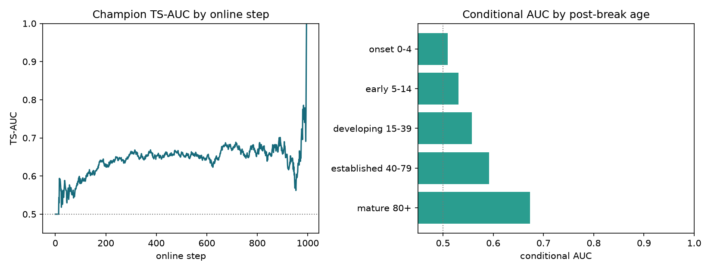
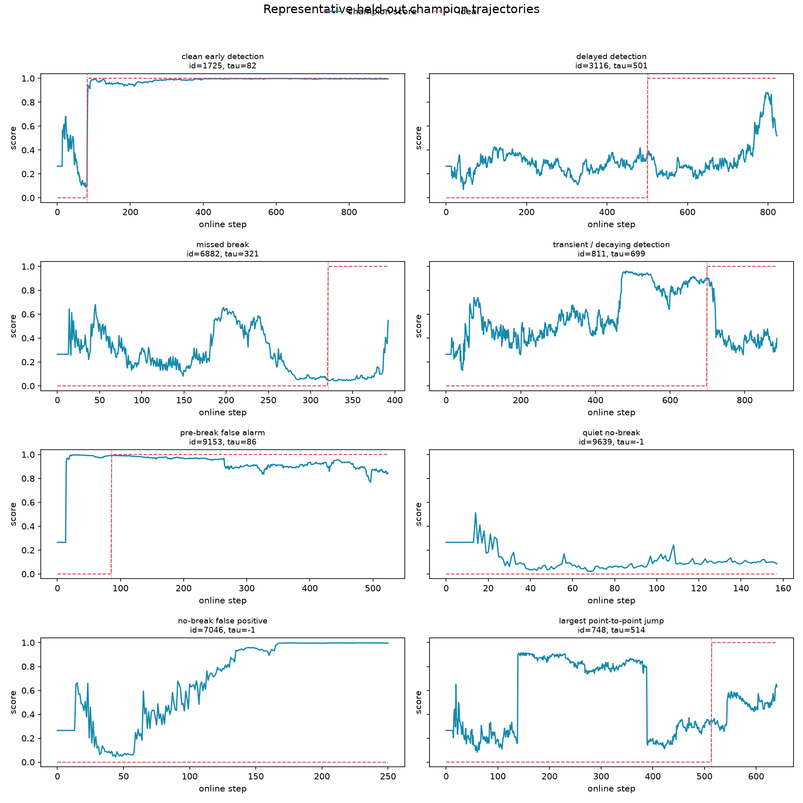

# Champion Time-Regime EDA

Seed `42` real held-out validation; untouched 166-feature four-member champion.
The conditional age-band AUC compares positives in that post-break age band with all
currently negative series at the same online step, preserving the cross-sectional metric.

## Main results

- Absolute TS-AUC: **0.633993** across 2,000 held-out series and 1,012,097 online rows.
- Weakest positive-age regime: **onset 0-4**, AUC **0.509413**.
- Break series ever crossing score 0.5: **91.5%**; median first-crossing delay among crossers: **1.0** steps.
- Break series with early-to-late score decay above 0.10: **12.0%**.
- No-break online points scoring at least 0.5: **42.3%**.
- Mean exact plateau fraction: **6.1%**; median per-series maximum jump: **0.290**.

## Post-break age bands

| regime | auc | positive_rows | time_steps |
| --- | --- | --- | --- |
| onset 0-4 | 0.509413 | 4919 | 818 |
| early 5-14 | 0.530502 | 9519 | 890 |
| developing 15-39 | 0.557432 | 22250 | 938 |
| established 40-79 | 0.591949 | 31660 | 942 |
| mature 80+ | 0.673484 | 191682 | 916 |

## Selected trajectories

| case | id | tau | length | pre_max | post_mean | detection_delay_050 | decay | max_jump |
| --- | --- | --- | --- | --- | --- | --- | --- | --- |
| clean early detection | 1725 | 82 | 908 | 0.683 | 0.987 | 0 | -0.051 | 0.425 |
| delayed detection | 3116 | 501 | 823 | 0.427 | 0.346 | 265 | -0.040 | 0.120 |
| missed break | 6882 | 321 | 393 | 0.680 | 0.094 | 71 | NA | 0.380 |
| transient / decaying detection | 811 | 699 | 887 | 0.961 | 0.429 | 0 | +0.470 | 0.266 |
| pre-break false alarm | 9153 | 86 | 525 | 0.997 | 0.929 | 0 | +0.073 | 0.671 |
| quiet no-break | 9639 | -1 | 158 | 0.512 | NA | NA | NA | 0.258 |
| no-break false positive | 7046 | -1 | 251 | 0.998 | NA | NA | NA | 0.456 |
| largest point-to-point jump | 748 | 514 | 641 | 0.914 | 0.465 | 30 | -0.180 | 0.739 |

## Interpretation

The score need not be temporally smooth: TS-AUC rewards within-step ordering. Treat the
trajectory plots as diagnostics. A temporal feature or specialist is justified only when
a weak age regime is repeatable and the change improves the full cross-sectional metric.

